# **Bitacora**

## **Paso a paso del Fronted**

#### **Deisireed Castañeda**

#### **Desarrollo Web**

# FASE 1

# ISS-00 · Requisitos previos

## Objetivo

Dejar el equipo listo para construir el frontend: Node, npm, Angular CLI, navegador, backend Express corriendo y base de datos sembrada. Al terminar este ISS no se ha escrito código de Angular todavía; solo se comprueba el entorno.

## 0.1 Versiones del laboratorio

```         
node -v
npm -v
npx @angular/cli@22 version
```

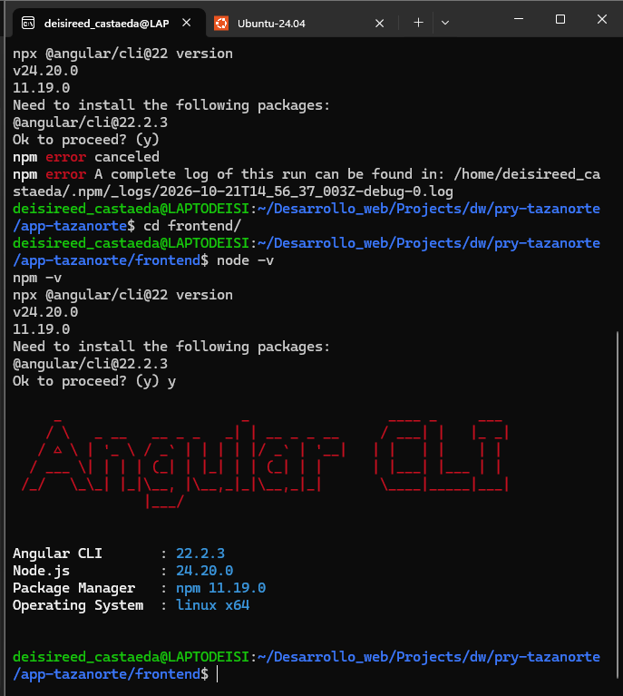{width="552"}

## 0.2 Backend en marcha

El frontend **no funciona solo**: consume la API en `http://localhost:4000/api`. Levanta el backend **correcto**:

```         

npm run dev
```

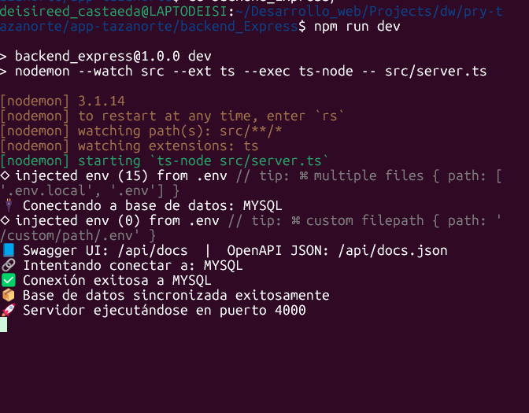

## 0.3 Login y permisos

El login del backend devuelve **solo el par de tokens**. El perfil y los permisos se piden aparte:

```         
# 1. Login (OPEN)
curl -s -X POST http://localhost:4000/api/sesion/login \
  -H "Content-Type: application/json" \
  -d '{"identifier":"admin","password":"Admin123!"}'
```

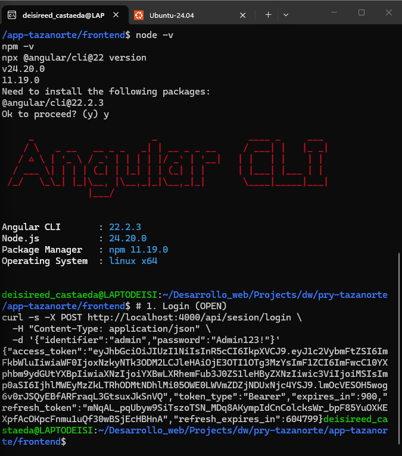

```         
# 2. Perfil (JWT)
curl -s http://localhost:4000/api/sesion/perfil \
  -H "Authorization: Bearer $TOKEN"
```

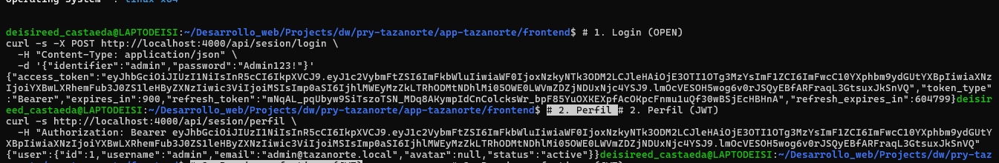

```         
# 3. Permisos efectivos (JWT)
curl -s http://localhost:4000/api/permisos \
  -H "Authorization: Bearer $TOKEN"
```

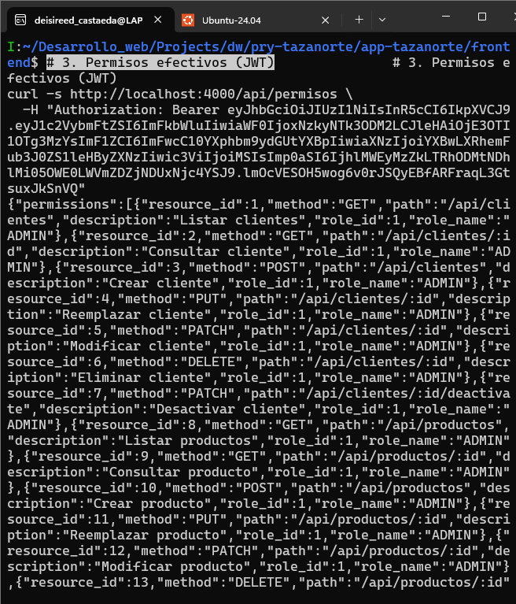

## Comprobación final

```         
# 1. Versiones
node -v && npm -v && npx @angular/cli@22 version

# 2. Backend vivo
curl -s -o /dev/null -w "HTTP %{http_code}\n" http://localhost:4000/api/clientes

# 3. Login + permisos
TOKEN=$(curl -s -X POST http://localhost:4000/api/sesion/login \
  -H "Content-Type: application/json" \
  -d '{"identifier":"admin","password":"Admin123!"}' \
  | grep -o '"access_token":"[^"]*' | cut -d'"' -f4)

curl -s http://localhost:4000/api/permisos \
  -H "Authorization: Bearer $TOKEN" | head -c 300
```

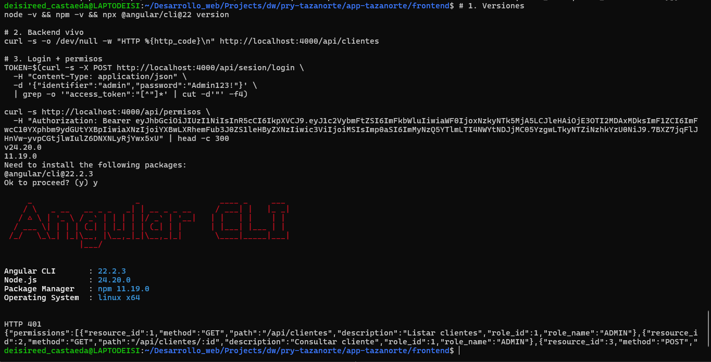

# 

# ISS-01 · Bootstrap Angular 22 con CLI, Tailwind y PrimeNG

# 

## Objetivo

Crear el proyecto Angular 22 **sin una carpeta adicional**, integrar Tailwind CSS 4, instalar PrimeNG 22 y dejar el tema Aura funcionando. Al final, `ng serve` debe mostrar la pantalla inicial sin errores.

## 1.1 Crear el proyecto en la carpeta actual

```         
 npx @angular/cli@22 new front-storelab-express-ii \   --directory . \   --style=tailwind \   --ssr=false \   --routing \   --zoneless \   --skip-git \   --package-manager=npm 
```

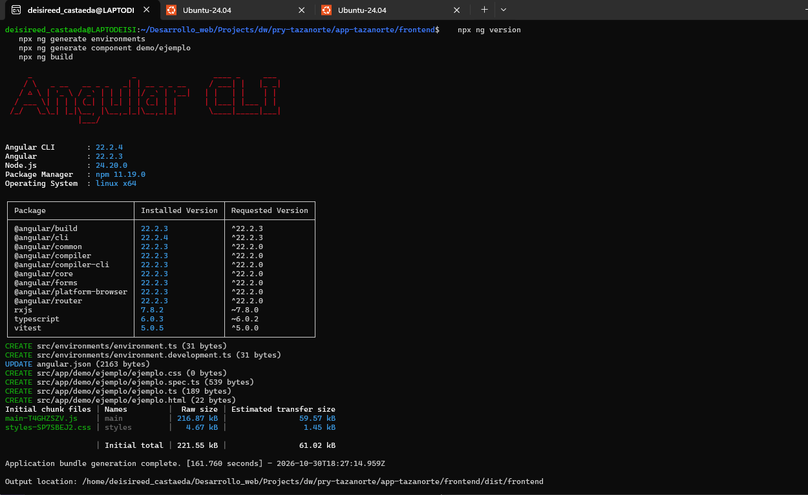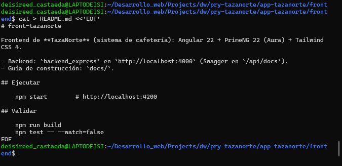

## .2 Instalar PrimeNG compatible con Angular

Consulta primero las peer dependencies:

```         
ng version npm view primeng version peerDependencies --json npm install primeng @primeuix/themes primeicons @angular/cdk 
```

Verifica versiones:

```         
npm ls primeng @primeuix/themes primeicons @angular/cdk --depth=0 
```

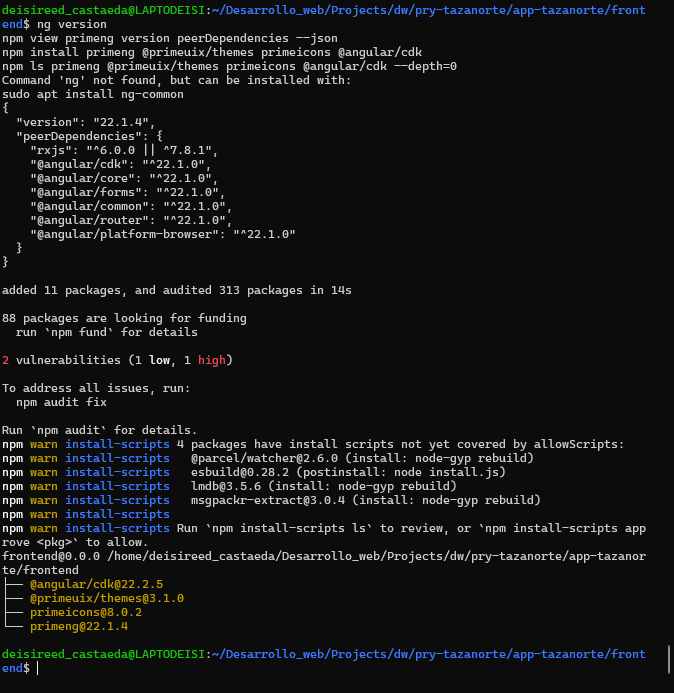

## 1.3 Estilos globales

Crea/reemplaza `src/styles.css`:

```         
cat > src/styles.css <<'EOF' @layer theme, base, primeng, utilities; @import 'tailwindcss'; @import 'primeicons/primeicons.css'; EOF 
```

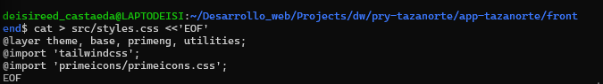

## 1.4 Configurar PrimeNG en `app.config.ts`

Reemplaza `src/app/app.config.ts`:

```         
cat > src/app/app.config.ts <<'EOF' import {   ApplicationConfig,   provideBrowserGlobalErrorListeners, } from '@angular/core'; import {   provideRouter,   withComponentInputBinding,   withInMemoryScrolling, } from '@angular/router'; import { ConfirmationService, MessageService } from 'primeng/api'; import { providePrimeNG } from 'primeng/config'; import Aura from '@primeuix/themes/aura'; import { environment } from '../environments/environment';  import { routes } from './app.routes';  export const appConfig: ApplicationConfig = {   providers: [     provideBrowserGlobalErrorListeners(),      provideRouter(       routes,       withComponentInputBinding(),       withInMemoryScrolling({ scrollPositionRestoration: 'top' }),     ),      // PrimeNG 22: tema Aura. El modo oscuro se activa con la clase .app-dark.     providePrimeNG({       license: environment.primeUiLicense || undefined,       ripple: true,       inputVariant: 'outlined',       theme: {         preset: Aura,         options: {           darkModeSelector: '.app-dark',           cssLayer: { name: 'primeng', order: 'theme, base, primeng, utilities' },         },       },     }),      MessageService,     ConfirmationService,   ], }; EOF
```

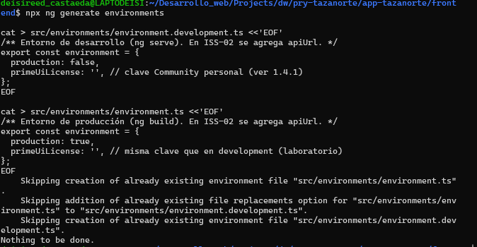

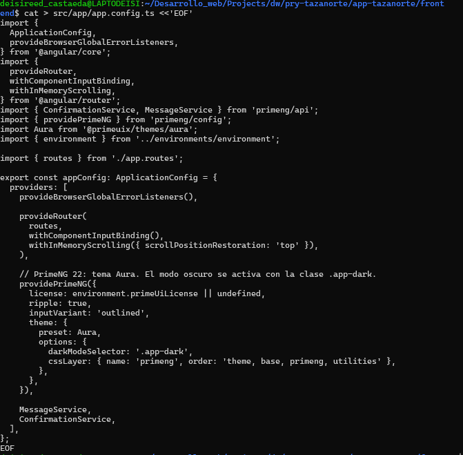

## 1.5 Pantalla de arranque: `App` compone el componente `demo/ejemplo`

**`src/app/app.ts`**

```         
cat > src/app/app.ts <<'EOF' import { Component } from '@angular/core'; import { Ejemplo } from './demo/ejemplo/ejemplo';  /**  * Componente principal (`<app-root>`).  *  * Es el primero que Angular dibuja. En ISS-01 solo compone el componente de  * ejemplo, para que se vea en pantalla con una etiqueta. Las rutas llegan en  * ISS-01B, cuando existe una pantalla de negocio que mostrar.  */ @Component({   host: { class: 'block' },   selector: 'app-root',   imports: [Ejemplo],   templateUrl: './app.html',   styleUrl: './app.css', }) export class App {} EOF
```

**`src/app/app.html`**

```         
cat > src/app/app.html <<'EOF' <!-- Marco de la aplicación: fondo, ancho máximo y padding con utilidades Tailwind. --> <main class="min-h-dvh bg-slate-50 p-6 text-slate-900">   <div class="mx-auto w-full max-w-4xl">     <!-- Composición: una etiqueta en la plantilla pinta el componente Ejemplo. -->     <app-ejemplo />   </div> </main> EOF
```

**`src/app/app.routes.ts`**

```         
cat > src/app/app.routes.ts <<'EOF' import { Routes } from '@angular/router';  /**  * Rutas de la aplicación.  *  * Vacío a propósito: en ISS-01 la pantalla se compone con etiquetas en `app.html`  * (`<app-ejemplo />`). El router se presenta en ISS-01B, con una pantalla real.  */ export const routes: Routes = []; EOF
```

**`src/app/app.css`**

```         
cat > src/app/app.css <<'EOF' /*  * Estilos propios del componente App.  *  * Queda VACÍO a propósito: el aspecto se resuelve con utilidades Tailwind en el  * HTML y con el tema Aura de PrimeNG (PATRON-VISUAL). Angular mantiene el archivo  * porque `styleUrl` lo referencia y solo afecta a `<app-root>`.  */ EOF
```

import { TestBed } from '\@angular/core/testing'; import { App } from './app';

describe('App', () =\> { beforeEach(async () =\> { await TestBed.configureTestingModule({ imports: [App], }).compileComponents(); });

it('should create the app', () =\> { const fixture = TestBed.createComponent(App); expect(fixture.componentInstance).toBeTruthy(); });

it('should render the example component', async () =\> { const fixture = TestBed.createComponent(App); await fixture.whenStable(); const compiled = fixture.nativeElement as HTMLElement; expect(compiled.querySelector('app-ejemplo')).toBeTruthy(); });

it('should show the product loaded by the example component', async () =\> { const fixture = TestBed.createComponent(App); await fixture.whenStable(); const compiled = fixture.nativeElement as HTMLElement; expect(compiled.textContent).toContain('Café molido 500 g'); }); });

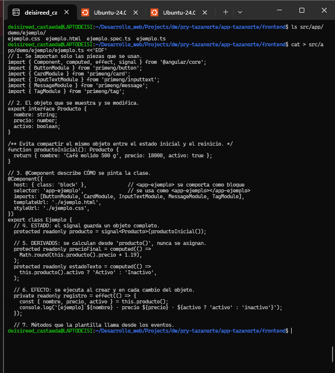

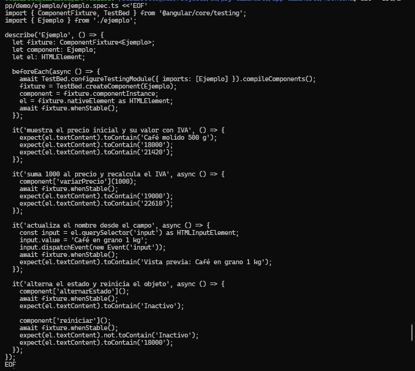

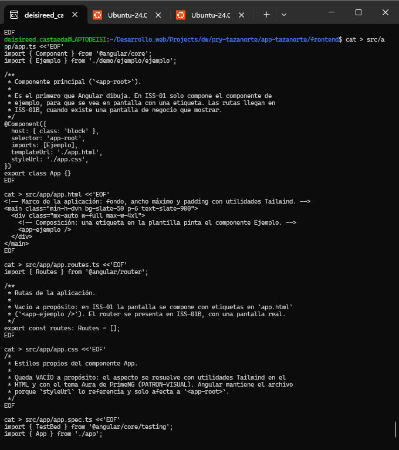

## 1.6 Personalizar `index.html`

cat \> src/index.html \<\<'EOF' \<!doctype html\> \<html lang="es"\> \<head\> \<meta charset="utf-8"\> \<title\>StoreLab Express II · Angular 22\</title\> \<base href="/"\> \<meta name="viewport" content="width=device-width, initial-scale=1"\> \<meta name="description" content="Frontend Angular 22 con Signals, PrimeNG y Tailwind para StoreLab Express."\> \<link rel="icon" type="image/x-icon" href="favicon.ico"\> \</head\> \<body class="m-0 bg-slate-100 font-sans text-slate-900"\> \<app-root\>\</app-root\> \</body\> \</html\> EOF

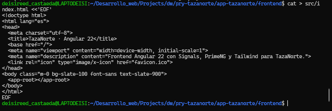

# 1.7 Ajuste de presupuesto

El bundle inicial con PrimeNG supera los 500 kB por defecto. En `angular.json`, dentro de `projects → ... → architect → build → configurations → production → budgets`, **cambia** el primer presupuesto:

```         
{   "type": "initial",   "maximumWarning": "750kB",   "maximumError": "1MB" }
```

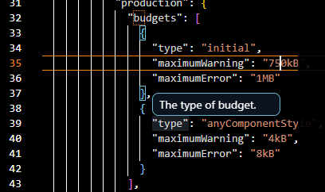

## 1.8 Primera ejecución

npm start

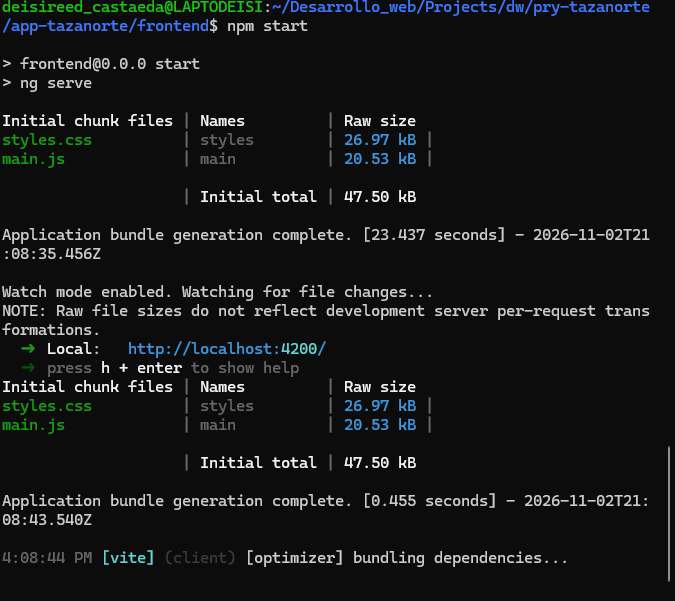

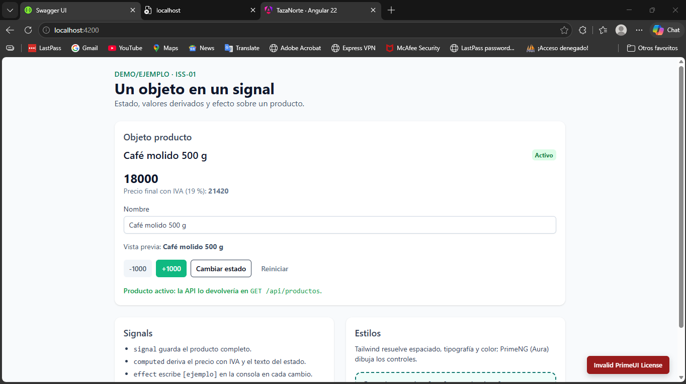

## 1.9 Anatomía del componente `demo/ejemplo` y signals

```         
src/app/demo/ejemplo/ ├── ejemplo.ts       ← la clase: estado, derivados, efecto y métodos ├── ejemplo.html     ← la plantilla: tarjetas, campos y botones ├── ejemplo.css      ← la excepción: una clase para explicar el aislamiento └── ejemplo.spec.ts  ← la prueba: crea el componente y comprueba el cambio de estado 
```

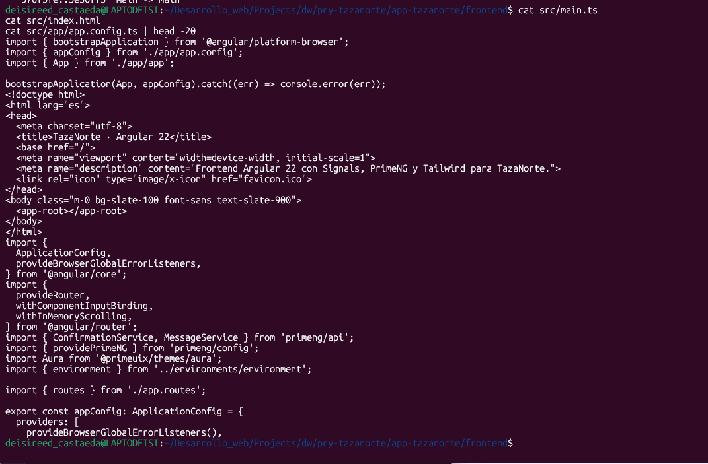

### 1.9.1 De `index.html` a la pantalla

```         
index.html    └─ <app-root></app-root>                  ← el HTML solo tiene esta etiqueta          │          ├─ src/main.ts                      bootstrapApplication(App, appConfig)          ├─ src/app/app.config.ts            providers globales (router, PrimeNG, …)          └─ src/app/app.ts                    clase App + @Component(...)                ├─ app.html                    plantilla: <main> + <app-ejemplo />                ├─ app.css                     estilos propios (vacío)                ├─ app.spec.ts                 pruebas de App                └─ app.routes.ts               rutas (vacío en ISS-01)                      │                      │  <app-ejemplo />  ← la etiqueta de app.html encuentra este componente                      ▼                src/app/demo/ejemplo/                      ├─ ejemplo.ts            clase Ejemplo + @Component(...)                      ├─ ejemplo.html          plantilla: las tres tarjetas                      ├─ ejemplo.css           una clase de demostración                      └─ ejemplo.spec.ts       4 pruebas 
```


### 1.9.2 Los cuatro archivos de un componente

```         
src/app/demo/ejemplo/ ├── ejemplo.ts        ← la clase (estado y lógica) + @Component(...) ├── ejemplo.html      ← la plantilla (lo que se ve) ├── ejemplo.css       ← los estilos de ESTE componente └── ejemplo.spec.ts   ← la prueba 
```

```         
@Component({   host: { class: 'block' },              // clases del elemento anfitrión <app-ejemplo>   selector: 'app-ejemplo',               // etiqueta HTML que lo representa   imports: [ButtonModule, CardModule, InputTextModule, MessageModule, TagModule],   templateUrl: './ejemplo.html',         // vista externa   styleUrl: './ejemplo.css',             // estilos externos }) export class Ejemplo {} 
```

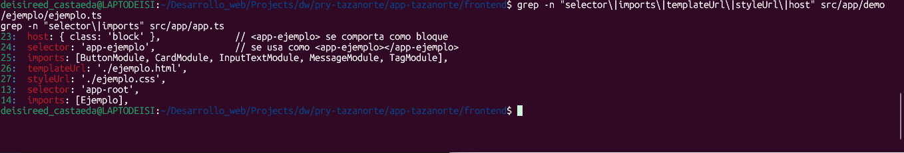

### 1.9.3 Leer `ejemplo.ts` línea a línea 

```         
// 1. Se importan solo las piezas que se usan. import { Component, computed, effect, signal } from '@angular/core'; import { ButtonModule } from 'primeng/button'; import { CardModule } from 'primeng/card'; import { InputTextModule } from 'primeng/inputtext'; import { MessageModule } from 'primeng/message'; import { TagModule } from 'primeng/tag';  // 2. El objeto que se muestra y se modifica. export interface Producto {   nombre: string;   precio: number;   activo: boolean; }  // 3. @Component describe CÓMO se pinta la clase. @Component({   host: { class: 'block' },              // <app-ejemplo> se comporta como bloque   selector: 'app-ejemplo',               // se usa como <app-ejemplo></app-ejemplo>   imports: [ButtonModule, CardModule, InputTextModule, MessageModule, TagModule],   templateUrl: './ejemplo.html',   styleUrl: './ejemplo.css', }) export class Ejemplo {   // 4. ESTADO: el signal guarda un objeto completo.   protected readonly producto = signal<Producto>(productoInicial());    // 5. DERIVADOS: se calculan desde `producto()`, nunca se asignan.   protected readonly precioFinal = computed(() =>     Math.round(this.producto().precio * 1.19),   );   protected readonly estadoTexto = computed(() =>     this.producto().activo ? 'Activo' : 'Inactivo',   );    // 6. EFECTO: se ejecuta al crear y en cada cambio del objeto.   private readonly registro = effect(() => {     const { nombre, precio, activo } = this.producto();     console.log(`[ejemplo] ${nombre} · precio ${precio} · ${activo ? 'activo' : 'inactivo'}`);   });    // 7. Métodos que la plantilla llama desde los eventos.   protected cambiarNombre(event: Event): void {     const nombre = (event.target as HTMLInputElement).value;     this.producto.update((actual) => ({ ...actual, nombre }));   }    protected variarPrecio(delta: number): void {     this.producto.update((actual) => ({       ...actual,       precio: Math.max(0, actual.precio + delta),     }));   }    protected alternarEstado(): void {     this.producto.update((actual) => ({ ...actual, activo: !actual.activo }));   }    protected reiniciar(): void {     this.producto.set(productoInicial());   } } 
```

### 1.9.4 Las cuatro formas de conectar la clase con el HTML

```         
@if (producto().activo) {   <p-message severity="success" variant="simple">     Producto activo: la API lo devolvería en <code>GET /api/productos</code>.   </p-message> } @else {   <p-message severity="warn" variant="simple">     Producto inactivo: el borrado lógico lo oculta de las listas.   </p-message> }  <!-- El mismo bloque aplica a una lista del negocio. --> @if (clients().length === 0) {   <p>No hay clientes activos.</p> } @else {   <ul>     @for (client of clients(); track client.id) {       <li>{{ client.name }}</li>     }   </ul> } 
```

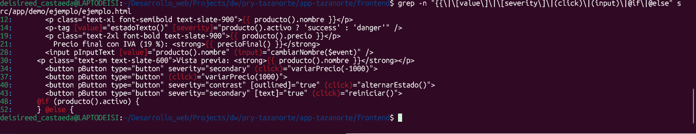

### 1.9.5 Signals: el estado que avisa a la vista

**Dónde está en `Ejemplo`.** El estado es un objeto `Producto`; la plantilla lee sus campos y los botones lo cambian:

```         
// ejemplo.ts — declaración y cambios del estado protected readonly producto = signal<Producto>(productoInicial());  protected variarPrecio(delta: number): void {   this.producto.update((actual) => ({     ...actual,                              // conserva nombre y activo     precio: Math.max(0, actual.precio + delta),   })); }  protected reiniciar(): void {   this.producto.set(productoInicial());     // valor nuevo, no depende del anterior } 
```

```         
<!-- ejemplo.html — lectura del signal: siempre con paréntesis --> <p class="text-2xl font-bold text-slate-900">{{ producto().precio }}</p> <p class="text-sm text-slate-500">   Precio final con IVA (19 %): <strong>{{ precioFinal() }}</strong> </p> <p-tag [value]="estadoTexto()" [severity]="producto().activo ? 'success' : 'danger'" /> 
```

#### 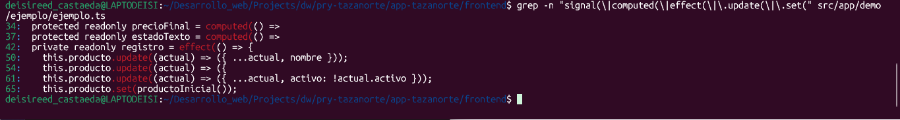

#### **Actualizar un objeto dentro de un signal**

Este es el punto que más se equivoca al empezar. Un signal compara **referencias**, no campos: si se modifica el objeto en el sitio, el signal sigue apuntando al mismo objeto y la vista **no se entera**.

```         
// MAL: muta el objeto y conserva la misma referencia. const actual = this.producto(); actual.precio = actual.precio + 1000;   // el signal no notifica: nadie llamó a set/update  // BIEN: crea un objeto nuevo y entrégaselo al signal. this.producto.update((actual) => ({ ...actual, precio: actual.precio + 1000 })); 
```

```         
// MAL: muta el objeto y conserva la misma referencia. const actual = this.producto(); actual.precio = actual.precio + 1000;   // el signal no notifica: nadie llamó a set/update  // BIEN: crea un objeto nuevo y entrégaselo al signal. this.producto.update((actual) => ({ ...actual, precio: actual.precio + 1000 })); 
```

### 1.9.6 `computed` y `effect`: derivar y reaccionar

```         
// ejemplo.ts — dos valores derivados y un efecto secundario protected readonly precioFinal = computed(() =>   Math.round(this.producto().precio * 1.19), );  protected readonly estadoTexto = computed(() =>   this.producto().activo ? 'Activo' : 'Inactivo', );  private readonly registro = effect(() => {   const { nombre, precio, activo } = this.producto();   console.log(`[ejemplo] ${nombre} · precio ${precio} · ${activo ? 'activo' : 'inactivo'}`); }); 
```

```         
<!-- ejemplo.html — los derivados se leen igual que un signal --> <p class="text-sm text-slate-500">   Precio final con IVA (19 %): <strong>{{ precioFinal() }}</strong> </p> <p-tag [value]="estadoTexto()" [severity]="producto().activo ? 'success' : 'danger'" /> 
```

### 1.9.7 Zoneless: por qué la vista se actualiza sin `Zone.js`

### 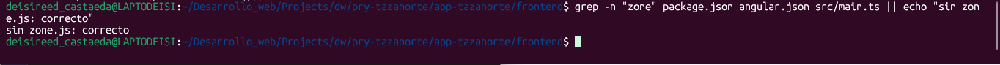1.9.8 Estilos globales y estilos del componente 

```         
/* src/app/demo/ejemplo/ejemplo.css — únicamente demostrativo. */ .ejemplo-alcance {   border: 2px dashed #0f766e;   border-radius: 0.75rem;   padding: 0.75rem 1rem;   background-color: #f0fdfa; } 
```

```         
<!-- La misma caja, con el resto del contenido en Tailwind. --> <div class="ejemplo-alcance mt-4 text-sm text-slate-700">…</div> 
```

```         
<div class="ejemplo-alcance mt-4 …" _ngcontent-ng-c4132172110>…</div> 
```

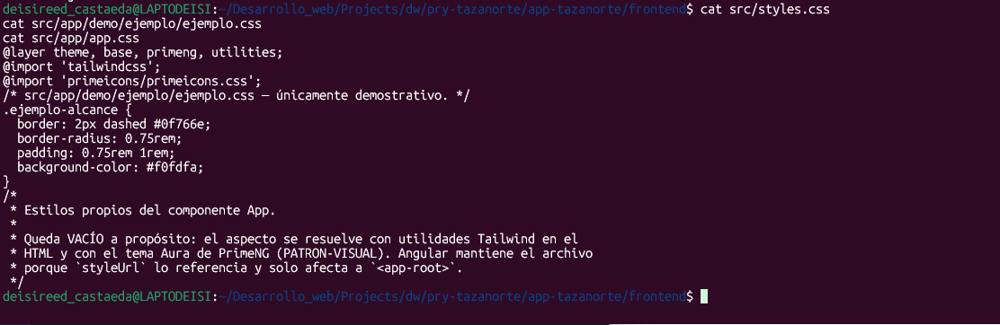

### 1.9.9 Verificación  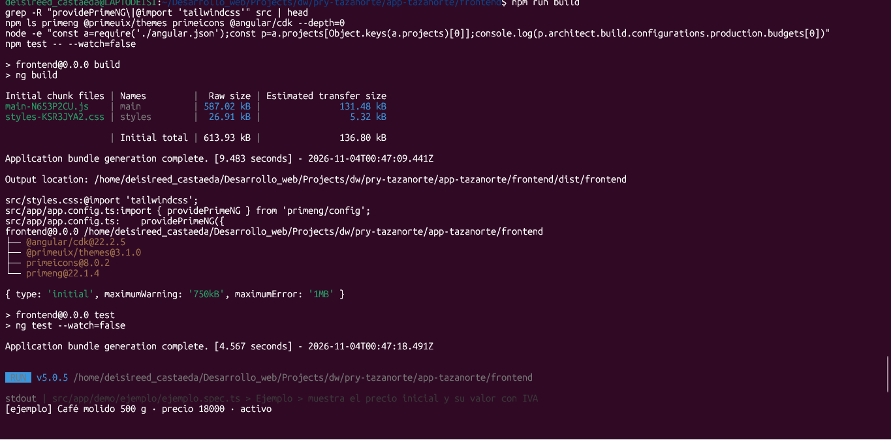

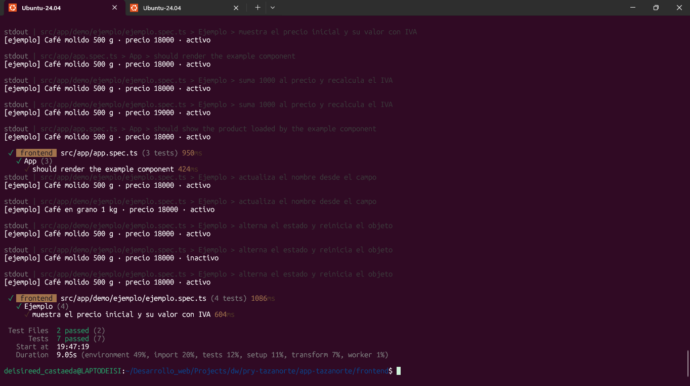

# Fase I: Frontend — ISS-01A — Esqueleto Header / Aside / contenido / Footer

## 1.1 Qué es un componente y por qué el padre debe importarlo

Un componente reúne una clase TypeScript (datos y lógica), una plantilla HTML (lo que se ve) y un archivo de estilos. `@Component` relaciona esos archivos:

**Regla que resuelve el error más común:** un componente generado existe, pero **no se ve** hasta que otro componente lo declara en su `imports` y escribe su etiqueta en su plantilla. Son dos pasos, no uno:

```         
// app.ts — paso 1: declarar el componente para que la plantilla lo reconozca imports: [Header, Aside, Footer], 
```

```         
<!-- app.html — paso 2: usar su selector como etiqueta --> <app-header /> 
```

## 1.2 Generar las tres piezas de `layout/`

```         
ng generate component layout/header --skip-tests --defaults ng generate component layout/aside --skip-tests --defaults ng generate component layout/footer --skip-tests --defaults 
```

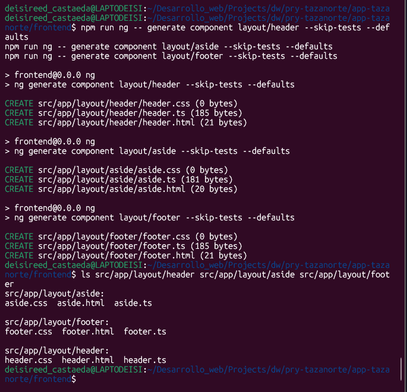

## 1.3 Contenido de cada componente

### Header

`src/app/layout/header/header.ts`

```         
import { Component } from '@angular/core';  /**  * Barra superior de la aplicación.  *  * ISS-01A: solo muestra el nombre. En ISS-01B recibe datos por `input()`, emite  * `menuRequested` y añade el menú de usuario. No consulta la API.  */ @Component({   host: { class: 'block' },   selector: 'app-header',   templateUrl: './header.html',   styleUrl: './header.css', }) export class Header {   readonly title = 'StoreLab Express II'; } 
```

`src/app/layout/header/header.html`

```         
<header   class="flex h-16 items-center border-b border-slate-200 bg-white px-6 font-semibold" >   <!-- Interpolación: `title` es una propiedad de la clase Header. -->   <p class="truncate text-sm font-semibold text-slate-900">{{ title }}</p> </header> 
```

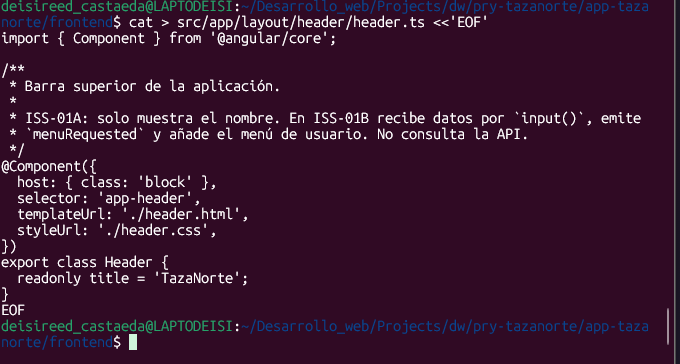

### Aside

`src/app/layout/aside/aside.ts`

```         
import { Component } from '@angular/core';  /**  * Menú lateral de la aplicación.  *  * ISS-01A: solo el contenedor. En ISS-01B recibe `items` por `input()` y pinta  * `p-panelmenu`. No conoce rutas ni permisos: eso llega en ISS-02/ISS-08.  */ @Component({   host: { class: 'block h-full' },   selector: 'app-aside',   templateUrl: './aside.html',   styleUrl: './aside.css', }) export class Aside {} 
```

`src/app/layout/aside/aside.html`

```         
<nav aria-label="Navegación principal" class="h-full bg-slate-950 p-6 text-white">   <p class="text-xs font-medium uppercase tracking-wider text-slate-400">Navegación</p>   <p class="mt-2 text-sm">Menú de StoreLab</p>   <p class="mt-4 text-xs text-slate-400">     En ISS-01B este bloque pasa a ser un <code>p-panelmenu</code>.   </p> </nav> 
```

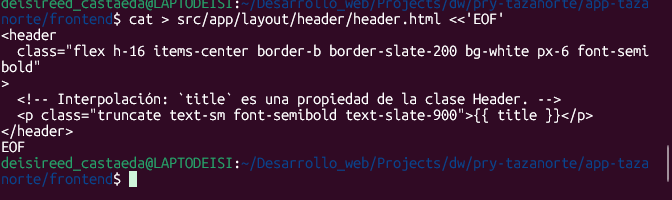

### Footer

`src/app/layout/footer/footer.ts`

```         
import { Component } from '@angular/core';  /**  * Pie de página de la aplicación.  *  * Presentación pura: no tiene estado ni depende de servicios.  */ @Component({   host: { class: 'block' },   selector: 'app-footer',   templateUrl: './footer.html',   styleUrl: './footer.css', }) export class Footer {} 
```

`src/app/layout/footer/footer.html`

```         
<footer   class="border-t border-slate-200 bg-white px-4 py-4 text-center text-xs text-slate-500 sm:px-6" >   StoreLab · Gestión de clientes, productos y ventas </footer> 
```

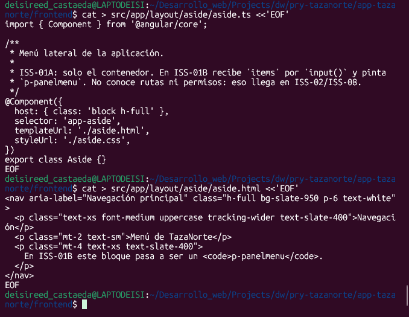

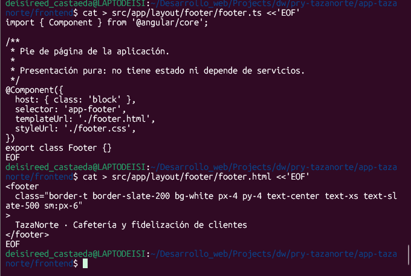

### Los tres `.css`

```         
/*  * Estilos del Header.  *  * Vacío a propósito: la apariencia se resuelve con utilidades Tailwind en  * `header.html` y con el tema Aura de PrimeNG (PATRON-VISUAL).  */ 
```

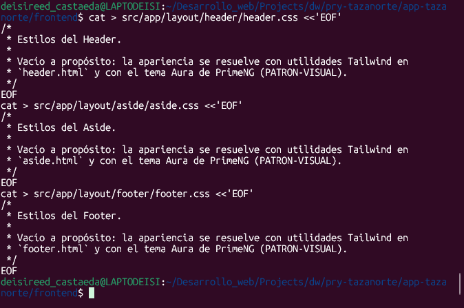

## 1.4 Componer las cuatro regiones en `App`

`src/app/app.ts`

```         
import { Component } from '@angular/core'; import { Header } from './layout/header/header'; import { Aside } from './layout/aside/aside'; import { Footer } from './layout/footer/footer';  /**  * Componente principal (`<app-root>`).  *  * Es el primero que Angular dibuja. Compone las cuatro regiones de la pantalla:  * Header arriba, Aside a la izquierda, el contenido del centro y Footer abajo.  * El contenido del centro todavía es fijo; en ISS-01B pasa a cambiar con el menú  * y en ISS-02 llega el router.  */ @Component({   host: { class: 'block' },   selector: 'app-root',   imports: [Header, Aside, Footer],   templateUrl: './app.html',   styleUrl: './app.css', }) export class App {   /** Título de la pantalla inicial. En ISS-01B cambia al elegir el menú. */   protected readonly title = 'Inicio'; } 
```

`src/app/app.html`

```         
<!-- Contenedor de las cuatro regiones: Tailwind para el alto y la dirección. --> <div class="flex min-h-screen flex-col bg-slate-100">   <app-header />    <div class="flex flex-1">     <!-- Aside fijo de 16rem; en ISS-01B se oculta en pantallas pequeñas. -->     <aside class="w-64 shrink-0">       <app-aside />     </aside>      <!-- min-w-0 evita que un contenido ancho desborde el flex y cree scroll. -->     <main id="contenido" class="min-w-0 flex-1 p-6">       <h1 class="text-2xl font-semibold text-slate-900">{{ title }}</h1>       <p class="mt-2 text-slate-600">Bienvenido a StoreLab.</p>     </main>   </div>    <app-footer /> </div> 
```

### Prueba de la composición

`src/app/app.spec.ts` no busca el `<h1>` de la plantilla por defecto: comprueba las regiones y el texto inicial.

```         
import { TestBed } from '@angular/core/testing'; import { App } from './app';  describe('App', () => {   beforeEach(async () => {     await TestBed.configureTestingModule({       imports: [App],     }).compileComponents();   });    async function crearApp() {     const fixture = TestBed.createComponent(App);     await fixture.whenStable();     return fixture.nativeElement as HTMLElement;   }    it('should create the app', () => {     const fixture = TestBed.createComponent(App);     expect(fixture.componentInstance).toBeTruthy();   });    it('should compose the three layout regions', async () => {     const compilado = await crearApp();     expect(compilado.querySelector('app-header')).toBeTruthy();     expect(compilado.querySelector('aside app-aside')).toBeTruthy();     expect(compilado.querySelector('app-footer')).toBeTruthy();   });    it('should render the application name in the header', async () => {     const compilado = await crearApp();     const header = compilado.querySelector('app-header') as HTMLElement;     expect(header.textContent).toContain('StoreLab Express II');   });    it('should render the initial title in the content', async () => {     const compilado = await crearApp();     const main = compilado.querySelector('main') as HTMLElement;     expect(main.textContent).toContain('Inicio');     expect(main.textContent).toContain('Bienvenido a StoreLab.');   }); }); 
```

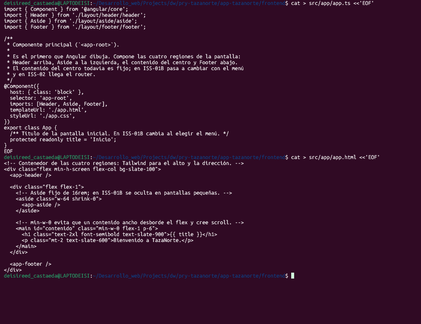

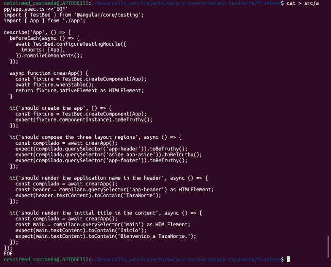


## 1.5 Comprobar antes de avanzar

```         
npm start 
```

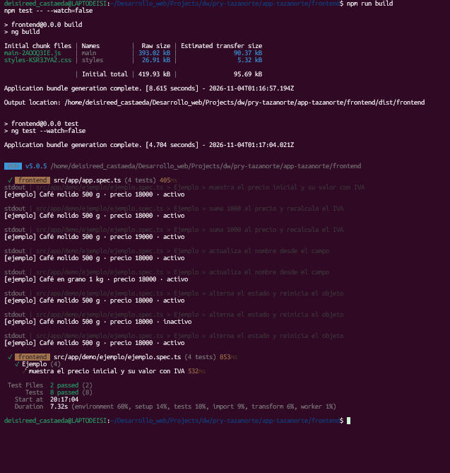

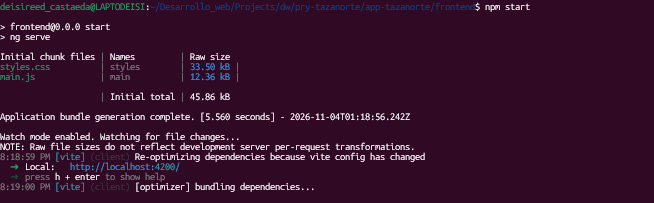

## Verificación del ISS

```         
# 1. Compila ng build  # 2. Existen las tres piezas con sus tres archivos ls src/app/layout/header src/app/layout/aside src/app/layout/footer  # 3. App declara los tres imports y compone las regiones grep -n "imports: \[Header, Aside, Footer\]" src/app/app.ts grep -n "app-header\|app-aside\|app-footer" src/app/app.html  # 4. demo/ejemplo ya no se compone grep -c "app-ejemplo" src/app/app.html || echo "no aparece: correcto"  # 5. Los CSS de layout no tienen reglas grep -v "^\s*$" src/app/layout/*/*.css | grep -v "^\S*: \*\|/\*\|^\S*:  \*" || echo "sin reglas: correcto"  # 6. Pruebas npm test -- --watch=false 
```

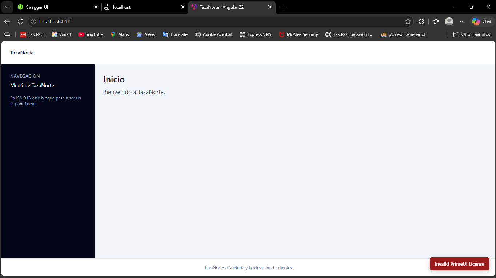

# Fase I: Frontend — ISS-01B — Menú PrimeNG y primera interacción

> 

**Objetivo:** pasar de una maqueta a una pantalla que responde. Al terminar: PanelMenu en el Aside, botón de menú en el Header, Drawer en pantalla pequeña y selección que cambia el contenido local. Sin rutas de negocio y sin API.

## 1.1 Los conceptos que se agregan, uno por vez

**Criterios de este sub-ítem**

**La frontera del ISS.** Los tres componentes de `layout/` son **presentación**: reciben datos y avisan. El único con estado es `Construir`. Esa separación es la que permite reutilizar el layout en ISS-02 sin duplicar Header, Aside ni Footer, y la que evita inyectar servicios de autenticación en componentes visuales.

## 1.2 El Aside recibe el menú con `input()`

`src/app/layout/aside/aside.ts`

```         
import { Component, input, output } from '@angular/core'; import { MenuItem } from 'primeng/api'; import { ButtonModule } from 'primeng/button'; import { PanelMenuModule } from 'primeng/panelmenu';  /**  * Menú lateral de la aplicación.  *  * Presentación pura: recibe el menú ya construido por `input()` y avisa de la  * navegación con `output()`. No conoce rutas, permisos ni la API.  */ @Component({   host: { class: 'block h-full' },   selector: 'app-aside',   imports: [ButtonModule, PanelMenuModule],   templateUrl: './aside.html',   styleUrl: './aside.css', }) export class Aside {   readonly appName = input('StoreLab Express II');    /** Opciones del menú, en el formato `MenuItem` de PrimeNG. */   readonly items = input<MenuItem[]>([]);    /** Datos de sesión con valores por defecto: ISS-08 los completa. */   readonly showSession = input(false);   readonly username = input('');   readonly roleLabel = input('Sin rol');   readonly permissionCount = input(0);    /** Aviso al padre: se seleccionó una opción (lo usa el Drawer en móvil). */   readonly navigated = output<void>();    /** Aviso al padre: se pidió cerrar sesión. */   readonly logoutRequested = output<void>();    /**    * Un clic dentro del menú puede caer en el propio ítem o en un hijo suyo.    * `closest` resuelve ambos casos con un solo listener en el `<nav>`.    */   onNavigationClick(event: Event): void {     if ((event.target as HTMLElement).closest('a, button, [role="button"]')) {       this.navigated.emit();     }   } } 
```

`src/app/layout/aside/aside.html`

```         
<div class="flex h-full flex-col border-r border-slate-200 bg-white text-slate-900">   <div class="flex h-16 items-center gap-3 border-b border-slate-200 px-5">          <div class="min-w-0">       <p class="truncate text-sm font-semibold text-slate-900">{{ appName() }}</p>       <p class="text-[11px] uppercase tracking-wider text-slate-400">         Panel administrativo       </p>     </div>   </div>    <div class="flex-1 overflow-y-auto p-3">     <nav aria-label="Navegación principal" (click)="onNavigationClick($event)">       <p-panelmenu [model]="items()" [multiple]="true" />     </nav>   </div>    @if (showSession()) {     <div class="border-t border-slate-200 p-4">       <p class="text-sm font-medium text-slate-900">{{ username() || 'Invitado' }}</p>       <p class="text-xs text-slate-400">{{ roleLabel() }}</p>       <div class="mt-3 flex items-center justify-between text-xs text-slate-400">         <span>{{ permissionCount() }} permisos</span>         <button           pButton           type="button"           text           rounded           aria-label="Cerrar sesión"           (click)="logoutRequested.emit()"         >           <i pButtonIcon class="pi pi-sign-out"></i>         </button>       </div>     </div>   } </div> 
```

`aria-label="Navegación principal"` nombra la región para lectores de pantalla y permite localizarla en las pruebas.

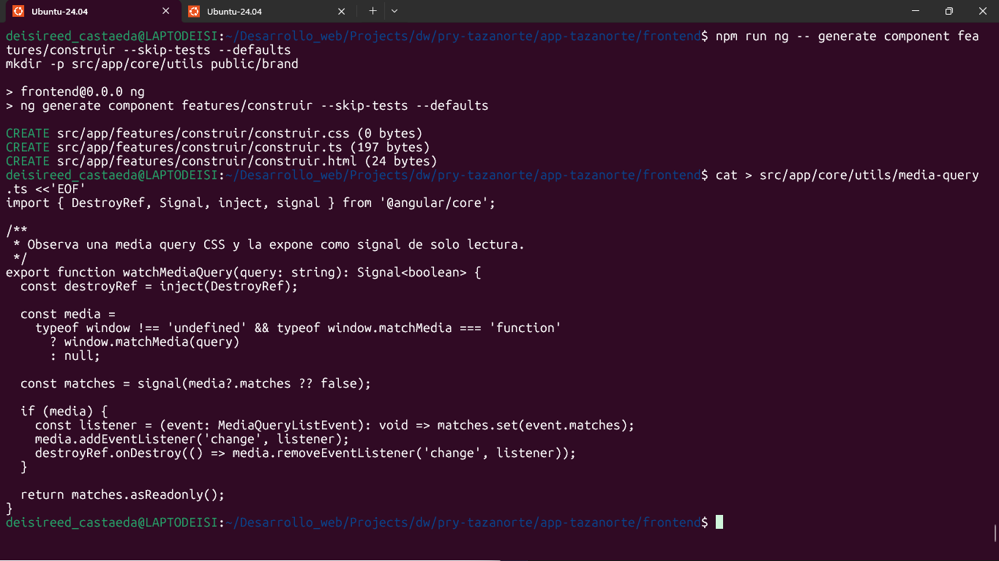

## 1.3 El Header avisa al padre con `output()`

`src/app/layout/header/header.ts`

```         
import { Component, input, output } from '@angular/core'; import { MenuItem } from 'primeng/api'; import { AvatarModule } from 'primeng/avatar'; import { ButtonModule } from 'primeng/button'; import { MenuModule } from 'primeng/menu'; import { TagModule } from 'primeng/tag';  /**  * Barra superior de la aplicación.  *  * Es presentación pura: recibe los datos por `input()` y avisa al padre con  * `output()`. No inyecta servicios, no consulta la API y no conoce permisos.  */ @Component({   host: { class: 'block' },   selector: 'app-header',   imports: [AvatarModule, ButtonModule, MenuModule, TagModule],   templateUrl: './header.html',   styleUrl: './header.css', }) export class Header {   /** Nombre visible de la aplicación. */   readonly appName = input('StoreLab Express II');    /** Datos de sesión con valores por defecto: ISS-08 los completa. */   readonly username = input('');   readonly initials = input('IN');   readonly roleLabel = input('Sin rol');   readonly authEnabled = input(true);   readonly showSession = input(false);   readonly userItems = input<MenuItem[]>([]);    /** Aviso al padre: el botón de menú se pulsó (solo visible en móvil). */   readonly menuRequested = output<void>(); } 
```

`src/app/layout/header/header.html`

```         
<header   class="sticky top-0 z-30 flex h-16 items-center gap-3 border-b border-slate-200 bg-white px-4 sm:px-6" >   <!-- Botón de menú: siempre visible; el padre decide qué hacer (aside fijo o Drawer). -->   <button     pButton     type="button"     text     rounded     aria-label="Mostrar u ocultar el menú"     (click)="menuRequested.emit()"   >     <i pButtonIcon class="pi pi-bars"></i>   </button>    <div class="min-w-0 flex-1">     <p class="truncate text-sm font-semibold text-slate-900">{{ appName() }}</p>     <p class="truncate text-xs text-slate-500">       Gestión de clientes, productos y ventas     </p>   </div>    @if (showSession() && !authEnabled()) {     <p-tag value="Fase I · sin auth" severity="warn" [rounded]="true" />   }   @if (username()) {     <p-tag       [value]="roleLabel()"       severity="info"       [rounded]="true"       class="hidden sm:inline-flex"     />   }    @if (showSession()) {     <button       pButton       type="button"       severity="secondary"       outlined       (click)="userMenuPanel.toggle($event)"       aria-label="Menú de usuario"     >       <p-avatar [label]="initials()" shape="circle" size="normal" />       <span class="hidden max-w-32 truncate text-sm font-medium text-slate-700 sm:block">         {{ username() }}       </span>       <i class="pi pi-chevron-down pr-1 text-[10px] text-slate-400"></i>     </button>     <p-menu #userMenuPanel [model]="userItems()" [popup]="true" appendTo="body" />   } </header> 
```

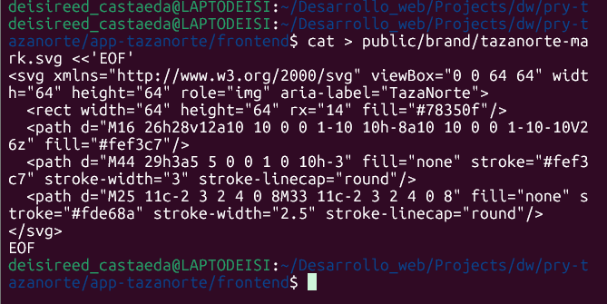

## 1.4 `features/construir`: estado local y Drawer móvil

```         
ng generate component features/construir --skip-tests --defaults 
```

El `--skip-tests` no es para evitar pruebas: la prueba de esta pantalla se escribe completa en este ISS (más abajo) y sustituye a la plantilla vacía del CLI.

`src/app/features/construir/construir.ts`

```         
import { Component, signal } from '@angular/core'; import { MenuItem } from 'primeng/api'; import { ButtonModule } from 'primeng/button'; import { CardModule } from 'primeng/card'; import { DrawerModule } from 'primeng/drawer'; import { watchMediaQuery } from '../../core/utils/media-query'; import { Aside } from '../../layout/aside/aside'; import { Footer } from '../../layout/footer/footer'; import { Header } from '../../layout/header/header';  /**  * Pantalla del prototipo.  *  * Es el único componente con estado en ISS-01B: guarda el título elegido y el  * estado del menú. El layout solo recibe datos por `input()`; así en ISS-02 se  * puede reutilizar sin duplicar Header, Aside ni Footer.  */ @Component({   host: { class: 'block' },   selector: 'app-construir',   imports: [Aside, ButtonModule, CardModule, DrawerModule, Footer, Header],   templateUrl: './construir.html',   styleUrl: './construir.css', }) export class Construir {   /** `lg` de Tailwind: desde aquí el Aside es fijo y el botón lo alterna. */   private readonly isDesktop = watchMediaQuery('(min-width: 1024px)');    /** Escritorio: el Aside fijo se oculta y el contenido se ensancha. */   readonly sidebarCollapsed = signal(false);    /** Móvil: el Drawer se abre desde el botón y se cierra al elegir una opción. */   readonly mobileOpen = signal(false);    /** Título del contenido. Cambia al elegir una opción del menú, sin HTTP. */   readonly title = signal('Inicio');    /**    * Menú en el formato `MenuItem` de PrimeNG.    *    * `command` ejecuta una función al elegir la opción. Todavía no navega: solo    * cambia el título. En ISS-02 cada comando apuntará a una ruta real.    */   readonly items: MenuItem[] = [     { label: 'Inicio', icon: 'pi pi-home', command: () => this.seleccionar('Inicio') },     { label: 'Clientes', icon: 'pi pi-users', command: () => this.seleccionar('Clientes') },     {       label: 'Tipos de producto',       icon: 'pi pi-tags',       command: () => this.seleccionar('Tipos de producto'),     },     { label: 'Productos', icon: 'pi pi-box', command: () => this.seleccionar('Productos') },     { label: 'Ventas', icon: 'pi pi-shopping-cart', command: () => this.seleccionar('Ventas') },   ];    /**    * Un solo botón, dos disposiciones: en escritorio alterna el Aside fijo; por    * debajo de `lg` abre el Drawer (donde el Aside fijo no cabe).    */   protected onMenuToggle(): void {     if (this.isDesktop()) {       this.sidebarCollapsed.update((collapsed) => !collapsed);       return;     }     this.mobileOpen.set(true);   }    /** Una sola puerta de entrada al estado: la usan los cinco comandos. */   protected seleccionar(titulo: string): void {     this.title.set(titulo);     this.mobileOpen.set(false);   } } 
```

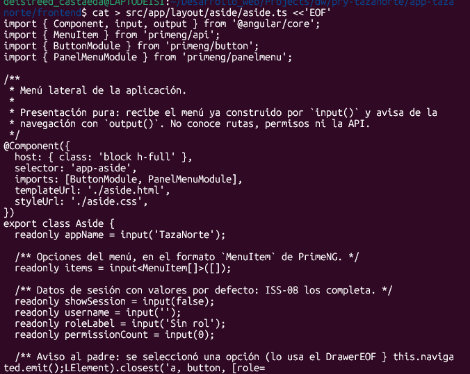

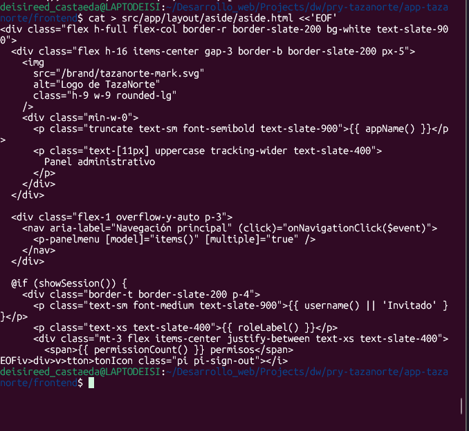

### El helper que decide el ancho

`src/app/core/utils/media-query.ts`

```         
import { DestroyRef, Signal, inject, signal } from '@angular/core';  /**  * Observa una media query CSS y la expone como signal de solo lectura.  */ export function watchMediaQuery(query: string): Signal<boolean> {   const destroyRef = inject(DestroyRef);    const media =     typeof window !== 'undefined' && typeof window.matchMedia === 'function'       ? window.matchMedia(query)       : null;    const matches = signal(media?.matches ?? false);    if (media) {     const listener = (event: MediaQueryListEvent): void => matches.set(event.matches);     media.addEventListener('change', listener);     destroyRef.onDestroy(() => media.removeEventListener('change', listener));   }    return matches.asReadonly(); } 
```

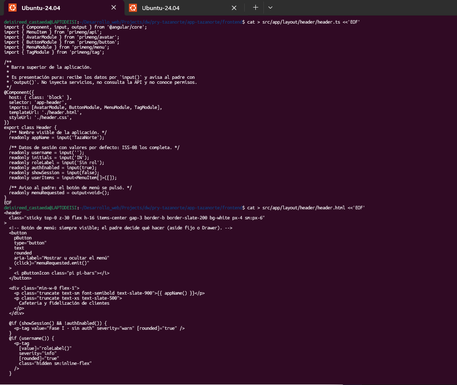

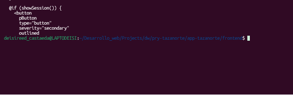

`src/app/features/construir/construir.html`

```         
<div class="flex min-h-screen flex-col bg-slate-100">   <app-header (menuRequested)="onMenuToggle()" />    <div class="flex flex-1">     <!--       Escritorio: Aside fijo que el botón del Header puede ocultar.       Por debajo de lg no se pinta: el menú vive en el Drawer.     -->     @if (!sidebarCollapsed()) {       <aside class="hidden w-72 shrink-0 lg:block">         <app-aside [items]="items" (navigated)="mobileOpen.set(false)" />       </aside>     }      <main id="contenido" class="min-w-0 flex-1 p-4 sm:p-6">       <p-card class="block">         <h1 class="text-2xl font-semibold text-slate-900">{{ title() }}</h1>         <p class="mt-3 text-slate-600">           Bienvenido a StoreLab. Elige una opción del menú para explorar la estructura.         </p>         <p class="mt-2 text-sm text-slate-500">           Esta primera pantalla usa datos locales. Los formularios y la conexión con           Express se incorporan después.         </p>       </p-card>     </main>   </div>    <app-footer /> </div>  <!-- Móvil: el mismo Aside, otra disposición. --> <p-drawer [(visible)]="mobileOpen" header="Menú" position="left" styleClass="w-72">   <app-aside [items]="items" (navigated)="mobileOpen.set(false)" /> </p-drawer> 
```

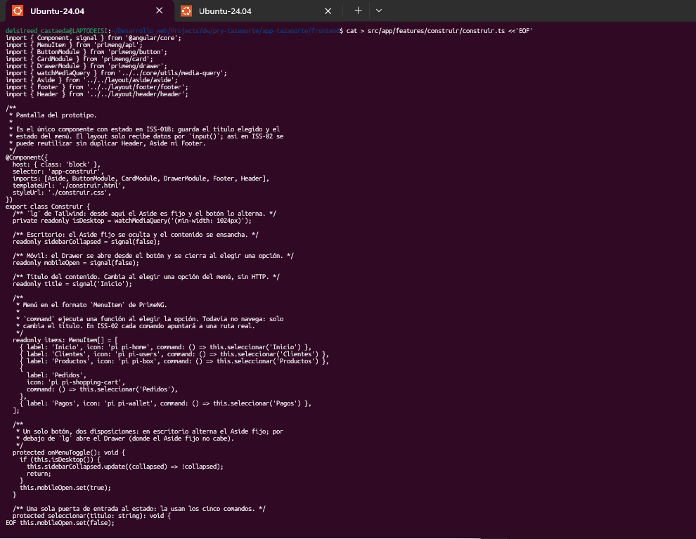

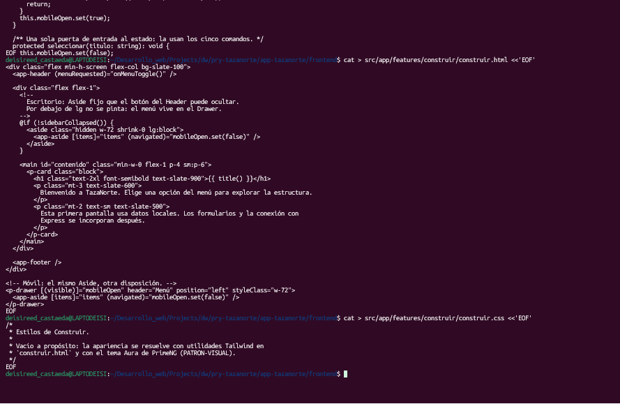

## 1.5 `App` pasa a ser punto de entrada con `router-outlet`

`src/app/app.ts`

```         
import { Component } from '@angular/core'; import { RouterOutlet } from '@angular/router';  /**  * Componente principal (`<app-root>`).  *  * Desde ISS-01B es solo el punto de entrada: el router elige qué componente se  * dibuja dentro de `<router-outlet />` según la URL.  */ @Component({   host: { class: 'block' },   selector: 'app-root',   imports: [RouterOutlet],   templateUrl: './app.html',   styleUrl: './app.css', }) export class App {} 
```

`src/app/app.html`

```         
<!-- El router dibuja aquí el componente de la ruta activa (app.routes.ts). --> <router-outlet /> 
```

`src/app/app.routes.ts`

```         
import { Routes } from '@angular/router';  /**  * Rutas de la aplicación.  *  * ISS-01B presenta el router con una pantalla real. `loadComponent` descarga  * `Construir` solo cuando se visita su URL: el bundle inicial no lo incluye.  */ export const routes: Routes = [   {     path: 'construir',     loadComponent: () =>       import('./features/construir/construir').then((m) => m.Construir),   },   { path: '', pathMatch: 'full', redirectTo: 'construir' },   { path: '**', redirectTo: 'construir' }, ]; 
```

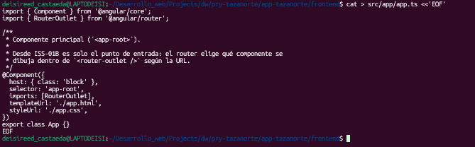

### Prueba del punto de entrada

`src/app/app.spec.ts`

```         
import { TestBed } from '@angular/core/testing'; import { provideRouter } from '@angular/router'; import { App } from './app';  describe('App', () => {   beforeEach(async () => {     await TestBed.configureTestingModule({       imports: [App],       // Sin rutas: esta prueba comprueba el punto de entrada, no las pantallas.       providers: [provideRouter([])],     }).compileComponents();   });    it('should create the app', () => {     const fixture = TestBed.createComponent(App);     expect(fixture.componentInstance).toBeTruthy();   });    it('should render the router outlet', async () => {     const fixture = TestBed.createComponent(App);     await fixture.whenStable();     const compilado = fixture.nativeElement as HTMLElement;     expect(compilado.querySelector('router-outlet')).toBeTruthy();   }); }); 
```

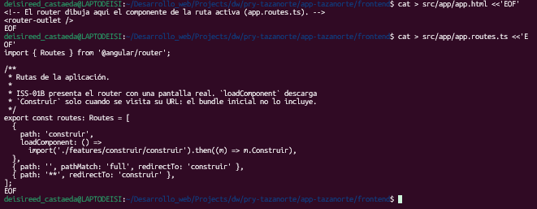

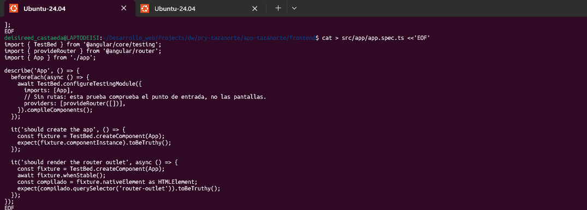

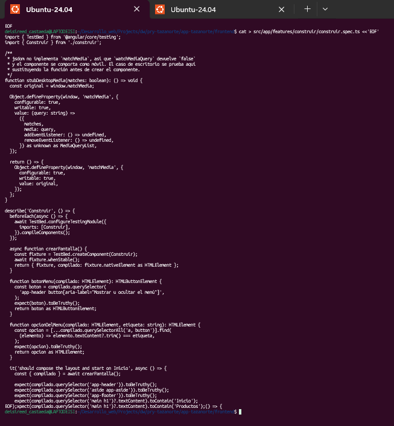

## 1.6 Comprobar antes de avanzar

```         
npm start 
```


# Fase I: Frontend — ISS-02 — Núcleo: environment, modelos, servicios y layout

> **Vigencia · revisión local del 23-oct-2026.** En el incremento didáctico se registra HttpClient sin interceptores de sesión. El consolidado ya incorpora la Fase II: authInterceptor y errorInterceptor. Shell reutiliza Header/Aside/Footer. `requireAuth=true` existe en ambos entornos; no demuestra que el backend activo tenga AUTH_ENABLED=true. Los bloques de código de la guía pueden representar incrementos; los archivos locales citados son la referencia consolidada.
>
> **Vigencia · revisión local del 23-oct-2026.** Los pasos describen una construcción incremental en una copia de práctica. El código consolidado puede incluir fases posteriores. Los resultados importados son reportes de la fuente, no pruebas repetidas en esta actualización. Véase [estado y trazabilidad](https://tecnogua.com/academic/site/frontend2026/express/estado-vigente/).
>
> **Contexto mínimo (autosuficiente).** Si abres este archivo aislado —o lo llevas a otra IA—, esto es lo que hay que saber antes de ejecutarlo. - **Proyecto:** `front-storelab-express-ii` — Angular 22 (standalone + zoneless + signals), **PrimeNG 22 en modo styled con Aura** y **Tailwind CSS 4**. Sin CSS de negocio ni PrimeFlex. - **Backend:** `app-storelab-express-ii` (Express + TypeScript + Sequelize) en [`http://localhost:4000`](http://localhost:4000), prefijo `/api`. - **Estado al terminar ISS-01B:** existe `features/construir` con el prototipo (Header, Aside con PanelMenu, Drawer, Footer), `App` es solo `<router-outlet />` y la ruta `construir` se carga diferida. No hay HTTP ni modelos. - **Patrón visual:** [`PATRON-VISUAL.md`](https://tecnogua.com/academic/site/frontend2026/express/construir/patron-visual/).
>
> | **Este ISS** |   |
> |:-----------------------------------|:-----------------------------------|
> | **Título** | Núcleo: environment, modelos, servicios y layout |
> | **Feature / tabla** | `core/models`, `core/services`, `core/utils`, un `feature/*-api` por entidad, `shared/ui`, `layout/shell` |
> | **API** | contrato REST completo (solo se declara; todavía no se consume en pantalla) |
> | **Depende de** | [ISS-01B — Menú PrimeNG e interacción](https://tecnogua.com/academic/site/frontend2026/express/construir/ISS-01-bootstrap-angular-22/#iss-01b) |
> | **Habilita** | [ISS-03 — CRUD de clientes](https://tecnogua.com/academic/site/frontend2026/express/construir/ISS-03-crud-de-clientes/) |

## Contenido de este ISS

- 2.1 `environment`: una sola URL para todo el frente

- 2.2 Modelos: reflejar el backend, no inventarlo

- 2.3 Servicios HTTP por feature: desenvolver la respuesta

- 2.4 Utilidades transversales: `toApiMessage` y `NotificationService`

- 2.5 Componentes compartidos: `PageHeader`, `EmptyState`, `StatusTag`

- 2.6 `Shell`: conservar el esqueleto al navegar

- 2.7 Registrar `HttpClient` sin interceptores de sesión

- 2.8 Comprobar antes de avanzar

- Verificación del ISS

- Cierre del ISS

**Objetivo:** dejar lista la **capa de infraestructura** del frontend antes de tocar pantallas de negocio:

1.  `environment` con la URL del backend y el interruptor de autenticación.

2.  Interfaces TypeScript que reflejan el contrato REST de Express.

3.  Servicios HTTP que devuelven `Observable<T>` **ya desenvuelto**.

4.  Utilidades transversales (`toApiMessage`, `NotificationService`).

5.  Componentes de UI reutilizables y el layout `Shell`.

**Bloqueado por:** [ISS-01B](https://tecnogua.com/academic/site/frontend2026/express/construir/ISS-01-bootstrap-angular-22/#iss-01b).

**Evidencia de aprendizaje:** dibuja y explica la cadena *plantilla → componente → `ClientApi` → Express → respuesta → signal*, e indica en qué eslabón se desenvuelve la respuesta.

**Equipo y terminal:** Ubuntu WSL, terminal del editor, carpeta del frontend. Los ejemplos con `cat >` se ejecutan en una copia de práctica; en el workspace consolidado inspecciona y ajusta los archivos existentes.

### Criterios de aceptación (ISS-02) — consolidados

- [ ] **2.1** `environment.apiUrl === 'http://localhost:4000/api'`, sin slash final

- [ ] **2.1** `environment` y `environment.development.ts` existen y `angular.json` aplica `fileReplacements`

- [ ] **2.2** Los 13 modelos compilan y coinciden campo a campo con las tablas del backend

- [ ] **2.2** `Money` acepta `number | string` y `toNumber()` normaliza DECIMAL

- [ ] **2.2** `status` no viaja en los DTO de edición: solo el backend lo cambia con `/deactivate`

- [ ] **2.3** Cada servicio usa `this.base` construido desde `environment.apiUrl`

- [ ] **2.3** `list()`/`get()`/`create()` devuelven la entidad, **no** la envoltura (`{ clients }` → `Client[]`)

- [ ] **2.3** Las envolturas pivote son `{ assignments }` y `{ grants }`, no `{ role_users }`

- [ ] **2.4** `toApiMessage` distingue `status === 0` (backend caído) de un `403`

- [ ] **2.4** `NotificationService` traduce a `MessageService` con duraciones por severidad

- [ ] **2.5** `PageHeader`, `EmptyState` y `StatusTag` compilan como standalone y no añaden CSS

- [ ] **2.5** `StatusTag` se repinta al cambiar el `input` gracias a `computed`

- [ ] **2.6** `Shell` compone Header/aside/`router-outlet`/Footer **una sola vez**; el botón del Header alterna el Aside en escritorio y abre el Drawer en móvil

- [ ] **2.6** `app.routes.ts` carga `Shell` con `loadComponent` y conserva el prototipo

- [ ] **2.7** `provideHttpClient()` está registrado y **no** hay interceptores de sesión

- [ ] **2.8** `ng build` termina con código 0 y `shell` aparece como chunk diferido

- [ ] **2.8** Las pruebas pasan: 8 archivos, 33 casos

> **`demo/ejemplo` sigue fuera.** La introducción a Angular quedó en ISS-01: no tiene ruta, no está en el menú y no se compone aquí.

## 2.1 `environment`: una sola URL para todo el frente

**Criterios de este sub-ítem**

- [ ] `apiUrl` termina en `/api`, nunca en `/`

- [ ] Existen `environment.ts` (build) y `environment.development.ts` (`ng serve`)

- [ ] `angular.json` sustituye el archivo en la configuración `development`

- [ ] `primeUiLicense` está documentado en ambos archivos (clave Community PrimeUI; ISS-01 §1.4.1)

```         
ng generate environments 
```

Crea los dos archivos y registra el reemplazo. Si ya existen, edítalos sin repetir el generador.

`src/environments/environment.ts` — lo usa `ng build`, es el **base**:

```         
/**  * Entorno de producción (`ng build`).  *  * `apiUrl` termina en `/api` SIN slash final: con uno, las llamadas saldrían  * como `//clientes` y Express las trataría como otra ruta.  *  * `requireAuth`: mitad frontal del interruptor de fases. Nadie lo lee hasta  * ISS-08 (Fase II). Se empareja con `AUTH_ENABLED` del backend: mover una sola  * mitad produce `401 Missing Bearer token` (ISS-11 §11.1).  *  * `primeUiLicense`: clave **Community** de PrimeUI (PrimeNG 22). Solicítala en  * https://primeui.dev · requisitos en https://primeui.dev/licenses. Déjala en `''`  * si aún no la tienes (aviso en consola; la app funciona). No subas claves  * comerciales al repo.  */ export const environment = {   production: true,   appName: 'StoreLab Express II',   apiUrl: 'http://localhost:4000/api',   requireAuth: true,   primeUiLicense: '', }; 
```

`src/environments/environment.development.ts` — lo usa `ng serve` y `npm test`:

```         
/**  * En el día a día del laboratorio es **este** archivo el que importa Angular  * (vía `fileReplacements`). Pega aquí la misma `primeUiLicense` que en producción.  */ export const environment = {   production: false,   appName: 'StoreLab Express II',   apiUrl: 'http://localhost:4000/api',   requireAuth: true,   primeUiLicense: '', }; 
```

### 2.1.1 Licencia PrimeUI (`primeUiLicense`)

Tras ISS-01, `app.config.ts` registra PrimeNG así:

```         
providePrimeNG({   license: environment.primeUiLicense || undefined,   // ... }); 
```

**Pasos:**

1.  Solicita la **Community License** (gratuita para estudiantes) en [https://primeui.dev](https://primeui.dev/).

2.  Copia la clave del correo (cadena larga, suele empezar por `eyJ…`).

3.  Pégala en `primeUiLicense` de **`environment.development.ts`** (para `ng serve`).

4.  Repite el mismo valor en **`environment.ts`** (para `ng build` / entrega).

5.  Reinicia `ng serve` y recarga el navegador: desaparecen `[PrimeUI] No license key configured` y la banda *Invalid PrimeUI License*.

Si trabajas sin clave, mantén `primeUiLicense: ''` y documenta el aviso en la evidencia (ISS-01 §1.4.1).

`angular.json` → `projects.<proyecto>.architect.build.configurations.development`:

```         
"development": {   "optimization": false,   "extractLicenses": false,   "sourceMap": true,   "fileReplacements": [     {       "replace": "src/environments/environment.ts",       "with": "src/environments/environment.development.ts"     }   ] } 
```

| **Idea** | **Consecuencia** |
|:-----------------------------------|:-----------------------------------|
| `environment.ts` es el **base** | El build de producción no necesita reemplazo |
| `development` reemplaza por `environment.development.ts` | `ng serve` compila con `production: false` |
| Solo cambia lo que difiere | `apiUrl` aparece **una vez** por archivo; los servicios la importan |

> **El slash final no es cosmético.** Con `apiUrl = 'http://localhost:4000/api/'`, el servicio armaría `${apiUrl}/clientes` y la URL real sería [`http://localhost:4000/api//clientes`](http://localhost:4000/api//clientes). Express compara rutas literales: `//clientes` no coincide con `/api/clientes` y responde 404.

**Sobre `requireAuth`.** En ISS-02 nadie lo lee todavía: es el interruptor que ISS-08 consumirá desde `SessionStore`. Se declara ahora para que la URL y la configuración vivan en el mismo lugar. Es **la mitad frontal** de un interruptor de dos piezas:

| **Pieza** | **Repositorio** | **Efecto** |
|:-----------------------|:-----------------------|:-----------------------|
| `requireAuth` | Frontend (`environment*.ts`) | Guards, directiva, menú y refresh |
| `AUTH_ENABLED` | Backend (`.env`) | `authenticate` y `authorize` de las rutas de negocio |

Con el backend consolidado (JWT + RBAC activo) las dos valen `true`. Si cambias solo el frontend a `false`, las peticiones salen sin `Bearer` y Express responde `401`: no existe forma de «abrir» la API desde el cliente. Las dos banderas se mueven juntas (ISS-11 §11.1). No es lo que hace que la Fase I funcione: la Fase I simplemente no tiene guards, directiva ni interceptor.

## 2.2 Modelos: reflejar el backend, no inventarlo

**Criterios de este sub-ítem**

- [ ] Cada entidad tiene su interfaz y su `Payload` de escritura

- [ ] Los modelos de lectura **no** exponen `password`

- [ ] `Money` cubre `number | string`; `toNumber()` normaliza

- [ ] Los campos son los del backend, en `snake_case`

```         
ng generate interface core/models/api --type=model --defaults ng generate interface core/models/client --type=model --defaults ng generate interface core/models/product-type --type=model --defaults ng generate interface core/models/product --type=model --defaults ng generate interface core/models/sale --type=model --defaults ng generate interface core/models/product-sale --type=model --defaults ng generate interface core/models/user --type=model --defaults ng generate interface core/models/role --type=model --defaults ng generate interface core/models/resource --type=model --defaults ng generate interface core/models/role-user --type=model --defaults ng generate interface core/models/resource-role --type=model --defaults ng generate interface core/models/auth --type=model --defaults ng generate interface core/models/dashboard --type=model --defaults 
```

Cada comando crea un `*.model.ts` con una interfaz vacía. **Reemplaza también el nombre exportado**: el archivo se llama `client.model.ts`, pero el export es `Client`, no `Client`.

### `api.model.ts` — los tipos que comparten todos

```         
export type Status = 'active' | 'inactive'; export type Money = number | string;  export interface ApiError {   error: string;   detail?: string; }  /** Firma mínima de los objetos Sequelize que devuelve el backend. */ export interface Timestamps {   createdAt?: string;   updatedAt?: string; }  export function toNumber(value: Money | null | undefined): number {   const parsed = Number(value ?? 0);   return Number.isFinite(parsed) ? parsed : 0; } 
```

**Por qué `Money` es una unión.** Sequelize define `price`, `total`, `unit_price` como `DECIMAL(12,2)`. Según el motor y el driver, ese valor llega como `number` o como `string` (`"12.50"`). Si el modelo dijera solo `number`, TypeScript mentiría y una suma como `price + tax` concatenaría texto. `toNumber()` convierte en un solo lugar.

### Las entidades

`src/app/core/models/client.model.ts`

```         
import { Status, Timestamps } from './api.model';  /** Tabla `clients` — /api/clientes */ export interface Client extends Timestamps {   id: number;   name: string;   address: string | null;   phone: string | null;   email: string | null;   status: Status; }  /** El backend acepta password en Client (residual del ISS-03), pero la UI no lo usa. */ export interface ClientPayload {   name: string;   address?: string | null;   phone?: string | null;   email?: string | null;   status?: Status; } 
```

`product-type.model.ts`, `product.model.ts`, `product-sale.model.ts`.

```         
export interface ProductType extends Timestamps {   id: number;   name: string;   description: string | null;   status: Status; }  export interface ProductTypePayload {   name: string;   description?: string | null;   status?: Status; } 
```

```         
export interface Product extends Timestamps {   id: number;   name: string;   brand: string;   price: Money;          // DECIMAL → puede llegar como string   min_stock: number;   quantity: number;   product_type_id: number;   status: Status; }  export interface ProductPayload {   name: string;   brand: string;   price: number;         // al escribir siempre es number   min_stock: number;   quantity: number;   product_type_id: number;   status?: Status; } 
```

```         
export interface ProductSale extends Timestamps {   id: number;   sale_id: number;   product_id: number;   quantity: number;   unit_price: Money;   line_total: Money;   status: Status; }  export interface ProductSalePayload {   sale_id: number;   product_id: number;   quantity: number;   status?: Status; } 
```

`sale.model.ts` — la cabecera y sus dos payloads.

```         
export interface Sale extends Timestamps {   id: number;   sale_date: string;   subtotal: Money;   tax: Money;   discounts: Money;   total: Money;   client_id: number;   status: Status;   /** El backend incluye el detalle con `include: [{ model: ProductSale, as: 'items' }]`. */   items?: ProductSale[]; }  export interface SaleItemInput {   product_id: number;   quantity: number; }  export interface SaleCreatePayload {   client_id: number;   tax?: number;   discounts?: number;   sale_date?: string;   items: SaleItemInput[]; }  export interface SaleUpdatePayload {   client_id?: number;   tax?: number;   discounts?: number;   sale_date?: string; } 
```

> **`SaleCreatePayload` no lleva `total`.** El total lo calcula Express a partir de las líneas y del stock real. Enviarlo desde la UI sería confiar en el cliente para un dato contable.

`user.model.ts`, `role.model.ts`, `resource.model.ts`.

```         
/** Tabla `users` — /api/usuarios. Nunca incluye `password`. */ export interface User extends Timestamps {   id: number;   username: string;   email: string;   avatar: string | null;   status: Status; }  export interface UserPayload {   username: string;   email: string;   /** Obligatorio al crear; opcional al editar (si viene vacío se conserva el hash). */   password?: string;   avatar?: string | null;   status?: Status; } 
```

```         
export interface Role extends Timestamps {   id: number;   name: string;          // el backend lo normaliza a MAYÚSCULAS   description: string | null;   status: Status; }  export interface RolePayload {   name: string;   description?: string | null;   status?: Status; } 
```

```         
export type HttpMethod = 'GET' | 'POST' | 'PUT' | 'PATCH' | 'DELETE';  export const HTTP_METHODS: HttpMethod[] = ['GET', 'POST', 'PUT', 'PATCH', 'DELETE'];  /** Tabla `resources` — /api/recursos (catálogo de 58 pares method+path). */ export interface Resource extends Timestamps {   id: number;   path: string;   method: HttpMethod;   description: string | null;   status: Status; }  export interface ResourcePayload {   path: string;   method: HttpMethod;   description?: string | null;   status?: Status; } 
```

`role-user.model.ts` y `resource-role.model.ts` — los dos pivotes.

```         
/** Pivote `role_users` — /api/asignaciones-rol */ export interface RoleUser extends Timestamps {   id: number;   user_id: number;   role_id: number;   status: Status;   user?: { id: number; username: string; email: string } | null;   role?: { id: number; name: string } | null; } 
```

```         
/** Pivote `resource_roles` — /api/concesiones-rol. Cada fila ES un permiso. */ export interface ResourceRole extends Timestamps {   id: number;   resource_id: number;   role_id: number;   status: Status;   role?: { id: number; name: string } | null;   resource?: {     id: number;     method: HttpMethod;     path: string;     description: string | null;   } | null; } 
```

`auth.model.ts` y `dashboard.model.ts` — se declaran ahora, se consumen en ISS-08 e ISS-07.

```         
export interface SessionTokens {   access_token: string;   token_type: 'Bearer';   expires_in: number;   refresh_token: string;   refresh_expires_in: number; }  export interface EffectivePermission {   resource_id: number;   method: HttpMethod;   path: string;   description: string | null;   role_id: number;   role_name: string; } 
```

```         
export interface DashboardStats {   clients: number;   productTypes: number;   products: number;   lowStock: number;   sales: number;   revenue: number; }  export interface DashboardData {   stats: DashboardStats;   lowStockProducts: Product[];   latestSales: Sale[]; } 
```

**La regla que se repite en todos los modelos.** `status` aparece en la interfaz de lectura y como opcional en el `Payload` de **creación**, pero los DTO de `PUT`/`PATCH` lo excluyen: el estado solo cambia con `PATCH /:id/deactivate`. Si el formulario de edición enviara `status`, el backend lo ignoraría o respondería 400 — y la UI estaría prometiendo algo que no puede hacer.

## 2.3 Servicios HTTP por feature: desenvolver la respuesta

**Criterios de este sub-ítem**

- [ ] Cada servicio es `@Injectable({ providedIn: 'root' })` y usa `inject(HttpClient)`

- [ ] `base` se construye **una vez** desde `environment.apiUrl`

- [ ] Los métodos devuelven `Observable<Entidad>`, no `Observable<{ entidad }>`

- [ ] Ninguna URL se escribe completa dentro de un método

```         
ng generate service features/clients/client-api --skip-tests --defaults ng generate service features/product-types/product-type-api --skip-tests --defaults ng generate service features/products/product-api --skip-tests --defaults ng generate service features/sales/sale-api --skip-tests --defaults ng generate service features/product-sales/product-sale-api --skip-tests --defaults ng generate service features/admin/users/user-api --skip-tests --defaults ng generate service features/admin/roles/role-api --skip-tests --defaults ng generate service features/admin/resources/resource-api --skip-tests --defaults ng generate service features/admin/role-users/role-user-api --skip-tests --defaults ng generate service features/admin/resource-roles/resource-role-api --skip-tests --defaults ng generate service core/services/notification --skip-tests --defaults 
```

> **`--skip-tests` aquí sí es deliberado:** los servicios se prueban en un mismo `client-api.spec.ts` con `HttpTestingController` (más abajo), no con un stub vacío por archivo.

### El contrato real del backend

Express responde **envolturas**, y el nombre de la clave no siempre coincide con el nombre de la tabla. Esta tabla es la fuente de verdad:

| **Recurso** | **Ruta** | **Colección** | **Elemento** |
|:-----------------|:-----------------|:-----------------|:-----------------|
| Clientes | `/api/clientes` | `clients` | `client` |
| Tipos de producto | `/api/tipos-producto` | `product_types` | `product_type` |
| Productos | `/api/productos` | `products` | `product` |
| Ventas | `/api/ventas` | `sales` | `sale` |
| Detalle de ventas | `/api/detalle-ventas` | `product_sales` | `product_sale` |
| Usuarios | `/api/usuarios` | `users` | `user` |
| Roles | `/api/roles` | `roles` | `role` |
| Recursos | `/api/recursos` | `resources` | `resource` |
| Asignaciones | `/api/asignaciones-rol` | **`assignments`** | **`assignment`** |
| Concesiones | `/api/concesiones-rol` | **`grants`** | **`grant`** |

Las dos últimas filas son la trampa del contrato: la tabla se llama `role_users` y `resource_roles`, pero la respuesta usa `assignments` y `grants`. Escribir `{ role_users }` compila —TypeScript no valida el nombre que tú declaras— y falla en ejecución con `undefined`.

### `client-api.ts` — el patrón completo

```         
import { HttpClient } from '@angular/common/http'; import { Injectable, inject } from '@angular/core'; import { Observable, map } from 'rxjs'; import { environment } from '../../../environments/environment'; import { Client, ClientPayload } from '../../core/models/client.model';  /** Contrato exacto de `features/business/clients` en Express. */ @Injectable({ providedIn: 'root' }) export class ClientApi {   private readonly http = inject(HttpClient);   private readonly base = `${environment.apiUrl}/clientes`;    list(): Observable<Client[]> {     return this.http       .get<{ clients: Client[] }>(this.base)       .pipe(map((response) => response.clients));   }    get(id: number): Observable<Client> {     return this.http       .get<{ client: Client }>(`${this.base}/${id}`)       .pipe(map((response) => response.client));   }    create(payload: ClientPayload): Observable<Client> {     return this.http       .post<{ client: Client }>(this.base, payload)       .pipe(map((response) => response.client));   }    /** PATCH /api/clientes/:id — actualización parcial (la que usa el formulario). */   update(id: number, payload: Partial<ClientPayload>): Observable<Client> {     return this.http       .patch<{ client: Client }>(`${this.base}/${id}`, payload)       .pipe(map((response) => response.client));   }    /** PUT /api/clientes/:id — reemplazo completo (se muestra en el ISS de ventas). */   replace(id: number, payload: ClientPayload): Observable<Client> {     return this.http       .put<{ client: Client }>(`${this.base}/${id}`, payload)       .pipe(map((response) => response.client));   }    /** Baja lógica: status = inactive. */   deactivate(id: number): Observable<unknown> {     return this.http.patch(`${this.base}/${id}/deactivate`, {});   }    /** Baja física: DELETE. */   remove(id: number): Observable<unknown> {     return this.http.delete(`${this.base}/${id}`);   } } 
```

**Dónde se desenvuelve.** En el `.pipe(map(...))` del servicio, no en el componente:

```         
GET /api/clientes   → Express responde  { "clients": [ {...}, {...} ] }   → ClientApi.map      devuelve [ {...}, {...} ]        ← Observable<Client[]>   → el componente      recibe Client[] y lo pinta 
```

Si el componente recibiera la envoltura, **cada** pantalla tendría que recordar el nombre de la clave —y `assignments`/`grants` romperían esa memoria.

### Los otros servicios, en una línea cada uno

```         
// product-type-api.ts private readonly base = `${environment.apiUrl}/tipos-producto`; list(): Observable<ProductType[]> {   return this.http.get<{ product_types: ProductType[] }>(this.base)     .pipe(map((r) => r.product_types)); } 
```

```         
// sale-api.ts — POST devuelve { sale, items }; el stock ya está descontado create(payload: SaleCreatePayload): Observable<Sale> {   return this.http.post<{ sale: Sale; items: unknown[] }>(this.base, payload)     .pipe(map((r) => r.sale)); } 
```

```         
// product-sale-api.ts — PATCH solo acepta quantity update(id: number, payload: { quantity: number }): Observable<ProductSale> {   return this.http.patch<{ product_sale: ProductSale }>(`${this.base}/${id}`, payload)     .pipe(map((r) => r.product_sale)); } 
```

```         
// role-user-api.ts — envoltura { assignments }, no { role_users } list(): Observable<RoleUser[]> {   return this.http.get<{ assignments: RoleUser[] }>(this.base)     .pipe(map((r) => r.assignments)); } 
```

```         
// resource-role-api.ts — filtros por query y envoltura { grants } list(filters?: { role_id?: number; resource_id?: number }): Observable<ResourceRole[]> {   let params = new HttpParams();   if (filters?.role_id) { params = params.set('role_id', filters.role_id); }   if (filters?.resource_id) { params = params.set('resource_id', filters.resource_id); }   return this.http.get<{ grants: ResourceRole[] }>(this.base, { params })     .pipe(map((r) => r.grants)); } 
```

### Prueba del servicio con `HttpTestingController`

`src/app/features/clients/client-api.spec.ts`

```         
import { provideHttpClient } from '@angular/common/http'; import {   HttpTestingController,   provideHttpClientTesting, } from '@angular/common/http/testing'; import { TestBed } from '@angular/core/testing'; import { environment } from '../../../environments/environment'; import { Client } from '../../core/models/client.model'; import { ClientApi } from './client-api';  const BASE = `${environment.apiUrl}/clientes`;  describe('ClientApi', () => {   let api: ClientApi;   let http: HttpTestingController;    beforeEach(() => {     TestBed.configureTestingModule({       providers: [provideHttpClient(), provideHttpClientTesting()],     });     api = TestBed.inject(ClientApi);     http = TestBed.inject(HttpTestingController);   });    afterEach(() => http.verify());    it('should unwrap { clients } into Client[]', () => {     let resultado: Client[] | undefined;     api.list().subscribe((clients) => (resultado = clients));      const peticion = http.expectOne(BASE);     expect(peticion.request.method).toBe('GET');     peticion.flush({ clients: [CLIENTE] });      expect(resultado).toEqual([CLIENTE]);   });    it('should build URLs from environment.apiUrl (no trailing slash)', () => {     expect(environment.apiUrl.endsWith('/api')).toBe(true);     api.list().subscribe();     http.expectOne('http://localhost:4000/api/clientes').flush({ clients: [] });   }); }); 
```

`HttpTestingController` no necesita el backend levantado: simula la respuesta y permite afirmar **dos** cosas: la URL construida y que la envoltura desaparece. `http.verify()` falla si quedó una petición sin responder, así que también detecta llamadas de más.

## 2.4 Utilidades transversales: `toApiMessage` y `NotificationService`

**Criterios de este sub-ítem**

- [ ] Un único lugar traduce el error HTTP a texto legible

- [ ] `status === 0` se explica como backend caído

- [ ] `NotificationService` fija la duración por severidad

`src/app/core/utils/api-error.ts`

```         
import { HttpErrorResponse } from '@angular/common/http';  /**  * Traduce el error HTTP del backend a un texto para el usuario.  * Express responde `{ error, detail? }`; los 403 de RBAC son opacos a propósito.  */ export function toApiMessage(error: unknown): string {   if (error instanceof HttpErrorResponse) {     const body = error.error as { error?: string; detail?: string } | string | null;      if (error.status === 0) {       return 'No se pudo conectar con el backend. Verifica que esté en http://localhost:4000.';     }     if (typeof body === 'string' && body.trim()) {       return body;     }     if (body && typeof body === 'object' && body.error) {       return body.detail ? `${body.error} — ${body.detail}` : body.error;     }     return error.message;   }   return error instanceof Error ? error.message : 'Error inesperado'; } 
```

Los cuatro casos que importan:

| **Situación** | **`status`** | **Mensaje** |
|:-----------------------|:-----------------------|:-----------------------|
| Backend apagado o CORS rechazado | `0` | «No se pudo conectar con el backend…» |
| Validación de Express | `400` | `Validation error — name must be a string` |
| Permiso denegado por RBAC | `403` | Solo `Forbidden` |
| Cuerpo de texto plano | cualquiera | El texto tal cual |

`status === 0` merece su propia rama porque **no** es un error del servidor: es un error de red o de CORS. Mostrar «Unknown Error» ahí deja al estudiante buscando el fallo en el lugar equivocado.

`src/app/core/services/notification.ts`

```         
import { Injectable, inject } from '@angular/core'; import { MessageService } from 'primeng/api';  /** Azúcar sintáctica sobre MessageService para no repetir `severity/life`. */ @Injectable({ providedIn: 'root' }) export class NotificationService {   private readonly messages = inject(MessageService);    success(summary: string, detail?: string): void {     this.messages.add({ severity: 'success', summary, detail, life: 3000 });   }    info(summary: string, detail?: string): void {     this.messages.add({ severity: 'info', summary, detail, life: 3500 });   }    warn(summary: string, detail?: string): void {     this.messages.add({ severity: 'warn', summary, detail, life: 4500 });   }    error(summary: string, detail?: string): void {     this.messages.add({ severity: 'error', summary, detail, life: 6000 });   } } 
```

`NotificationService` **no** reemplaza a `MessageService`: lo envuelve. La diferencia es que la duración deja de ser una decisión repetida en cada componente —un error debe leerse más tiempo que un «guardado»— y queda en un solo archivo.

## 2.5 Componentes compartidos: `PageHeader`, `EmptyState`, `StatusTag`

**Criterios de este sub-ítem**

- [ ] Los tres son standalone y usan `input()` con valor por defecto o `input.required`

- [ ] `PageHeader` y `EmptyState` proyectan contenido con `<ng-content />`

- [ ] `StatusTag` deriva texto y color con `computed`

- [ ] Los tres `.css` quedan vacíos

```         
ng generate component shared/ui/page-header --skip-tests --defaults ng generate component shared/ui/empty-state --skip-tests --defaults ng generate component shared/ui/status-tag --skip-tests --defaults 
```

`src/app/shared/ui/page-header/page-header.ts`

```         
import { Component, input } from '@angular/core';  @Component({   host: { class: 'block' },   selector: 'app-page-header',   templateUrl: './page-header.html',   styleUrl: './page-header.css', }) export class PageHeader {   readonly title = input.required<string>();   readonly subtitle = input<string>(''); } 
```

```         
<header class="mb-6 flex flex-col gap-4 md:flex-row md:items-end md:justify-between">   <div>     <h1 class="text-2xl font-semibold tracking-tight text-slate-900">{{ title() }}</h1>     @if (subtitle()) {       <p class="mt-1 max-w-2xl text-sm text-slate-500">{{ subtitle() }}</p>     }   </div>   <div class="flex flex-wrap items-center gap-2">     <ng-content />   </div> </header> 
```

Uso desde una pantalla de negocio:

```         
<app-page-header title="Clientes" subtitle="Alta, edición y baja de clientes.">   <button pButton label="Nuevo"></button> </app-page-header> 
```

`input.required` es la decisión importante: una pantalla **sin título** no se puede identificar, así que el compilador debe impedirla. `subtitle` sí es opcional, y el `@if` evita dejar un `<p>` vacío con margen.

`src/app/shared/ui/empty-state/empty-state.ts`

```         
@Component({   host: { class: 'block' },   selector: 'app-empty-state',   templateUrl: './empty-state.html',   styleUrl: './empty-state.css', }) export class EmptyState {   readonly icon = input<string>('pi pi-inbox');   readonly title = input<string>('Sin registros');   readonly message = input<string>('Todavía no hay datos para mostrar.'); } 
```

```         
<div class="flex flex-col items-center justify-center gap-2 px-6 py-12 text-center">   <div class="flex h-12 w-12 items-center justify-center rounded-full bg-slate-100 text-slate-500">     <i [class]="icon()" class="text-xl"></i>   </div>   <p class="mt-2 text-sm font-semibold text-slate-700">{{ title() }}</p>   <p class="max-w-sm text-sm text-slate-500">{{ message() }}</p>   <div class="mt-3"><ng-content /></div> </div> 
```

`src/app/shared/ui/status-tag/status-tag.ts`

```         
import { Component, computed, input } from '@angular/core'; import { TagModule } from 'primeng/tag'; import { Status } from '../../../core/models/api.model';  @Component({   host: { class: 'inline-block' },   selector: 'app-status-tag',   imports: [TagModule],   templateUrl: './status-tag.html',   styleUrl: './status-tag.css', }) export class StatusTag {   readonly status = input.required<Status>();    readonly label = computed(() => (this.status() === 'active' ? 'Activo' : 'Inactivo'));   readonly severity = computed<'success' | 'danger'>(() =>     this.status() === 'active' ? 'success' : 'danger',   ); } 
```

```         
<p-tag [value]="label()" [severity]="severity()" [rounded]="true" /> 
```

**Por qué `computed` y no un método.** Un método se reevaluaría en cada ciclo de detección; un `computed` guarda el resultado y solo se recalcula cuando `status()` cambia. La prueba lo demuestra: al hacer `setInput('status', 'inactive')`, texto y severidad cambian sin tocar la plantilla.

`src/app/shared/ui/status-tag/status-tag.spec.ts`

```         
it('should react when the input changes to inactive', async () => {   const fixture = TestBed.createComponent(StatusTag);   fixture.componentRef.setInput('status', 'active');   await fixture.whenStable();    fixture.componentRef.setInput('status', 'inactive');   await fixture.whenStable();    expect(fixture.componentInstance.label()).toBe('Inactivo');   expect(fixture.componentInstance.severity()).toBe('danger'); }); 
```

## 2.6 `Shell`: conservar el esqueleto al navegar

**Criterios de este sub-ítem**

- [ ] `Shell` monta Header, Aside, `router-outlet` y Footer

- [ ] Solo el contenido central cambia al navegar

- [ ] El Drawer móvil reutiliza el mismo `Aside` y la misma lista `items`

- [ ] El botón de menú está siempre visible y alterna el Aside en escritorio (misma lógica que ISS-01B)

- [ ] `<p-toast />` y `<p-confirmdialog />` viven en el Shell, una sola vez

- [ ] En Fase I no inyecta `AuthService` ni `SessionStore`

```         
ng generate component layout/shell --skip-tests --defaults 
```

`src/app/layout/shell/shell.ts`

```         
import { Component, signal } from '@angular/core'; import { RouterOutlet } from '@angular/router'; import { MenuItem } from 'primeng/api'; import { ConfirmDialogModule } from 'primeng/confirmdialog'; import { DrawerModule } from 'primeng/drawer'; import { ToastModule } from 'primeng/toast'; import { watchMediaQuery } from '../../core/utils/media-query'; import { Aside } from '../aside/aside'; import { Footer } from '../footer/footer'; import { Header } from '../header/header';  /**  * Layout persistente de la aplicación.  *  * El Header, el Aside y el Footer se montan **una sola vez**; solo la región  * central cambia con `<router-outlet />`. Reutilizar el layout evita  * remontar el menú (y perder el scroll o el foco) al navegar.  *  * Fase I: sin `AuthService` ni `SessionStore`. Las rutas de negocio se agregan  * como hijas de `Shell` desde ISS-03; la sesión, en ISS-08.  */ @Component({   host: { class: 'block' },   selector: 'app-shell',   imports: [RouterOutlet, Header, Aside, Footer, ConfirmDialogModule, DrawerModule, ToastModule],   templateUrl: './shell.html',   styleUrl: './shell.css', }) export class Shell {   /** `lg` de Tailwind: desde aquí el Aside es fijo y el botón lo alterna. */   private readonly isDesktop = watchMediaQuery('(min-width: 1024px)');    /** Escritorio: Aside fijo visible u oculto. */   readonly sidebarCollapsed = signal(false);    /** Móvil: Drawer abierto. */   readonly mobileOpen = signal(false);    /**    * Menú mínimo de la Fase I (ISS-02). En el proyecto consolidado ISS-08/09    * sustituyen este arreglo por `navGroups` + `NAV` en    * `layout/shell/nav.config.ts` (Operación, Seguridad, permisos y sesión).    */   readonly items: MenuItem[] = [     { label: 'Clientes', icon: 'pi pi-users', routerLink: '/clientes' },     { label: 'Prototipo', icon: 'pi pi-desktop', routerLink: '/construir' },   ];    /**    * Un solo botón, dos disposiciones: en escritorio alterna el Aside fijo; por    * debajo de `lg` abre el Drawer.    */   protected onMenuToggle(): void {     if (this.isDesktop()) {       this.sidebarCollapsed.update((collapsed) => !collapsed);       return;     }     this.mobileOpen.set(true);   } } 
```

`src/app/layout/shell/shell.html`

```         
<div class="flex min-h-screen flex-col bg-slate-100">   <app-header (menuRequested)="onMenuToggle()" />    <div class="flex flex-1">     <!--       Escritorio: Aside fijo que el botón del Header puede ocultar.       Por debajo de lg no se pinta: el menú vive en el Drawer.     -->     @if (!sidebarCollapsed()) {       <aside class="hidden w-72 shrink-0 lg:block">         <app-aside [items]="items" (navigated)="mobileOpen.set(false)" />       </aside>     }      <main id="contenido" class="min-w-0 flex-1 p-4 sm:p-6">       <div class="mx-auto w-full max-w-7xl">         <router-outlet />       </div>     </main>   </div>    <app-footer /> </div>  <!-- Móvil: el mismo Aside, otra disposición. --> <p-drawer [(visible)]="mobileOpen" header="Menú" position="left" styleClass="w-72">   <app-aside [items]="items" (navigated)="mobileOpen.set(false)" /> </p-drawer>  <!-- Anfitriones de las notificaciones y confirmaciones del CRUD (ISS-03). --> <p-toast position="top-right" /> <p-confirmdialog /> 
```

### Qué cambia respecto a `Construir`

| **Pieza** | **`Construir` (ISS-01B)** | **`Shell` (ISS-02)** |
|:-----------------------|:-----------------------|:-----------------------|
| Layout | Lo compone el propio prototipo | Lo compone el layout, una vez |
| Contenido | Fijo dentro del componente | `<router-outlet />` |
| Menú | `command` que cambia un título | `routerLink` que navega |
| Sesión | No | No (ISS-08) |
| Botón de menú | `onMenuToggle()` con `watchMediaQuery` | El mismo método y el mismo helper |

`Shell` es la razón por la que el prototipo no se borra: sirve de referencia visual mientras el layout real gana pantallas.

> **El helper se reutiliza, no se copia.** `watchMediaQuery('(min-width: 1024px)')` se creó en ISS-01B (`core/utils/media-query.ts`) y aquí se vuelve a usar. Si la frontera cambiara —por ejemplo a `xl`— se cambia en la llamada y no hay dos `@media` desincronizadas con Tailwind.
>
> **`Shell` nace sin hijos y los gana en ISS-03.** En ISS-02 la ruta `''` monta el Shell y su única hija redirige a `/construir`, así que al abrir `/` se veía el prototipo. Desde ISS-03 esa misma hija redirige a `clientes`: ahora `/` sí monta el Shell con su primera pantalla de negocio. La composición del Shell se verifica además con pruebas (`shell.spec.ts`) y con el chunk diferido del build.

### Rutas

`src/app/app.routes.ts`

```         
import { Routes } from '@angular/router';  export const routes: Routes = [   {     path: 'construir',     loadComponent: () =>       import('./features/construir/construir').then((m) => m.Construir),   },   {     path: '',     loadComponent: () => import('./layout/shell/shell').then((m) => m.Shell),     children: [       // La primera pantalla de negocio es la redirección por defecto.       // ISS-07 la cambiará por el dashboard.       { path: '', pathMatch: 'full', redirectTo: 'clientes' },       {         path: 'clientes',         title: 'Clientes · StoreLab',         loadComponent: () =>           import('./features/clients/client-list/client-list').then((m) => m.ClientList),       },     ],   },   { path: '**', redirectTo: 'construir' }, ]; 
```

| **Ruta** | **Qué hace** |
|:-----------------------------------|:-----------------------------------|
| `construir` | Prototipo con su propio layout (ISS-01B) |
| `''` | Monta `Shell`; sus hijas son las pantallas de negocio |
| `''` hija con `pathMatch: 'full'` | Entra a la primera entidad (`clientes`) |
| `**` | Cualquier URL desconocida vuelve a `/construir` |

`Shell` se carga con `loadComponent`: el build lo confirma emitiendo un chunk `shell` aparte del bundle inicial.

`src/app/layout/shell/shell.spec.ts`

```         
it('should compose header, aside, main, footer and the router outlet', async () => {   const { compilado } = await crearShell();    expect(compilado.querySelector('app-header')).toBeTruthy();   expect(compilado.querySelector('aside app-aside')).toBeTruthy();   expect(compilado.querySelector('main#contenido router-outlet')).toBeTruthy();   expect(compilado.querySelector('app-footer')).toBeTruthy(); });  it('should open the mobile drawer from the header button', async () => {   const { fixture, compilado } = await crearShell();    const boton = compilado.querySelector(     'app-header button[aria-label="Mostrar u ocultar el menú"]',   ) as HTMLButtonElement;   boton.click();   fixture.detectChanges();   await fixture.whenStable();    expect(fixture.componentInstance.mobileOpen()).toBe(true); }); 
```

La prueba necesita `provideRouter([])` (por `<router-outlet />`) y los proveedores de PrimeNG (`MessageService`, `ConfirmationService`) que consumen `<p-toast />` y `<p-confirmdialog />`. Como jsdom no implementa `matchMedia`, `watchMediaQuery` devuelve `false` y la prueba ejercita la rama móvil; la rama de escritorio se cubre en `construir.spec.ts` sustituyendo `window.matchMedia`.

## 2.7 Registrar `HttpClient` sin interceptores de sesión

**Criterios de este sub-ítem**

- [ ] `provideHttpClient()` está en `app.config.ts`

- [ ] No hay `withInterceptors(...)` todavía

- [ ] `MessageService` y `ConfirmationService` siguen registrados (los usan los hosts del Shell)

`src/app/app.config.ts` — debajo de los imports y antes de `MessageService`:

```         
import { provideHttpClient } from '@angular/common/http';  // ...      // Habilita la inyección de HttpClient en los servicios `*Api`.     // Sin interceptores de sesión: el authInterceptor llega en ISS-08.     provideHttpClient(),      MessageService,     ConfirmationService, 
```

`provideHttpClient()` habilita la **inyección** de `HttpClient`; no configura autenticación. El `authInterceptor` (adjuntar el Bearer, refrescar el token en 401) es ISS-08. Añadirlo ahora significaría escribir un interceptor que lee un `SessionStore` que aún no existe.

## 2.8 Comprobar antes de avanzar

**Criterios de este sub-ítem**

- [ ] `ng build` termina con código 0 y sin `✘ [ERROR]`

- [ ] `shell` aparece como chunk diferido

- [ ] `npm test` pasa completo

- [ ] `/` redirige a `/construir` y la pantalla del prototipo sigue funcionando

- [ ] Network no registra llamadas `/api` en ninguna pantalla

```         
ng build npm test -- --watch=false npm start 
```

**Problemas frecuentes**

| **Síntoma** | **Causa** | **Solución** |
|:-----------------------|:-----------------------|:-----------------------|
| `Cannot find module '../../core/models/...'` | Profundidad de `../` incorrecta | Cuenta carpetas desde el archivo del servicio |
| `Cannot find name 'Injectable'` | Falta el import de Angular | Importa `Injectable` desde `@angular/core` |
| `NG8001: 'p-tag' is not a known element` | Falta `TagModule` en `imports` | Añádelo al array `imports` del componente |
| `NullInjectorError: No provider for HttpClient!` | Falta `provideHttpClient()` | Regístralo en `app.config.ts` |
| `resultado` es `undefined` en la prueba del servicio | No se llamó `flush` | Responde la petición con `peticion.flush({...})` |
| `list()` devuelve `undefined` en ejecución | Envoltura mal escrita (`role_users` en vez de `assignments`) | Revisa la tabla de envolturas |
| 404 en todas las llamadas | `apiUrl` con slash final | Deja `.../api`, sin `/` |

**Siguiente:** [ISS-03 — CRUD de clientes](https://tecnogua.com/academic/site/frontend2026/express/construir/ISS-03-crud-de-clientes/) usa `ClientApi` en una pantalla real, como hija de `Shell`.

## Verificación del ISS

```         
# 1. Compila y separa los chunks diferidos ng build  # 2. La URL del backend existe una sola vez grep -n "apiUrl" src/environments/environment.ts src/environments/environment.development.ts  # 3. Los modelos existen y coinciden con el backend ls src/app/core/models/*.model.ts  # 4. Los servicios desenvuelven con map grep -rn "\.pipe(map" src/app/features src/app/core | wc -l  # 5. HttpClient registrado, sin interceptores grep -n "provideHttpClient" src/app/app.config.ts grep -rn "withInterceptors" src/app/app.config.ts || echo "sin interceptores: correcto"  # 6. Las envolturas especiales están bien escritas grep -n "assignments\|grants" src/app/features/admin/*/*-api.ts  # 7. Los CSS compartidos no tienen reglas for f in src/app/shared/ui/*/*.css src/app/layout/shell/shell.css; do   grep -q '[{}]' "$f" && echo "REGLAS EN $f" done  # 8. Pruebas npm test -- --watch=false 
```

### Resultado reportado por la fuente (23-oct-2026)

| **Comprobación** | **Resultado** |
|:-----------------------------------|:-----------------------------------|
| `ng build` | código **0**; `Initial total` **548.57 kB** (\< 750 kB, sin warning) |
| Chunks diferidos | `client-list` **568.09 kB** · `shell` **60.26 kB** · `construir` **7.76 kB** |
| `npm test -- --watch=false` | **11 archivos, 55 pruebas** |
| `/` | Redirige a `/clientes` (ISS-03); `/construir` sigue accesible |
| `/construir` | Prototipo intacto: Header, Aside con 5 opciones, Drawer y Footer |
| Shell en escritorio 1280 px | `aside` **288 px**, `main#contenido router-outlet`, Footer al borde inferior (800 px), `scrollWidth = clientWidth = 1280` |
| Shell en escritorio, botón de menú | `display: flex`: visible también a 1280 px (antes `lg:hidden` lo escondía) |
| Shell en escritorio, clic en el botón | `aside` sale del DOM; no aparece Drawer; el contenido ocupa el ancho |
| Shell en móvil 390 px | Aside oculto; el botón abre el Drawer con el mismo menú |
| Menú del Shell | Enlaces reales `href="/clientes"` y `href="/construir"` |
| Hosts del CRUD | `p-toast` y `p-confirmdialog` presentes en el DOM |
| Network | **0** peticiones `/api` en `/` y `/construir` |
| Envolturas pivote | `assignments` y `grants` verificadas en su servicio |

> La verificación visual del Shell se hizo exponiendo el componente en una ruta temporal (`/shell-preview`), que se **retiró** antes del build final. El estado entregado es el de la tabla anterior: desde `/` se monta el Shell con la pantalla de clientes de ISS-03, y el Shell se valida además con `shell.spec.ts`.

## Cierre del ISS

La capa de infraestructura está completa: una URL de backend, 13 modelos que reflejan las tablas, 11 servicios que desenvuelven la respuesta de Express, dos utilidades transversales, tres componentes de UI y un `Shell` que conserva el layout al navegar.

No hay pantallas de negocio todavía y **no se ha hecho ni una petición HTTP real**: eso empieza en ISS-03. `SessionStore`, `AuthService` y la directiva `*appHasPermission` pertenecen a ISS-08/ISS-09 y se documentan allí; adelantarlos aquí dejaría código que nadie consume.

**Siguiente:** [ISS-03 — CRUD de clientes](https://tecnogua.com/academic/site/frontend2026/express/construir/ISS-03-crud-de-clientes/).

## Correspondencia con el código

Esta guía es la que contiene los comandos (`ng generate`, `cat >`) y la explicación paso a paso para construir el frontend desde cero. El código no se duplica en `docs/`: la referencia completa son los archivos reales del proyecto, enlazados al final de esta ISS.

Los ejemplos breves muestran incrementos y no sustituyen todos los archivos del componente. Las configuraciones de las primeras etapas omiten deliberadamente la sesión y las pantallas que se construyen después; en el proyecto consolidado la seguridad final está activa. No combines imports de una etapa final con stubs que todavía no implementaste.

> **Lo que este ISS no construye.** `SessionStore` (§2.8 del material de ampliación), `AuthService` y la directiva `*appHasPermission` pertenecen a ISS-08 y ISS-09. Aquí solo se declaran los modelos que consumirán (`auth.model.ts`, `resource.model.ts`).

## Código completo de referencia

Los fragmentos de esta ISS se estudian por incrementos. Estos archivos contienen la implementación consolidada:

- angular.json (`angular.json`).

- src/environments/environment.ts (`src/environments/environment.ts`).

- src/environments/environment.development.ts (`src/environments/environment.development.ts`).

- src/app/app.config.ts (`src/app/app.config.ts`).

- src/app/app.routes.ts (`src/app/app.routes.ts`).

- src/app/core/models/api.model.ts (`src/app/core/models/api.model.ts`).

- src/app/core/models/auth.model.ts (`src/app/core/models/auth.model.ts`).

- src/app/core/models/client.model.ts (`src/app/core/models/client.model.ts`).

- src/app/core/models/dashboard.model.ts (`src/app/core/models/dashboard.model.ts`).

- src/app/core/models/product-sale.model.ts (`src/app/core/models/product-sale.model.ts`).

- src/app/core/models/product-type.model.ts (`src/app/core/models/product-type.model.ts`).

- src/app/core/models/product.model.ts (`src/app/core/models/product.model.ts`).

- src/app/core/models/resource-role.model.ts (`src/app/core/models/resource-role.model.ts`).

- src/app/core/models/resource.model.ts (`src/app/core/models/resource.model.ts`).

- src/app/core/models/role-user.model.ts (`src/app/core/models/role-user.model.ts`).

- src/app/core/models/role.model.ts (`src/app/core/models/role.model.ts`).

- src/app/core/models/sale.model.ts (`src/app/core/models/sale.model.ts`).

- src/app/core/models/user.model.ts (`src/app/core/models/user.model.ts`).

- src/app/core/utils/media-query.ts (`src/app/core/utils/media-query.ts`).

- src/app/core/utils/media-query.spec.ts (`src/app/core/utils/media-query.spec.ts` — no existe en la copia inspeccionada).

- src/app/core/services/notification.ts (`src/app/core/services/notification.ts`).

- src/app/core/utils/api-error.ts (`src/app/core/utils/api-error.ts`).

- src/app/core/utils/api-error.spec.ts (`src/app/core/utils/api-error.spec.ts` — no existe en la copia inspeccionada).

- src/app/features/clients/client-api.ts (`src/app/features/clients/client-api.ts`).

- src/app/features/clients/client-api.spec.ts (`src/app/features/clients/client-api.spec.ts`).

- src/app/features/product-types/product-type-api.ts (`src/app/features/product-types/product-type-api.ts`).

- src/app/features/products/product-api.ts (`src/app/features/products/product-api.ts`).

- src/app/features/sales/sale-api.ts (`src/app/features/sales/sale-api.ts`).

- src/app/features/product-sales/product-sale-api.ts (`src/app/features/product-sales/product-sale-api.ts`).

- src/app/features/admin/users/user-api.ts (`src/app/features/admin/users/user-api.ts`).

- src/app/features/admin/roles/role-api.ts (`src/app/features/admin/roles/role-api.ts`).

- src/app/features/admin/resources/resource-api.ts (`src/app/features/admin/resources/resource-api.ts`).

- src/app/features/admin/role-users/role-user-api.ts (`src/app/features/admin/role-users/role-user-api.ts`).

- src/app/features/admin/resource-roles/resource-role-api.ts (`src/app/features/admin/resource-roles/resource-role-api.ts`).

- src/app/layout/shell/shell.ts (`src/app/layout/shell/shell.ts`).

- src/app/layout/shell/shell.html (`src/app/layout/shell/shell.html`).

- src/app/layout/shell/shell.css (`src/app/layout/shell/shell.css`).

- src/app/layout/shell/shell.spec.ts (`src/app/layout/shell/shell.spec.ts`).

- src/app/shared/ui/empty-state/empty-state.ts (`src/app/shared/ui/empty-state/empty-state.ts`).

- src/app/shared/ui/empty-state/empty-state.html (`src/app/shared/ui/empty-state/empty-state.html`).

- src/app/shared/ui/empty-state/empty-state.css (`src/app/shared/ui/empty-state/empty-state.css`).

- src/app/shared/ui/page-header/page-header.ts (`src/app/shared/ui/page-header/page-header.ts`).

- src/app/shared/ui/page-header/page-header.html (`src/app/shared/ui/page-header/page-header.html`).

- src/app/shared/ui/page-header/page-header.css (`src/app/shared/ui/page-header/page-header.css`).

- src/app/shared/ui/status-tag/status-tag.ts (`src/app/shared/ui/status-tag/status-tag.ts`).

- src/app/shared/ui/status-tag/status-tag.html (`src/app/shared/ui/status-tag/status-tag.html`).

- src/app/shared/ui/status-tag/status-tag.css (`src/app/shared/ui/status-tag/status-tag.css`).

- src/app/shared/ui/status-tag/status-tag.spec.ts (`src/app/shared/ui/status-tag/status-tag.spec.ts`).

> **Unidad ISS-03 · CRUD de clientes con Signals** — capa **🛠 CONSTRUIR**
>
> [🧠 Comprender este bloque →](https://tecnogua.com/academic/site/frontend2026/express/aprender/ISS-03-crud-de-clientes/) · [↑ Ruta Frontend-Express](https://tecnogua.com/academic/site/frontend2026/express/)
>
> | **Capa** | **Página** | **Para qué** |
> |:-----------------------|:-----------------------|:-----------------------|
> | 🧠 **Aprender** | [CRUD de clientes con Signals](https://tecnogua.com/academic/site/frontend2026/express/aprender/ISS-03-crud-de-clientes/) | comprender, explicar y relacionar |
> | 🛠 **Construir** | esta página | ejecutar, verificar y entregar |

# ISS-03 · CRUD de clientes con Signals

> **Vigencia · revisión local del 23-oct-2026.** ClientList sí implementa carga, búsqueda, diálogo, creación, edición y bajas. Sin embargo, no importa HasPermission y su plantilla no usa appHasPermission: el filtrado de botones de ISS-09 sigue pendiente. Express mantiene la autorización de cada petición. **Los criterios no cumplidos permanecen pendientes; no equivalen a evidencia de implementación.**
>
> **Vigencia · revisión local del 23-oct-2026.** El recorrido parte de datos locales, añade tabla y GET, y después formulario y escrituras. Los formularios emiten el resultado y la lista de clientes coordina la API. La protección de botones pertenece a ISS-09 y aún no está integrada en ClientList. Los bloques de código de la guía pueden representar incrementos; los archivos locales citados son la referencia consolidada.
>
> **Vigencia · revisión local del 23-oct-2026.** Los pasos describen una construcción incremental en una copia de práctica. El código consolidado puede incluir fases posteriores. Los resultados importados son reportes de la fuente, no pruebas repetidas en esta actualización. Véase [estado y trazabilidad](https://tecnogua.com/academic/site/frontend2026/express/estado-vigente/).
>
> **Convención visual:** PrimeNG con Aura para controles y datos; Tailwind para flex, grid, espaciado y adaptación a pantalla. Sin CSS propio ni PrimeFlex. Las tarjetas nuevas usan `p-card` e importan `CardModule` de `primeng/card`. Si usas `p-message` para validación, importa `MessageModule` de `primeng/message`. Consulta [el patrón visual](https://tecnogua.com/academic/site/frontend2026/express/construir/patron-visual/) antes de copiar una pantalla.

**Fase:** I · **Bloqueado por:** ISS-02 · **Habilita:** ISS-04

## Antes de construir: Primer CRUD por incrementos

Primero muestra `Client[]` local con `@for`; después sustituye la lista por `p-table`; conecta el `GET`; agrega búsqueda; construye el formulario; por último `POST`, `PATCH` y bajas.

**Evidencia de aprendizaje:** Prueba cada incremento por separado y explica `input(client)` y `output(saved)` antes de conectar el diálogo.

**Equipo y terminal:** Ubuntu WSL, terminal del editor, carpeta del frontend. Los ejemplos que crean o reemplazan archivos se ejecutan en una copia de práctica; en el workspace consolidado inspecciona y ajusta los archivos existentes.

## Objetivo

Implementar el primer CRUD completo: **listar, crear, editar, desactivar y eliminar** clientes contra `/api/clientes`. Es el patrón que se replicará en los siguientes ISS; entiéndelo bien antes de copiarlo.

> **Encaje en las dos fases.** Esta ISS es **Fase I (Business)**: construye el CRUD completo **sin** login, interceptor, guards ni directiva de permisos. Eso es Fase II (ISS-08 sesión, ISS-09 protección). Para probar la Fase I usa una copia del backend **anterior a su ISS-13** o un **stub local** con el contrato `{ clients }` / `{ client }`.
>
> El backend consolidado (`app-storelab-express-ii`) ya protege `/api/clientes` con `authenticate` + `authorize`: sin `Authorization: Bearer <token>` responde `401 Missing Bearer token`. Si abres esta pantalla contra él con `AUTH_ENABLED=true` verás ese texto en el `p-message`; **no es un fallo del CRUD**, es un backend en modo Fase II. Sirve como evidencia del criterio 6 (un error del backend se muestra al usuario) y se resuelve al terminar ISS-08/ISS-09. Para probar el CRUD ahora, pon `AUTH_ENABLED=false` en el `.env` del backend: deja OPEN solo las rutas de negocio (ISS-13 §18.7 del backend, resumen en ISS-11 §11.1).

## 3.1 Generar componentes con CLI

```         
ng generate component features/clients/client-list --skip-tests --defaults ng generate component features/clients/client-form --skip-tests --defaults 
```

El CLI crea cuatro archivos por componente:

```         
features/clients/ ├── client-api.ts                 # ya existe (ISS-02) ├── client-api.spec.ts            # ya existe (ISS-02) ├── client-form/ │   ├── client-form.ts │   ├── client-form.html │   ├── client-form.css │   └── client-form.spec.ts       # se escribe completo en esta ISS └── client-list/     ├── client-list.ts     ├── client-list.html     ├── client-list.css     └── client-list.spec.ts       # se escribe completo en esta ISS 
```

El `--skip-tests` no es para evitar pruebas: las dos pruebas de esta ISS son más largas que la plantilla del CLI y la sustituyen.

**Criterio de aceptación:** los componentes existen y son standalone (`imports: [...]` en el decorador, sin `NgModule`).

## 3.2 Utilidad de filtro local

PrimeNG 22 eliminó el input `globalFilter` de `p-table`. En su lugar filtramos el arreglo con una función pura y entregamos el resultado a `[value]`.

`src/app/core/utils/filter-rows.ts`

```         
/**  * Filtro local reutilizable para tablas PrimeNG 22.  *  * PrimeNG 22 eliminó el input `globalFilter` de `p-table`, así que filtramos el  * arreglo **antes** de entregarlo a `[value]`. Es una función pura: no depende  * del DOM, de la tabla ni de Angular, y por eso se prueba sin montar nada.  */ export function filterRows<T>(   rows: readonly T[],   query: string,   pick: (row: T) => Array<string | number | null | undefined>, ): T[] {   const term = query.trim().toLowerCase();    // Sin término se devuelve una copia: el llamador puede mutar el resultado sin   // tocar el arreglo original que vive en el signal.   if (!term) {     return [...rows];   }    return rows.filter((row) =>     pick(row).some((value) => (value ?? '').toString().toLowerCase().includes(term)),   ); } 
```

| **Decisión** | **Por qué** |
|:-----------------------------------|:-----------------------------------|
| `pick` recibe la fila | La utilidad no adivina qué campos son buscables; lo decide el llamador |
| `[...rows]` sin término | El `computed` no comparte referencia con el signal original |
| `(value ?? '')` | `email` y `phone` son `null` en la base y no deben romper el filtro |

Ventaja didáctica: el filtro es **una función pura**, fácil de testear, sin depender de la tabla ni del DOM.

## 3.3 Formulario reactivo reutilizable

El mismo componente sirve para crear y editar. Recibe `client` y `resetKey` como `input()`, y emite `saved` / `cancelled` como `output()`.

### `client-form.ts`

```         
import { Component, effect, inject, input, output } from '@angular/core'; import { NonNullableFormBuilder, ReactiveFormsModule, Validators } from '@angular/forms'; import { ButtonModule } from 'primeng/button'; import { InputTextModule } from 'primeng/inputtext'; import { MessageModule } from 'primeng/message'; import { SelectModule } from 'primeng/select'; import { TextareaModule } from 'primeng/textarea'; import { Status } from '../../../core/models/api.model'; import { Client, ClientPayload } from '../../../core/models/client.model';  /**  * Formulario de cliente, reutilizado para crear y editar.  *  * No llama a la API: recibe `client` (o `null` para crear) y emite el payload  * con `saved`. El padre decide entre `POST` y `PATCH` y controla el diálogo, así  * que este componente sirve igual dentro de un Dialog que en una página.  */ @Component({   host: { class: 'block' },   selector: 'app-client-form',   imports: [     MessageModule,     ReactiveFormsModule,     ButtonModule,     InputTextModule,     SelectModule,     TextareaModule,   ],   templateUrl: './client-form.html',   styleUrl: './client-form.css', }) export class ClientForm {   /** Cliente a editar. `null` deja el formulario en modo creación. */   readonly client = input<Client | null>(null);    /**    * Cambia cada vez que el padre abre el diálogo.    *    * Sin esto, reabrir «Nuevo cliente» tras cancelar conservaría lo escrito:    * `client` sigue siendo `null`, así que el `effect()` no volvería a correr.    * Es una llave explícita para reiniciar, no un estado duplicado.    */   readonly resetKey = input(0);    /** Petición en curso: deshabilita el botón y muestra su spinner. */   readonly saving = input(false);    readonly saved = output<ClientPayload>();   readonly cancelled = output<void>();    private readonly fb = inject(NonNullableFormBuilder);    readonly statusOptions = [     { label: 'Activo', value: 'active' },     { label: 'Inactivo', value: 'inactive' },   ];    readonly form = this.fb.group({     name: ['', [Validators.required, Validators.maxLength(120)]],     address: [''],     phone: [''],     email: ['', [Validators.email]],     status: ['active' as Status, [Validators.required]],   });    constructor() {     // `effect()` reacciona al input `client()`: el mismo formulario sirve para     // crear y editar sin `ngOnChanges` ni comparar objetos a mano.     effect(() => {       const current = this.client();       // `resetKey` se lee a propósito: abrir de nuevo el diálogo debe vaciar el       // formulario aunque `client` siga siendo `null`.       this.resetKey();        this.form.reset({         name: current?.name ?? '',         address: current?.address ?? '',         phone: current?.phone ?? '',         email: current?.email ?? '',         status: current?.status ?? 'active',       });        // El backend solo cambia `status` con PATCH /deactivate. Si el campo       // siguiera habilitado, el formulario prometería algo que el backend ignora.       if (current) {         this.form.controls.status.disable();       } else {         this.form.controls.status.enable();       }     });   }    submit(): void {     if (this.form.invalid) {       this.form.markAllAsTouched();       return;     }      const value = this.form.getRawValue();     const payload: ClientPayload = {       name: value.name.trim(),       address: value.address.trim() || null,       phone: value.phone.trim() || null,       email: value.email.trim() || null,     };      // `status` solo se envía al crear: en edición lo gobierna /deactivate.     this.saved.emit(this.client() ? payload : { ...payload, status: value.status });   } } 
```

### `client-form.html`

```         
<form [formGroup]="form" (ngSubmit)="submit()" class="space-y-4">   <div>     <label for="client-name" class="mb-1 block text-sm font-medium text-slate-700">       Nombre <span class="text-red-500">*</span>     </label>     <input       id="client-name"       pInputText       formControlName="name"       placeholder="Tienda La Esquina"       autocomplete="organization"       class="w-full"     />     @if (form.controls.name.touched && form.controls.name.invalid) {       <p-message severity="error" size="small" variant="simple" styleClass="mt-1">         El nombre es obligatorio (máximo 120 caracteres).       </p-message>     }   </div>    <div class="grid gap-4 sm:grid-cols-2">     <div>       <label for="client-phone" class="mb-1 block text-sm font-medium text-slate-700">         Teléfono       </label>       <input         id="client-phone"         pInputText         formControlName="phone"         placeholder="300 000 0000"         autocomplete="tel"         class="w-full"       />     </div>      <div>       <label for="client-email" class="mb-1 block text-sm font-medium text-slate-700">         Email       </label>       <input         id="client-email"         type="email"         pInputText         formControlName="email"         placeholder="cliente@correo.com"         autocomplete="email"         class="w-full"       />       @if (form.controls.email.touched && form.controls.email.invalid) {         <p-message severity="error" size="small" variant="simple" styleClass="mt-1">           Formato de email inválido.         </p-message>       }     </div>   </div>    <div>     <label for="client-address" class="mb-1 block text-sm font-medium text-slate-700">       Dirección     </label>     <textarea       id="client-address"       pTextarea       formControlName="address"       rows="2"       placeholder="Calle 1 # 2-3"       class="w-full"     ></textarea>   </div>    <div>     <label for="client-status" class="mb-1 block text-sm font-medium text-slate-700">       Estado     </label>     <p-select       inputId="client-status"       formControlName="status"       [options]="statusOptions"       optionLabel="label"       optionValue="value"       [fluid]="true"     />     @if (client()) {       <p class="mt-1 text-xs text-slate-500">         El estado de un cliente existente solo cambia con la baja lógica.       </p>     }   </div>    <div class="flex justify-end gap-2 border-t border-slate-100 pt-4">     <button pButton type="button" severity="secondary" outlined (click)="cancelled.emit()">       <span pButtonLabel>Cancelar</span>     </button>     <button pButton type="submit" [loading]="saving()">       <i pButtonIcon class="pi pi-check"></i>       <span pButtonLabel>Guardar</span>     </button>   </div> </form> 
```

`client-form.css` queda **sin reglas**.

### Conceptos clave

| **Concepto** | **Uso en este archivo** |
|:-----------------------------------|:-----------------------------------|
| `input<T>()` | `client` y `resetKey` entran desde el padre; Angular los actualiza como signals |
| `output<T>()` | `saved` y `cancelled` avisan al padre |
| `NonNullableFormBuilder` | Evita `null` en los controles; `getRawValue()` es tipado |
| `effect()` | Rellena el formulario cuando cambia el cliente seleccionado |
| `markAllAsTouched()` | Muestra los mensajes de validación al intentar guardar |

> **No uses `ngOnChanges`** para esto: con signals, `effect()` reacciona a `client()` sin comparar objetos ni implementar `OnChanges`.
>
> **PARCHE — por qué existe `resetKey`.** El `p-dialog` de PrimeNG 22 mantiene su contenido montado al cerrarse (ya no tiene `destroyOnHide`), así que abrir «Nuevo cliente», escribir algo, cancelar y volver a abrir dejaba los valores anteriores: `client` seguía siendo `null` y el `effect()` no volvía a ejecutarse. Un contador que el padre incrementa en cada apertura obliga al efecto a correr. Es más explícito que exponer un método `reset()` del hijo y llamarlo por `viewChild()`, y se comprueba en una prueba.
>
> **`status` deshabilitado al editar.** `PATCH /api/clientes/:id` no debe cambiar el estado: para eso existe `PATCH /:id/deactivate`. Con el control deshabilitado el formulario no ofrece una acción que el backend va a ignorar, y `getRawValue()` sigue leyendo el valor para mostrarlo.
>
> **Sin campo `password` en la UI.** El `CreateClientDto` de Express declara `password`, pero la columna es `allowNull: true` y el service no lo exige: un cliente puede crearse desde el panel sin contraseña (`null`). Pedirla aquí confundiría al usuario, porque la contraseña del cliente solo sirve para un eventual portal externo, no para este panel. El formulario no la incluye y el `POST` funciona igual.

## 3.4 Lista con estado en Signals

`client-list.ts` mantiene:

```         
rows            → Client[]      datos del backend loading         → boolean       spinner de la tabla saving          → boolean       spinner del botón Guardar error           → string|null   mensaje de la última petición filter          → string        texto del buscador visibleRows     → computed()    rows filtrados dialogVisible   → boolean       diálogo abierto editing         → Client|null   null = crear resetKey        → number        se incrementa al abrir el diálogo title           → computed()    «Nuevo cliente» / «Editar cliente» 
```

### `client-list.ts`

```         
import { Component, computed, inject, signal } from '@angular/core'; import { ConfirmationService } from 'primeng/api'; import { ButtonModule } from 'primeng/button'; import { DialogModule } from 'primeng/dialog'; import { InputTextModule } from 'primeng/inputtext'; import { MessageModule } from 'primeng/message'; import { TableModule } from 'primeng/table'; import { TagModule } from 'primeng/tag'; import { TooltipModule } from 'primeng/tooltip'; import { Client, ClientPayload } from '../../../core/models/client.model'; import { NotificationService } from '../../../core/services/notification'; import { toApiMessage } from '../../../core/utils/api-error'; import { filterRows } from '../../../core/utils/filter-rows'; import { EmptyState } from '../../../shared/ui/empty-state/empty-state'; import { PageHeader } from '../../../shared/ui/page-header/page-header'; import { StatusTag } from '../../../shared/ui/status-tag/status-tag'; import { ClientApi } from '../client-api'; import { ClientForm } from '../client-form/client-form';  /**  * Lista de clientes con todas las operaciones del CRUD.  *  * Todo el estado vive en signals: la tabla y los contadores se repintan solos y  * `visibleRows` se recalcula solo cuando cambian `rows()` o `filter()`.  */ @Component({   host: { class: 'block' },   selector: 'app-client-list',   imports: [     ButtonModule,     DialogModule,     EmptyState,     InputTextModule,     MessageModule,     PageHeader,     StatusTag,     TableModule,     TagModule,     TooltipModule,     ClientForm,   ],   templateUrl: './client-list.html',   styleUrl: './client-list.css', }) export class ClientList {   private readonly api = inject(ClientApi);   private readonly notify = inject(NotificationService);   private readonly confirmation = inject(ConfirmationService);    /** Datos del backend (`GET /api/clientes` solo devuelve `active`). */   readonly rows = signal<Client[]>([]);   readonly loading = signal(true);   readonly saving = signal(false);   readonly error = signal<string | null>(null);   readonly filter = signal('');    /** Resultado de aplicar el buscador; `computed` lo memoriza. */   readonly visibleRows = computed(() =>     filterRows(this.rows(), this.filter(), (client) => [       client.name,       client.email,       client.phone,       client.address,     ]),   );    readonly dialogVisible = signal(false);   readonly editing = signal<Client | null>(null);   readonly resetKey = signal(0);    readonly title = computed(() => (this.editing() ? 'Editar cliente' : 'Nuevo cliente'));    constructor() {     this.load();   }    /** `GET /api/clientes`: recarga la tabla y limpia el error anterior. */   load(): void {     this.loading.set(true);     this.error.set(null);      this.api.list().subscribe({       next: (rows) => {         this.rows.set(rows);         this.loading.set(false);       },       error: (error: unknown) => {         this.rows.set([]);         this.error.set(toApiMessage(error));         this.loading.set(false);       },     });   }    openCreate(): void {     this.editing.set(null);     this.resetKey.update((key) => key + 1);     this.dialogVisible.set(true);   }    openEdit(client: Client): void {     this.editing.set(client);     this.resetKey.update((key) => key + 1);     this.dialogVisible.set(true);   }    /**    * El mismo manejador para crear y editar: el `editing()` decide el verbo.    * Tras el éxito se cierra el diálogo y se recarga (el backend es la verdad).    */   save(payload: ClientPayload): void {     const current = this.editing();     this.saving.set(true);      const request = current ? this.api.update(current.id, payload) : this.api.create(payload);      request.subscribe({       next: () => {         this.saving.set(false);         this.dialogVisible.set(false);         this.notify.success(current ? 'Cliente actualizado' : 'Cliente creado');         this.load();       },       error: (error: unknown) => {         this.saving.set(false);         this.notify.error('No se pudo guardar', toApiMessage(error));       },     });   } } 
```

### ¿Por qué `computed` y no una propiedad normal?
