# **Bitacora**

## **Paso a paso del Fronted**

#### **Deisireed Castañeda**

#### **Desarrollo Web**

# FASE 1

# ISS-00 · Requisitos previos

## Objetivo

Dejar el equipo listo para construir el frontend: Node, npm, Angular CLI, navegador, backend Express corriendo y base de datos sembrada. Al terminar este ISS no se ha escrito código de Angular todavía; solo se comprueba el entorno.

## 0.1 Versiones del laboratorio

```         
node -v
npm -v
npx @angular/cli@22 version
```

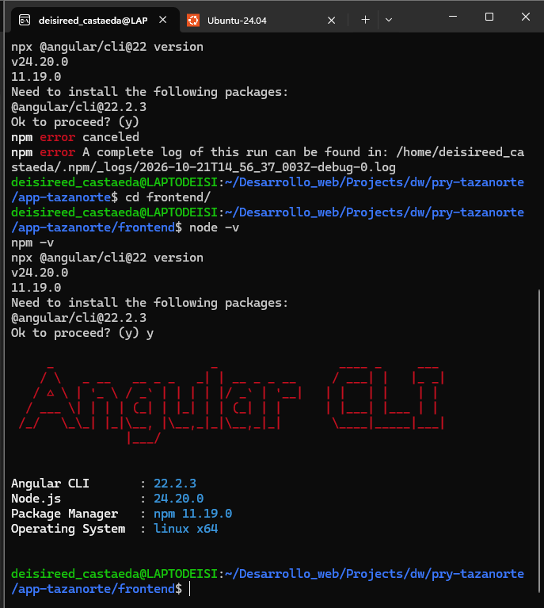{width="552"}

## 0.2 Backend en marcha

El frontend **no funciona solo**: consume la API en `http://localhost:4000/api`. Levanta el backend **correcto**:

```         

npm run dev
```

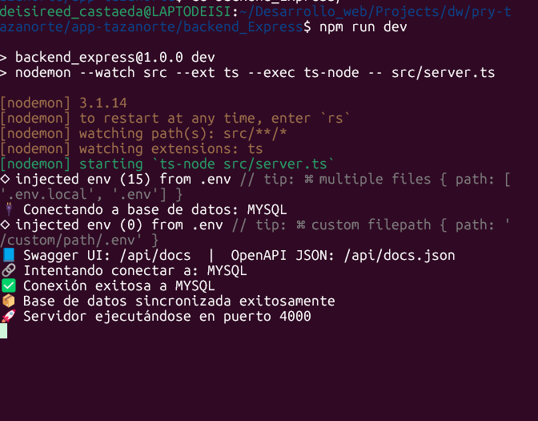

## 0.3 Login y permisos

El login del backend devuelve **solo el par de tokens**. El perfil y los permisos se piden aparte:

```         
# 1. Login (OPEN)
curl -s -X POST http://localhost:4000/api/sesion/login \
  -H "Content-Type: application/json" \
  -d '{"identifier":"admin","password":"Admin123!"}'
```

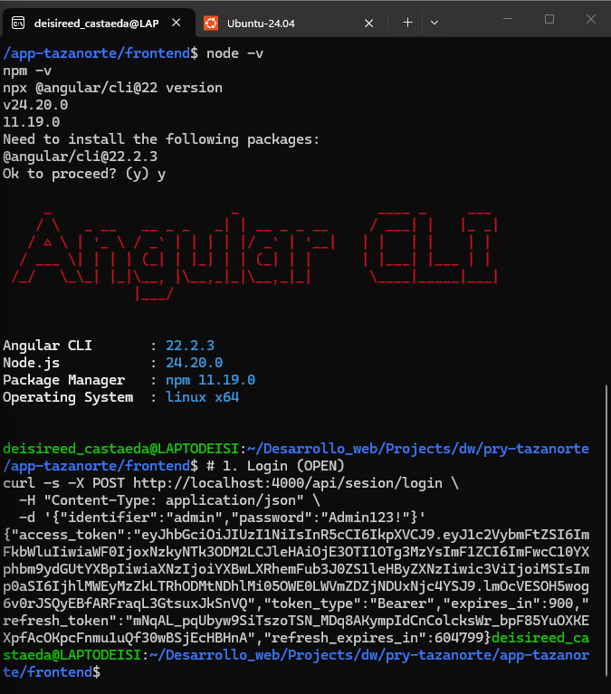

```         
# 2. Perfil (JWT)
curl -s http://localhost:4000/api/sesion/perfil \
  -H "Authorization: Bearer $TOKEN"
```

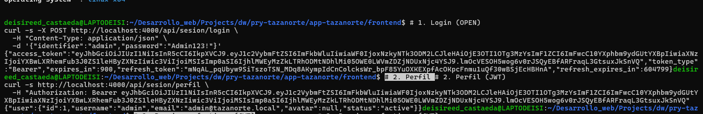

```         
# 3. Permisos efectivos (JWT)
curl -s http://localhost:4000/api/permisos \
  -H "Authorization: Bearer $TOKEN"
```

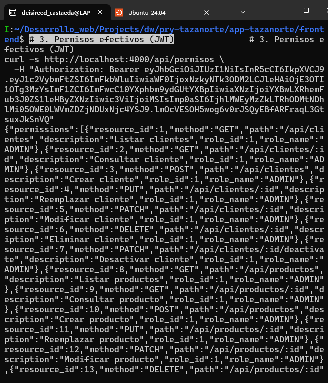

## Comprobación final

```         
# 1. Versiones
node -v && npm -v && npx @angular/cli@22 version

# 2. Backend vivo
curl -s -o /dev/null -w "HTTP %{http_code}\n" http://localhost:4000/api/clientes

# 3. Login + permisos
TOKEN=$(curl -s -X POST http://localhost:4000/api/sesion/login \
  -H "Content-Type: application/json" \
  -d '{"identifier":"admin","password":"Admin123!"}' \
  | grep -o '"access_token":"[^"]*' | cut -d'"' -f4)

curl -s http://localhost:4000/api/permisos \
  -H "Authorization: Bearer $TOKEN" | head -c 300
```

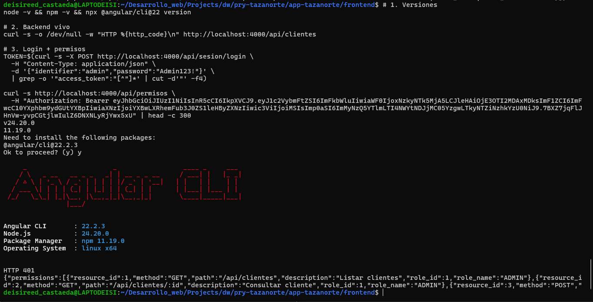

# 

# ISS-01 · Bootstrap Angular 22 con CLI, Tailwind y PrimeNG

# 

## Objetivo

Crear el proyecto Angular 22 **sin una carpeta adicional**, integrar Tailwind CSS 4, instalar PrimeNG 22 y dejar el tema Aura funcionando. Al final, `ng serve` debe mostrar la pantalla inicial sin errores.

## 1.1 Crear el proyecto en la carpeta actual

```         
 npx @angular/cli@22 new front-storelab-express-ii \   --directory . \   --style=tailwind \   --ssr=false \   --routing \   --zoneless \   --skip-git \   --package-manager=npm 
```

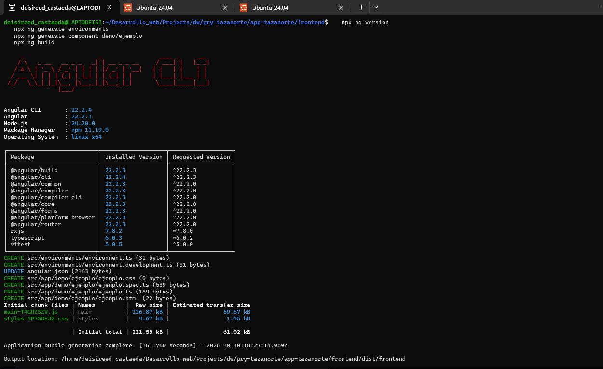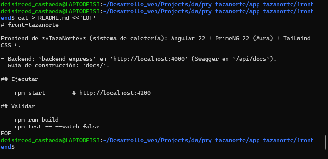

## .2 Instalar PrimeNG compatible con Angular

Consulta primero las peer dependencies:

```         
ng version npm view primeng version peerDependencies --json npm install primeng @primeuix/themes primeicons @angular/cdk 
```

Verifica versiones:

```         
npm ls primeng @primeuix/themes primeicons @angular/cdk --depth=0 
```

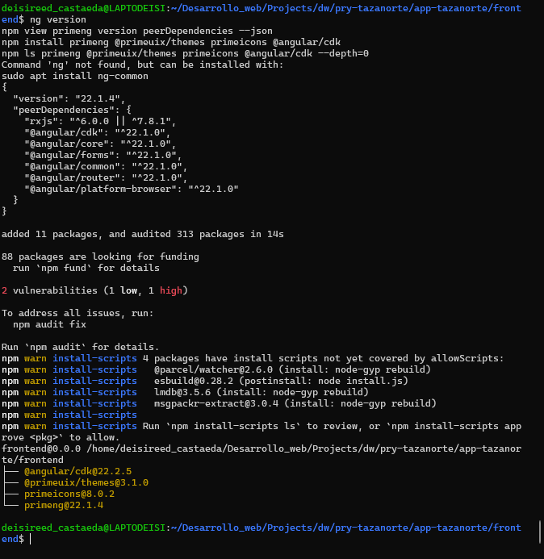

## 1.3 Estilos globales

Crea/reemplaza `src/styles.css`:

```         
cat > src/styles.css <<'EOF' @layer theme, base, primeng, utilities; @import 'tailwindcss'; @import 'primeicons/primeicons.css'; EOF 
```

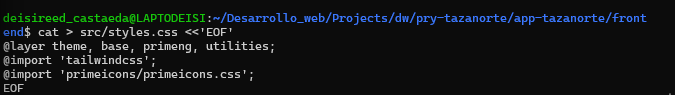

## 1.4 Configurar PrimeNG en `app.config.ts`

Reemplaza `src/app/app.config.ts`:

```         
cat > src/app/app.config.ts <<'EOF' import {   ApplicationConfig,   provideBrowserGlobalErrorListeners, } from '@angular/core'; import {   provideRouter,   withComponentInputBinding,   withInMemoryScrolling, } from '@angular/router'; import { ConfirmationService, MessageService } from 'primeng/api'; import { providePrimeNG } from 'primeng/config'; import Aura from '@primeuix/themes/aura'; import { environment } from '../environments/environment';  import { routes } from './app.routes';  export const appConfig: ApplicationConfig = {   providers: [     provideBrowserGlobalErrorListeners(),      provideRouter(       routes,       withComponentInputBinding(),       withInMemoryScrolling({ scrollPositionRestoration: 'top' }),     ),      // PrimeNG 22: tema Aura. El modo oscuro se activa con la clase .app-dark.     providePrimeNG({       license: environment.primeUiLicense || undefined,       ripple: true,       inputVariant: 'outlined',       theme: {         preset: Aura,         options: {           darkModeSelector: '.app-dark',           cssLayer: { name: 'primeng', order: 'theme, base, primeng, utilities' },         },       },     }),      MessageService,     ConfirmationService,   ], }; EOF
```

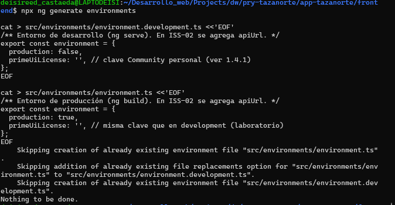

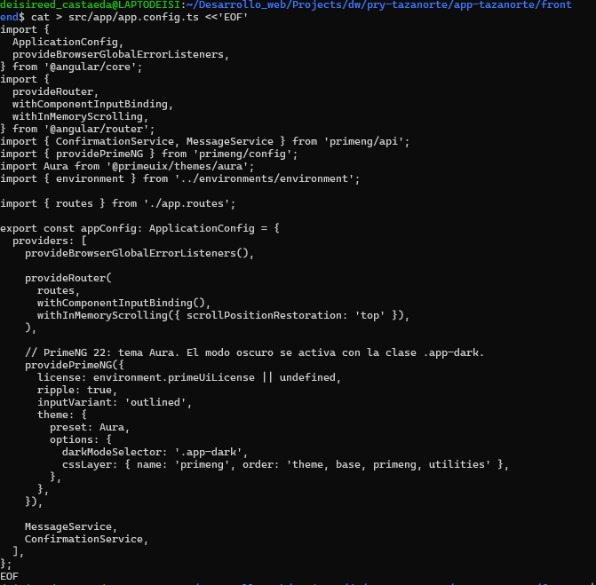

## 1.5 Pantalla de arranque: `App` compone el componente `demo/ejemplo`

**`src/app/app.ts`**

```         
cat > src/app/app.ts <<'EOF' import { Component } from '@angular/core'; import { Ejemplo } from './demo/ejemplo/ejemplo';  /**  * Componente principal (`<app-root>`).  *  * Es el primero que Angular dibuja. En ISS-01 solo compone el componente de  * ejemplo, para que se vea en pantalla con una etiqueta. Las rutas llegan en  * ISS-01B, cuando existe una pantalla de negocio que mostrar.  */ @Component({   host: { class: 'block' },   selector: 'app-root',   imports: [Ejemplo],   templateUrl: './app.html',   styleUrl: './app.css', }) export class App {} EOF
```

**`src/app/app.html`**

```         
cat > src/app/app.html <<'EOF' <!-- Marco de la aplicación: fondo, ancho máximo y padding con utilidades Tailwind. --> <main class="min-h-dvh bg-slate-50 p-6 text-slate-900">   <div class="mx-auto w-full max-w-4xl">     <!-- Composición: una etiqueta en la plantilla pinta el componente Ejemplo. -->     <app-ejemplo />   </div> </main> EOF
```

**`src/app/app.routes.ts`**

```         
cat > src/app/app.routes.ts <<'EOF' import { Routes } from '@angular/router';  /**  * Rutas de la aplicación.  *  * Vacío a propósito: en ISS-01 la pantalla se compone con etiquetas en `app.html`  * (`<app-ejemplo />`). El router se presenta en ISS-01B, con una pantalla real.  */ export const routes: Routes = []; EOF
```

**`src/app/app.css`**

```         
cat > src/app/app.css <<'EOF' /*  * Estilos propios del componente App.  *  * Queda VACÍO a propósito: el aspecto se resuelve con utilidades Tailwind en el  * HTML y con el tema Aura de PrimeNG (PATRON-VISUAL). Angular mantiene el archivo  * porque `styleUrl` lo referencia y solo afecta a `<app-root>`.  */ EOF
```

import { TestBed } from '\@angular/core/testing'; import { App } from './app';

describe('App', () =\> { beforeEach(async () =\> { await TestBed.configureTestingModule({ imports: [App], }).compileComponents(); });

it('should create the app', () =\> { const fixture = TestBed.createComponent(App); expect(fixture.componentInstance).toBeTruthy(); });

it('should render the example component', async () =\> { const fixture = TestBed.createComponent(App); await fixture.whenStable(); const compiled = fixture.nativeElement as HTMLElement; expect(compiled.querySelector('app-ejemplo')).toBeTruthy(); });

it('should show the product loaded by the example component', async () =\> { const fixture = TestBed.createComponent(App); await fixture.whenStable(); const compiled = fixture.nativeElement as HTMLElement; expect(compiled.textContent).toContain('Café molido 500 g'); }); });

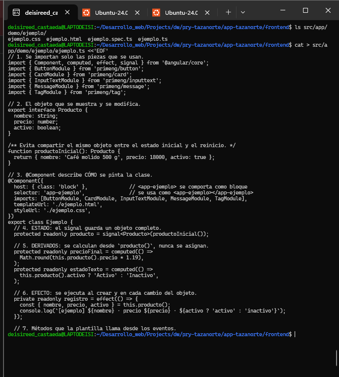

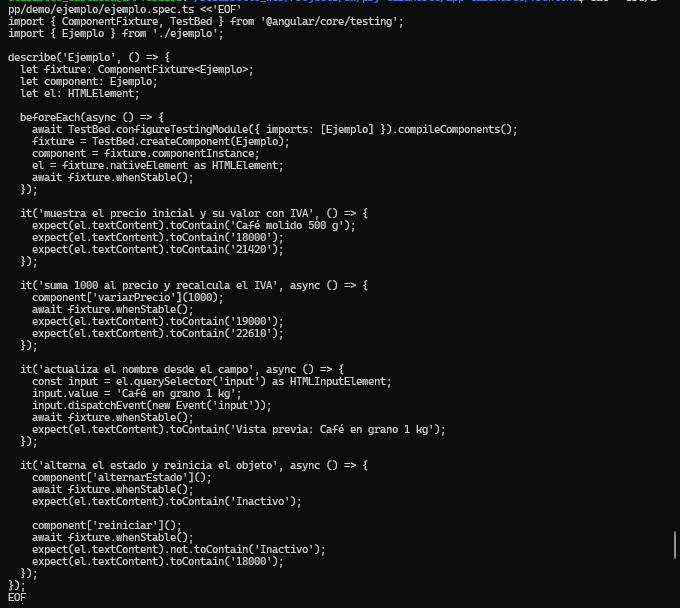

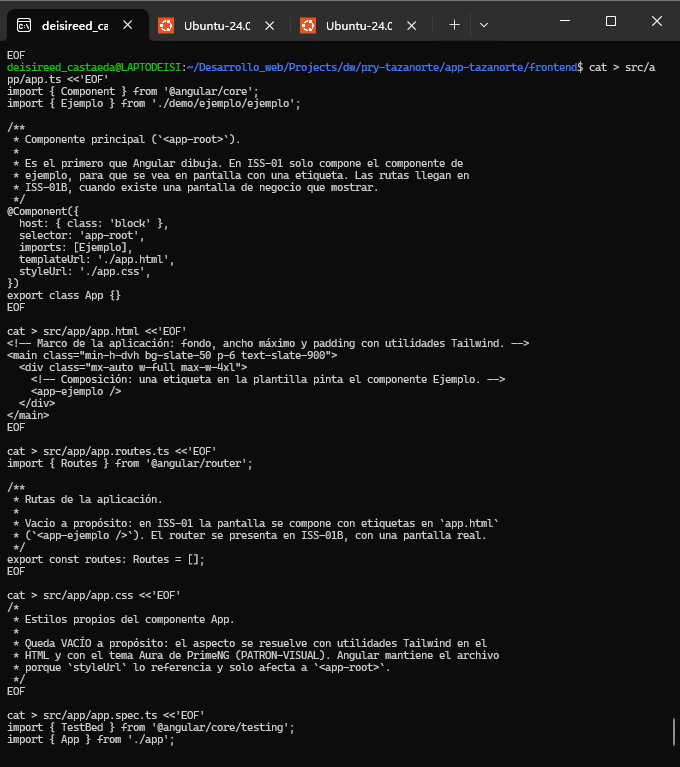

## 1.6 Personalizar `index.html`

cat \> src/index.html \<\<'EOF' \<!doctype html\> \<html lang="es"\> \<head\> \<meta charset="utf-8"\> \<title\>StoreLab Express II · Angular 22\</title\> \<base href="/"\> \<meta name="viewport" content="width=device-width, initial-scale=1"\> \<meta name="description" content="Frontend Angular 22 con Signals, PrimeNG y Tailwind para StoreLab Express."\> \<link rel="icon" type="image/x-icon" href="favicon.ico"\> \</head\> \<body class="m-0 bg-slate-100 font-sans text-slate-900"\> \<app-root\>\</app-root\> \</body\> \</html\> EOF

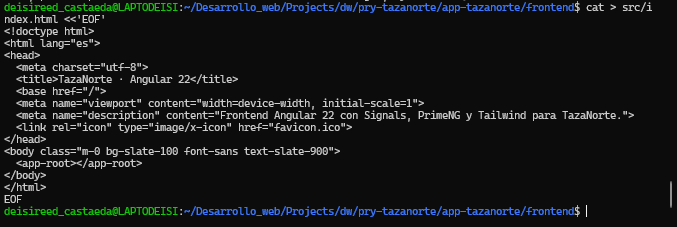

# 1.7 Ajuste de presupuesto

El bundle inicial con PrimeNG supera los 500 kB por defecto. En `angular.json`, dentro de `projects → ... → architect → build → configurations → production → budgets`, **cambia** el primer presupuesto:

```         
{   "type": "initial",   "maximumWarning": "750kB",   "maximumError": "1MB" }
```

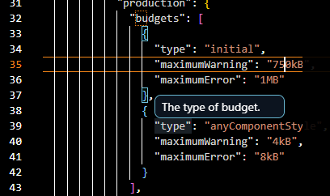

## 1.8 Primera ejecución

npm start

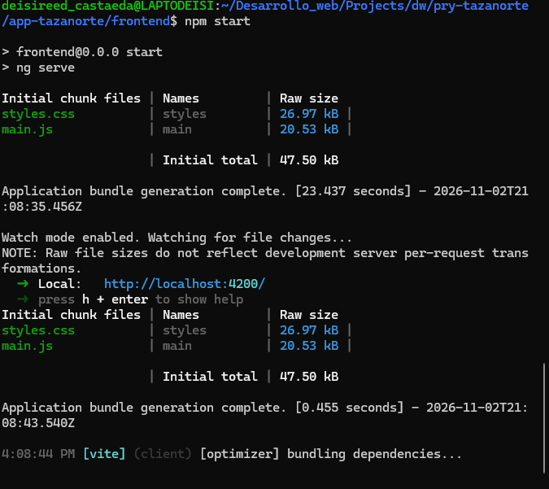

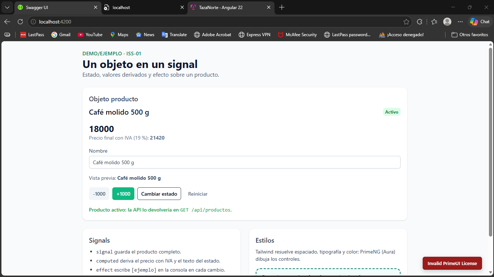

## 1.9 Anatomía del componente `demo/ejemplo` y signals

```         
src/app/demo/ejemplo/ ├── ejemplo.ts       ← la clase: estado, derivados, efecto y métodos ├── ejemplo.html     ← la plantilla: tarjetas, campos y botones ├── ejemplo.css      ← la excepción: una clase para explicar el aislamiento └── ejemplo.spec.ts  ← la prueba: crea el componente y comprueba el cambio de estado 
```

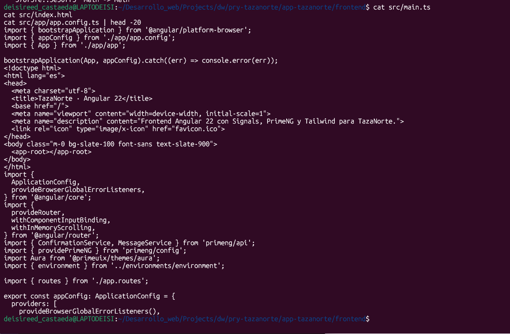

### 1.9.1 De `index.html` a la pantalla

```         
index.html    └─ <app-root></app-root>                  ← el HTML solo tiene esta etiqueta          │          ├─ src/main.ts                      bootstrapApplication(App, appConfig)          ├─ src/app/app.config.ts            providers globales (router, PrimeNG, …)          └─ src/app/app.ts                    clase App + @Component(...)                ├─ app.html                    plantilla: <main> + <app-ejemplo />                ├─ app.css                     estilos propios (vacío)                ├─ app.spec.ts                 pruebas de App                └─ app.routes.ts               rutas (vacío en ISS-01)                      │                      │  <app-ejemplo />  ← la etiqueta de app.html encuentra este componente                      ▼                src/app/demo/ejemplo/                      ├─ ejemplo.ts            clase Ejemplo + @Component(...)                      ├─ ejemplo.html          plantilla: las tres tarjetas                      ├─ ejemplo.css           una clase de demostración                      └─ ejemplo.spec.ts       4 pruebas 
```


### 1.9.2 Los cuatro archivos de un componente

```         
src/app/demo/ejemplo/ ├── ejemplo.ts        ← la clase (estado y lógica) + @Component(...) ├── ejemplo.html      ← la plantilla (lo que se ve) ├── ejemplo.css       ← los estilos de ESTE componente └── ejemplo.spec.ts   ← la prueba 
```

```         
@Component({   host: { class: 'block' },              // clases del elemento anfitrión <app-ejemplo>   selector: 'app-ejemplo',               // etiqueta HTML que lo representa   imports: [ButtonModule, CardModule, InputTextModule, MessageModule, TagModule],   templateUrl: './ejemplo.html',         // vista externa   styleUrl: './ejemplo.css',             // estilos externos }) export class Ejemplo {} 
```

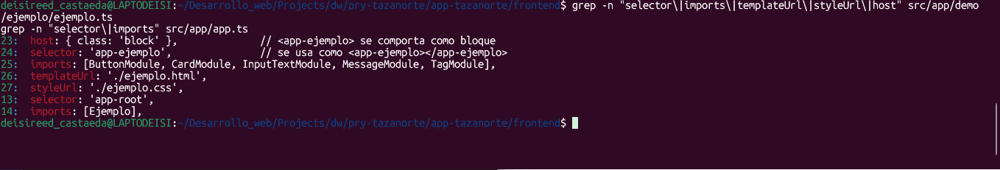

### 1.9.3 Leer `ejemplo.ts` línea a línea

```         
// 1. Se importan solo las piezas que se usan. import { Component, computed, effect, signal } from '@angular/core'; import { ButtonModule } from 'primeng/button'; import { CardModule } from 'primeng/card'; import { InputTextModule } from 'primeng/inputtext'; import { MessageModule } from 'primeng/message'; import { TagModule } from 'primeng/tag';  // 2. El objeto que se muestra y se modifica. export interface Producto {   nombre: string;   precio: number;   activo: boolean; }  // 3. @Component describe CÓMO se pinta la clase. @Component({   host: { class: 'block' },              // <app-ejemplo> se comporta como bloque   selector: 'app-ejemplo',               // se usa como <app-ejemplo></app-ejemplo>   imports: [ButtonModule, CardModule, InputTextModule, MessageModule, TagModule],   templateUrl: './ejemplo.html',   styleUrl: './ejemplo.css', }) export class Ejemplo {   // 4. ESTADO: el signal guarda un objeto completo.   protected readonly producto = signal<Producto>(productoInicial());    // 5. DERIVADOS: se calculan desde `producto()`, nunca se asignan.   protected readonly precioFinal = computed(() =>     Math.round(this.producto().precio * 1.19),   );   protected readonly estadoTexto = computed(() =>     this.producto().activo ? 'Activo' : 'Inactivo',   );    // 6. EFECTO: se ejecuta al crear y en cada cambio del objeto.   private readonly registro = effect(() => {     const { nombre, precio, activo } = this.producto();     console.log(`[ejemplo] ${nombre} · precio ${precio} · ${activo ? 'activo' : 'inactivo'}`);   });    // 7. Métodos que la plantilla llama desde los eventos.   protected cambiarNombre(event: Event): void {     const nombre = (event.target as HTMLInputElement).value;     this.producto.update((actual) => ({ ...actual, nombre }));   }    protected variarPrecio(delta: number): void {     this.producto.update((actual) => ({       ...actual,       precio: Math.max(0, actual.precio + delta),     }));   }    protected alternarEstado(): void {     this.producto.update((actual) => ({ ...actual, activo: !actual.activo }));   }    protected reiniciar(): void {     this.producto.set(productoInicial());   } } 
```

### 1.9.4 Las cuatro formas de conectar la clase con el HTML

```         
@if (producto().activo) {   <p-message severity="success" variant="simple">     Producto activo: la API lo devolvería en <code>GET /api/productos</code>.   </p-message> } @else {   <p-message severity="warn" variant="simple">     Producto inactivo: el borrado lógico lo oculta de las listas.   </p-message> }  <!-- El mismo bloque aplica a una lista del negocio. --> @if (clients().length === 0) {   <p>No hay clientes activos.</p> } @else {   <ul>     @for (client of clients(); track client.id) {       <li>{{ client.name }}</li>     }   </ul> } 
```

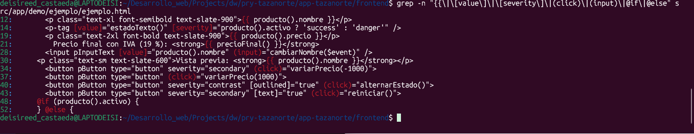

### 1.9.5 Signals: el estado que avisa a la vista

**Dónde está en `Ejemplo`.** El estado es un objeto `Producto`; la plantilla lee sus campos y los botones lo cambian:

```         
// ejemplo.ts — declaración y cambios del estado protected readonly producto = signal<Producto>(productoInicial());  protected variarPrecio(delta: number): void {   this.producto.update((actual) => ({     ...actual,                              // conserva nombre y activo     precio: Math.max(0, actual.precio + delta),   })); }  protected reiniciar(): void {   this.producto.set(productoInicial());     // valor nuevo, no depende del anterior } 
```

```         
<!-- ejemplo.html — lectura del signal: siempre con paréntesis --> <p class="text-2xl font-bold text-slate-900">{{ producto().precio }}</p> <p class="text-sm text-slate-500">   Precio final con IVA (19 %): <strong>{{ precioFinal() }}</strong> </p> <p-tag [value]="estadoTexto()" [severity]="producto().activo ? 'success' : 'danger'" /> 
```

#### 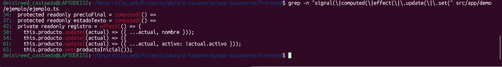

#### **Actualizar un objeto dentro de un signal**

Este es el punto que más se equivoca al empezar. Un signal compara **referencias**, no campos: si se modifica el objeto en el sitio, el signal sigue apuntando al mismo objeto y la vista **no se entera**.

```         
// MAL: muta el objeto y conserva la misma referencia. const actual = this.producto(); actual.precio = actual.precio + 1000;   // el signal no notifica: nadie llamó a set/update  // BIEN: crea un objeto nuevo y entrégaselo al signal. this.producto.update((actual) => ({ ...actual, precio: actual.precio + 1000 })); 
```

```         
// MAL: muta el objeto y conserva la misma referencia. const actual = this.producto(); actual.precio = actual.precio + 1000;   // el signal no notifica: nadie llamó a set/update  // BIEN: crea un objeto nuevo y entrégaselo al signal. this.producto.update((actual) => ({ ...actual, precio: actual.precio + 1000 })); 
```

### 1.9.6 `computed` y `effect`: derivar y reaccionar

```         
// ejemplo.ts — dos valores derivados y un efecto secundario protected readonly precioFinal = computed(() =>   Math.round(this.producto().precio * 1.19), );  protected readonly estadoTexto = computed(() =>   this.producto().activo ? 'Activo' : 'Inactivo', );  private readonly registro = effect(() => {   const { nombre, precio, activo } = this.producto();   console.log(`[ejemplo] ${nombre} · precio ${precio} · ${activo ? 'activo' : 'inactivo'}`); }); 
```

```         
<!-- ejemplo.html — los derivados se leen igual que un signal --> <p class="text-sm text-slate-500">   Precio final con IVA (19 %): <strong>{{ precioFinal() }}</strong> </p> <p-tag [value]="estadoTexto()" [severity]="producto().activo ? 'success' : 'danger'" /> 
```

### 1.9.7 Zoneless: por qué la vista se actualiza sin `Zone.js`

### 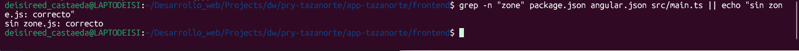1.9.8 Estilos globales y estilos del componente

```         
/* src/app/demo/ejemplo/ejemplo.css — únicamente demostrativo. */ .ejemplo-alcance {   border: 2px dashed #0f766e;   border-radius: 0.75rem;   padding: 0.75rem 1rem;   background-color: #f0fdfa; } 
```

```         
<!-- La misma caja, con el resto del contenido en Tailwind. --> <div class="ejemplo-alcance mt-4 text-sm text-slate-700">…</div> 
```

```         
<div class="ejemplo-alcance mt-4 …" _ngcontent-ng-c4132172110>…</div> 
```

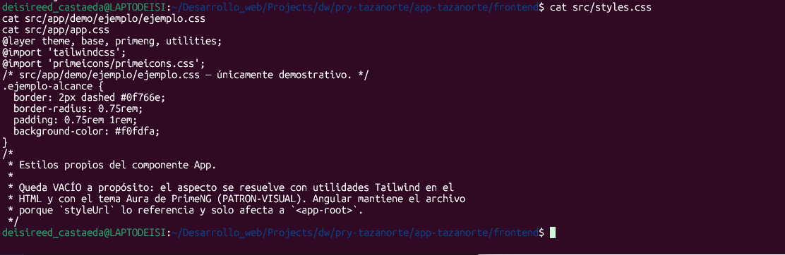

### 1.9.9 Verificación 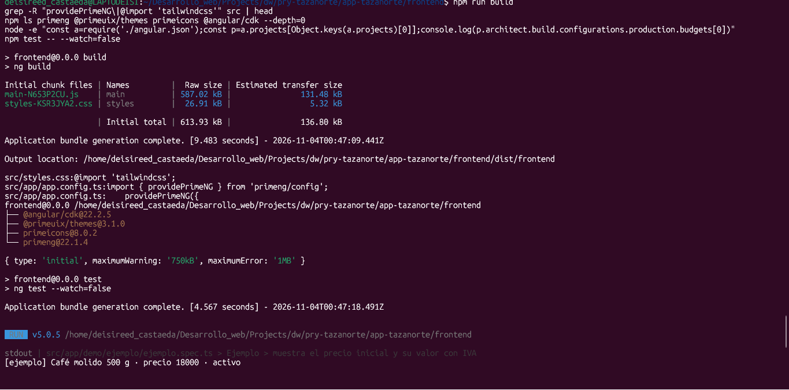

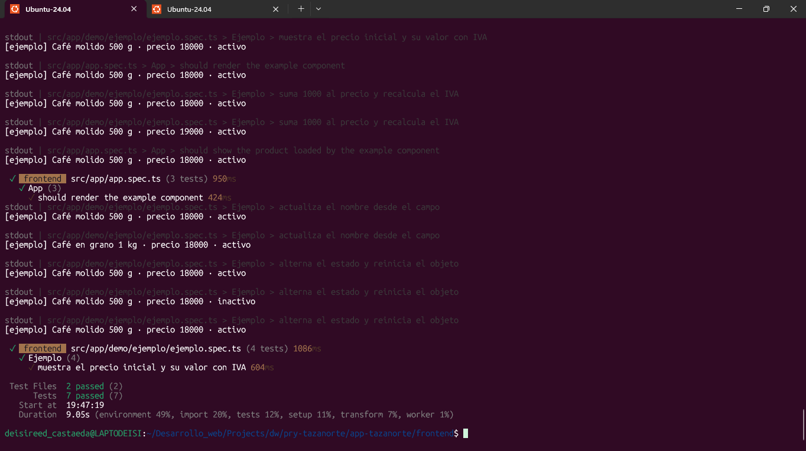

# Fase I: Frontend — ISS-01A — Esqueleto Header / Aside / contenido / Footer

## 1.1 Qué es un componente y por qué el padre debe importarlo

Un componente reúne una clase TypeScript (datos y lógica), una plantilla HTML (lo que se ve) y un archivo de estilos. `@Component` relaciona esos archivos:

**Regla que resuelve el error más común:** un componente generado existe, pero **no se ve** hasta que otro componente lo declara en su `imports` y escribe su etiqueta en su plantilla. Son dos pasos, no uno:

```         
// app.ts — paso 1: declarar el componente para que la plantilla lo reconozca imports: [Header, Aside, Footer], 
```

```         
<!-- app.html — paso 2: usar su selector como etiqueta --> <app-header /> 
```

## 1.2 Generar las tres piezas de `layout/`

```         
ng generate component layout/header --skip-tests --defaults ng generate component layout/aside --skip-tests --defaults ng generate component layout/footer --skip-tests --defaults 
```

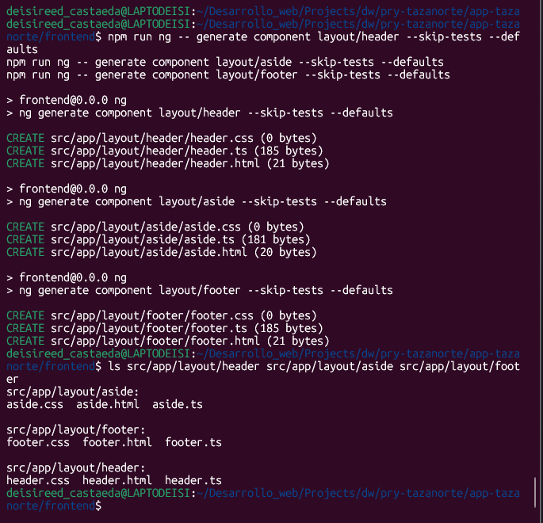

## 1.3 Contenido de cada componente

### Header

`src/app/layout/header/header.ts`

```         
import { Component } from '@angular/core';  /**  * Barra superior de la aplicación.  *  * ISS-01A: solo muestra el nombre. En ISS-01B recibe datos por `input()`, emite  * `menuRequested` y añade el menú de usuario. No consulta la API.  */ @Component({   host: { class: 'block' },   selector: 'app-header',   templateUrl: './header.html',   styleUrl: './header.css', }) export class Header {   readonly title = 'StoreLab Express II'; } 
```

`src/app/layout/header/header.html`

```         
<header   class="flex h-16 items-center border-b border-slate-200 bg-white px-6 font-semibold" >   <!-- Interpolación: `title` es una propiedad de la clase Header. -->   <p class="truncate text-sm font-semibold text-slate-900">{{ title }}</p> </header> 
```

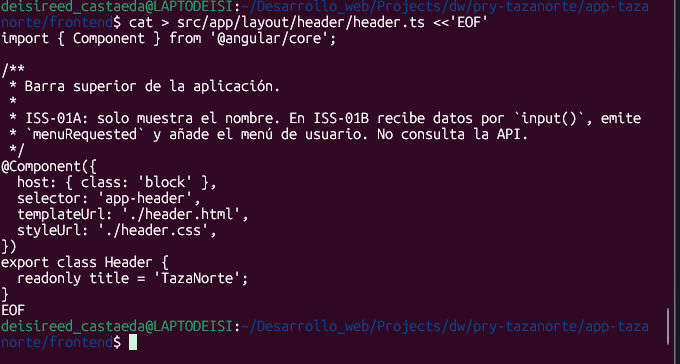

### Aside

`src/app/layout/aside/aside.ts`

```         
import { Component } from '@angular/core';  /**  * Menú lateral de la aplicación.  *  * ISS-01A: solo el contenedor. En ISS-01B recibe `items` por `input()` y pinta  * `p-panelmenu`. No conoce rutas ni permisos: eso llega en ISS-02/ISS-08.  */ @Component({   host: { class: 'block h-full' },   selector: 'app-aside',   templateUrl: './aside.html',   styleUrl: './aside.css', }) export class Aside {} 
```

`src/app/layout/aside/aside.html`

```         
<nav aria-label="Navegación principal" class="h-full bg-slate-950 p-6 text-white">   <p class="text-xs font-medium uppercase tracking-wider text-slate-400">Navegación</p>   <p class="mt-2 text-sm">Menú de StoreLab</p>   <p class="mt-4 text-xs text-slate-400">     En ISS-01B este bloque pasa a ser un <code>p-panelmenu</code>.   </p> </nav> 
```

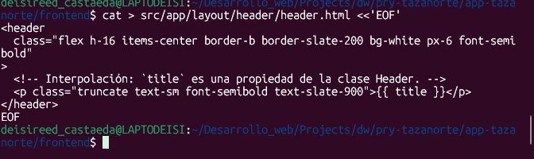

### Footer

`src/app/layout/footer/footer.ts`

```         
import { Component } from '@angular/core';  /**  * Pie de página de la aplicación.  *  * Presentación pura: no tiene estado ni depende de servicios.  */ @Component({   host: { class: 'block' },   selector: 'app-footer',   templateUrl: './footer.html',   styleUrl: './footer.css', }) export class Footer {} 
```

`src/app/layout/footer/footer.html`

```         
<footer   class="border-t border-slate-200 bg-white px-4 py-4 text-center text-xs text-slate-500 sm:px-6" >   StoreLab · Gestión de clientes, productos y ventas </footer> 
```

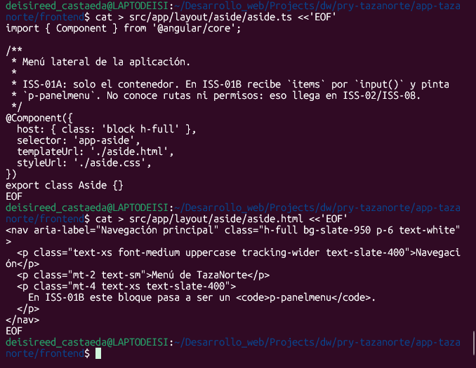

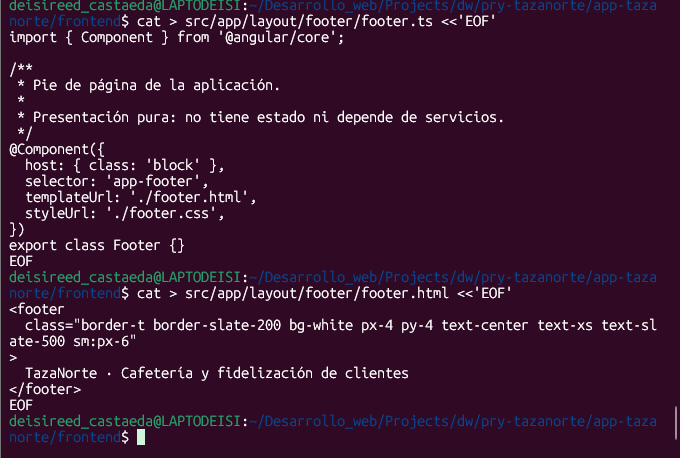

### Los tres `.css`

```         
/*  * Estilos del Header.  *  * Vacío a propósito: la apariencia se resuelve con utilidades Tailwind en  * `header.html` y con el tema Aura de PrimeNG (PATRON-VISUAL).  */ 
```

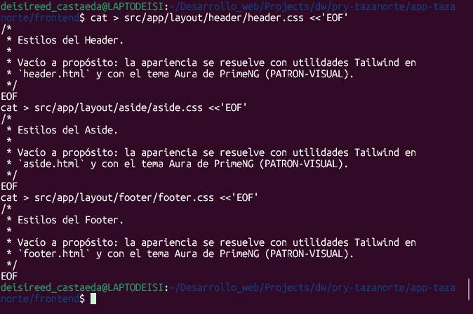

## 1.4 Componer las cuatro regiones en `App`

`src/app/app.ts`

```         
import { Component } from '@angular/core'; import { Header } from './layout/header/header'; import { Aside } from './layout/aside/aside'; import { Footer } from './layout/footer/footer';  /**  * Componente principal (`<app-root>`).  *  * Es el primero que Angular dibuja. Compone las cuatro regiones de la pantalla:  * Header arriba, Aside a la izquierda, el contenido del centro y Footer abajo.  * El contenido del centro todavía es fijo; en ISS-01B pasa a cambiar con el menú  * y en ISS-02 llega el router.  */ @Component({   host: { class: 'block' },   selector: 'app-root',   imports: [Header, Aside, Footer],   templateUrl: './app.html',   styleUrl: './app.css', }) export class App {   /** Título de la pantalla inicial. En ISS-01B cambia al elegir el menú. */   protected readonly title = 'Inicio'; } 
```

`src/app/app.html`

```         
<!-- Contenedor de las cuatro regiones: Tailwind para el alto y la dirección. --> <div class="flex min-h-screen flex-col bg-slate-100">   <app-header />    <div class="flex flex-1">     <!-- Aside fijo de 16rem; en ISS-01B se oculta en pantallas pequeñas. -->     <aside class="w-64 shrink-0">       <app-aside />     </aside>      <!-- min-w-0 evita que un contenido ancho desborde el flex y cree scroll. -->     <main id="contenido" class="min-w-0 flex-1 p-6">       <h1 class="text-2xl font-semibold text-slate-900">{{ title }}</h1>       <p class="mt-2 text-slate-600">Bienvenido a StoreLab.</p>     </main>   </div>    <app-footer /> </div> 
```

### Prueba de la composición

`src/app/app.spec.ts` no busca el `<h1>` de la plantilla por defecto: comprueba las regiones y el texto inicial.

```         
import { TestBed } from '@angular/core/testing'; import { App } from './app';  describe('App', () => {   beforeEach(async () => {     await TestBed.configureTestingModule({       imports: [App],     }).compileComponents();   });    async function crearApp() {     const fixture = TestBed.createComponent(App);     await fixture.whenStable();     return fixture.nativeElement as HTMLElement;   }    it('should create the app', () => {     const fixture = TestBed.createComponent(App);     expect(fixture.componentInstance).toBeTruthy();   });    it('should compose the three layout regions', async () => {     const compilado = await crearApp();     expect(compilado.querySelector('app-header')).toBeTruthy();     expect(compilado.querySelector('aside app-aside')).toBeTruthy();     expect(compilado.querySelector('app-footer')).toBeTruthy();   });    it('should render the application name in the header', async () => {     const compilado = await crearApp();     const header = compilado.querySelector('app-header') as HTMLElement;     expect(header.textContent).toContain('StoreLab Express II');   });    it('should render the initial title in the content', async () => {     const compilado = await crearApp();     const main = compilado.querySelector('main') as HTMLElement;     expect(main.textContent).toContain('Inicio');     expect(main.textContent).toContain('Bienvenido a StoreLab.');   }); }); 
```

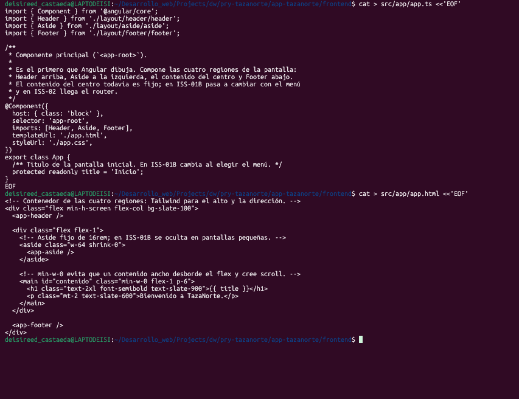

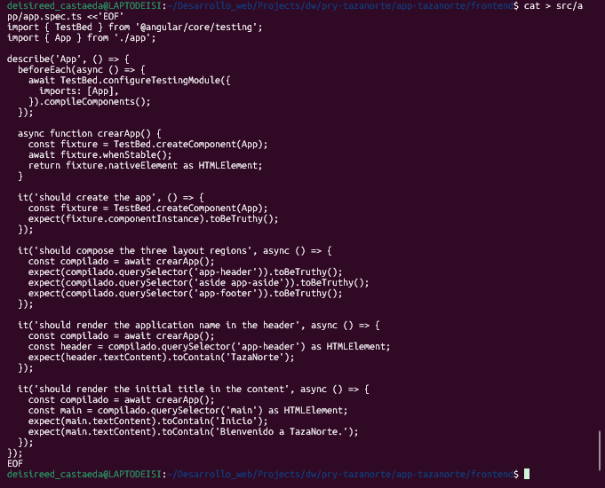


## 1.5 Comprobar antes de avanzar

```         
npm start 
```

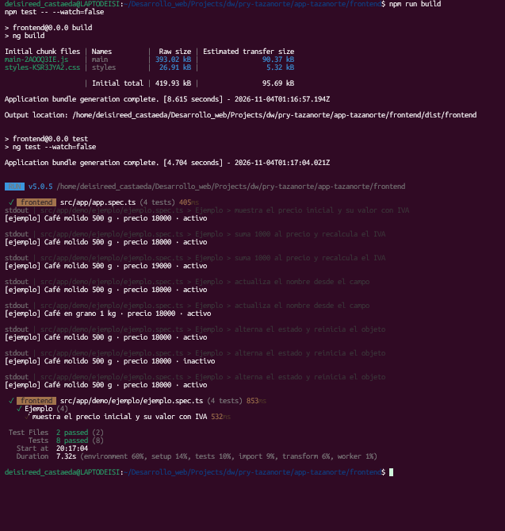

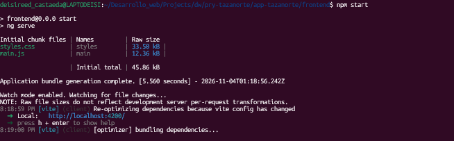

## Verificación del ISS

```         
# 1. Compila ng build  # 2. Existen las tres piezas con sus tres archivos ls src/app/layout/header src/app/layout/aside src/app/layout/footer  # 3. App declara los tres imports y compone las regiones grep -n "imports: \[Header, Aside, Footer\]" src/app/app.ts grep -n "app-header\|app-aside\|app-footer" src/app/app.html  # 4. demo/ejemplo ya no se compone grep -c "app-ejemplo" src/app/app.html || echo "no aparece: correcto"  # 5. Los CSS de layout no tienen reglas grep -v "^\s*$" src/app/layout/*/*.css | grep -v "^\S*: \*\|/\*\|^\S*:  \*" || echo "sin reglas: correcto"  # 6. Pruebas npm test -- --watch=false 
```

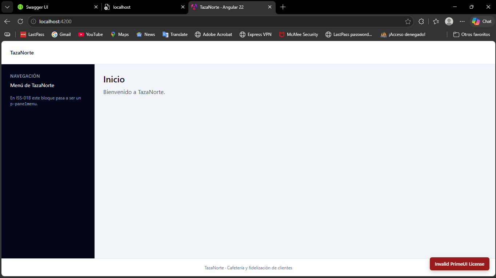

# Fase I: Frontend — ISS-01B — Menú PrimeNG y primera interacción

> 

**Objetivo:** pasar de una maqueta a una pantalla que responde. Al terminar: PanelMenu en el Aside, botón de menú en el Header, Drawer en pantalla pequeña y selección que cambia el contenido local. Sin rutas de negocio y sin API.

## 1.1 Los conceptos que se agregan, uno por vez

**Criterios de este sub-ítem**

**La frontera del ISS.** Los tres componentes de `layout/` son **presentación**: reciben datos y avisan. El único con estado es `Construir`. Esa separación es la que permite reutilizar el layout en ISS-02 sin duplicar Header, Aside ni Footer, y la que evita inyectar servicios de autenticación en componentes visuales.

## 1.2 El Aside recibe el menú con `input()`

`src/app/layout/aside/aside.ts`

```         
import { Component, input, output } from '@angular/core'; import { MenuItem } from 'primeng/api'; import { ButtonModule } from 'primeng/button'; import { PanelMenuModule } from 'primeng/panelmenu';  /**  * Menú lateral de la aplicación.  *  * Presentación pura: recibe el menú ya construido por `input()` y avisa de la  * navegación con `output()`. No conoce rutas, permisos ni la API.  */ @Component({   host: { class: 'block h-full' },   selector: 'app-aside',   imports: [ButtonModule, PanelMenuModule],   templateUrl: './aside.html',   styleUrl: './aside.css', }) export class Aside {   readonly appName = input('StoreLab Express II');    /** Opciones del menú, en el formato `MenuItem` de PrimeNG. */   readonly items = input<MenuItem[]>([]);    /** Datos de sesión con valores por defecto: ISS-08 los completa. */   readonly showSession = input(false);   readonly username = input('');   readonly roleLabel = input('Sin rol');   readonly permissionCount = input(0);    /** Aviso al padre: se seleccionó una opción (lo usa el Drawer en móvil). */   readonly navigated = output<void>();    /** Aviso al padre: se pidió cerrar sesión. */   readonly logoutRequested = output<void>();    /**    * Un clic dentro del menú puede caer en el propio ítem o en un hijo suyo.    * `closest` resuelve ambos casos con un solo listener en el `<nav>`.    */   onNavigationClick(event: Event): void {     if ((event.target as HTMLElement).closest('a, button, [role="button"]')) {       this.navigated.emit();     }   } } 
```

`src/app/layout/aside/aside.html`

```         
<div class="flex h-full flex-col border-r border-slate-200 bg-white text-slate-900">   <div class="flex h-16 items-center gap-3 border-b border-slate-200 px-5">          <div class="min-w-0">       <p class="truncate text-sm font-semibold text-slate-900">{{ appName() }}</p>       <p class="text-[11px] uppercase tracking-wider text-slate-400">         Panel administrativo       </p>     </div>   </div>    <div class="flex-1 overflow-y-auto p-3">     <nav aria-label="Navegación principal" (click)="onNavigationClick($event)">       <p-panelmenu [model]="items()" [multiple]="true" />     </nav>   </div>    @if (showSession()) {     <div class="border-t border-slate-200 p-4">       <p class="text-sm font-medium text-slate-900">{{ username() || 'Invitado' }}</p>       <p class="text-xs text-slate-400">{{ roleLabel() }}</p>       <div class="mt-3 flex items-center justify-between text-xs text-slate-400">         <span>{{ permissionCount() }} permisos</span>         <button           pButton           type="button"           text           rounded           aria-label="Cerrar sesión"           (click)="logoutRequested.emit()"         >           <i pButtonIcon class="pi pi-sign-out"></i>         </button>       </div>     </div>   } </div> 
```

`aria-label="Navegación principal"` nombra la región para lectores de pantalla y permite localizarla en las pruebas.

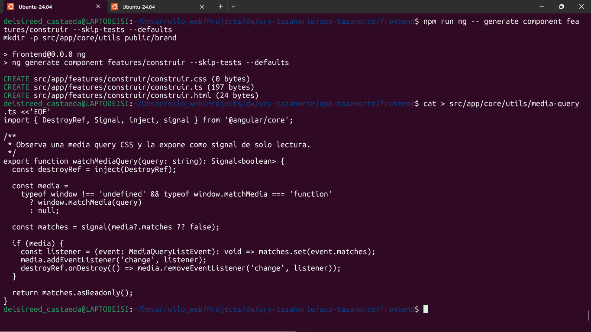

## 1.3 El Header avisa al padre con `output()`

`src/app/layout/header/header.ts`

```         
import { Component, input, output } from '@angular/core'; import { MenuItem } from 'primeng/api'; import { AvatarModule } from 'primeng/avatar'; import { ButtonModule } from 'primeng/button'; import { MenuModule } from 'primeng/menu'; import { TagModule } from 'primeng/tag';  /**  * Barra superior de la aplicación.  *  * Es presentación pura: recibe los datos por `input()` y avisa al padre con  * `output()`. No inyecta servicios, no consulta la API y no conoce permisos.  */ @Component({   host: { class: 'block' },   selector: 'app-header',   imports: [AvatarModule, ButtonModule, MenuModule, TagModule],   templateUrl: './header.html',   styleUrl: './header.css', }) export class Header {   /** Nombre visible de la aplicación. */   readonly appName = input('StoreLab Express II');    /** Datos de sesión con valores por defecto: ISS-08 los completa. */   readonly username = input('');   readonly initials = input('IN');   readonly roleLabel = input('Sin rol');   readonly authEnabled = input(true);   readonly showSession = input(false);   readonly userItems = input<MenuItem[]>([]);    /** Aviso al padre: el botón de menú se pulsó (solo visible en móvil). */   readonly menuRequested = output<void>(); } 
```

`src/app/layout/header/header.html`

```         
<header   class="sticky top-0 z-30 flex h-16 items-center gap-3 border-b border-slate-200 bg-white px-4 sm:px-6" >   <!-- Botón de menú: siempre visible; el padre decide qué hacer (aside fijo o Drawer). -->   <button     pButton     type="button"     text     rounded     aria-label="Mostrar u ocultar el menú"     (click)="menuRequested.emit()"   >     <i pButtonIcon class="pi pi-bars"></i>   </button>    <div class="min-w-0 flex-1">     <p class="truncate text-sm font-semibold text-slate-900">{{ appName() }}</p>     <p class="truncate text-xs text-slate-500">       Gestión de clientes, productos y ventas     </p>   </div>    @if (showSession() && !authEnabled()) {     <p-tag value="Fase I · sin auth" severity="warn" [rounded]="true" />   }   @if (username()) {     <p-tag       [value]="roleLabel()"       severity="info"       [rounded]="true"       class="hidden sm:inline-flex"     />   }    @if (showSession()) {     <button       pButton       type="button"       severity="secondary"       outlined       (click)="userMenuPanel.toggle($event)"       aria-label="Menú de usuario"     >       <p-avatar [label]="initials()" shape="circle" size="normal" />       <span class="hidden max-w-32 truncate text-sm font-medium text-slate-700 sm:block">         {{ username() }}       </span>       <i class="pi pi-chevron-down pr-1 text-[10px] text-slate-400"></i>     </button>     <p-menu #userMenuPanel [model]="userItems()" [popup]="true" appendTo="body" />   } </header> 
```

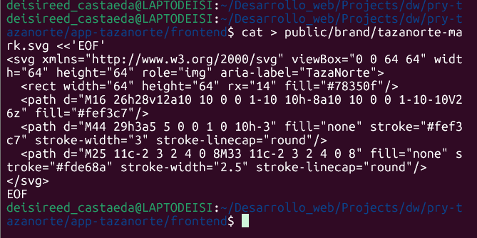

## 1.4 `features/construir`: estado local y Drawer móvil

```         
ng generate component features/construir --skip-tests --defaults 
```

El `--skip-tests` no es para evitar pruebas: la prueba de esta pantalla se escribe completa en este ISS (más abajo) y sustituye a la plantilla vacía del CLI.

`src/app/features/construir/construir.ts`

```         
import { Component, signal } from '@angular/core'; import { MenuItem } from 'primeng/api'; import { ButtonModule } from 'primeng/button'; import { CardModule } from 'primeng/card'; import { DrawerModule } from 'primeng/drawer'; import { watchMediaQuery } from '../../core/utils/media-query'; import { Aside } from '../../layout/aside/aside'; import { Footer } from '../../layout/footer/footer'; import { Header } from '../../layout/header/header';  /**  * Pantalla del prototipo.  *  * Es el único componente con estado en ISS-01B: guarda el título elegido y el  * estado del menú. El layout solo recibe datos por `input()`; así en ISS-02 se  * puede reutilizar sin duplicar Header, Aside ni Footer.  */ @Component({   host: { class: 'block' },   selector: 'app-construir',   imports: [Aside, ButtonModule, CardModule, DrawerModule, Footer, Header],   templateUrl: './construir.html',   styleUrl: './construir.css', }) export class Construir {   /** `lg` de Tailwind: desde aquí el Aside es fijo y el botón lo alterna. */   private readonly isDesktop = watchMediaQuery('(min-width: 1024px)');    /** Escritorio: el Aside fijo se oculta y el contenido se ensancha. */   readonly sidebarCollapsed = signal(false);    /** Móvil: el Drawer se abre desde el botón y se cierra al elegir una opción. */   readonly mobileOpen = signal(false);    /** Título del contenido. Cambia al elegir una opción del menú, sin HTTP. */   readonly title = signal('Inicio');    /**    * Menú en el formato `MenuItem` de PrimeNG.    *    * `command` ejecuta una función al elegir la opción. Todavía no navega: solo    * cambia el título. En ISS-02 cada comando apuntará a una ruta real.    */   readonly items: MenuItem[] = [     { label: 'Inicio', icon: 'pi pi-home', command: () => this.seleccionar('Inicio') },     { label: 'Clientes', icon: 'pi pi-users', command: () => this.seleccionar('Clientes') },     {       label: 'Tipos de producto',       icon: 'pi pi-tags',       command: () => this.seleccionar('Tipos de producto'),     },     { label: 'Productos', icon: 'pi pi-box', command: () => this.seleccionar('Productos') },     { label: 'Ventas', icon: 'pi pi-shopping-cart', command: () => this.seleccionar('Ventas') },   ];    /**    * Un solo botón, dos disposiciones: en escritorio alterna el Aside fijo; por    * debajo de `lg` abre el Drawer (donde el Aside fijo no cabe).    */   protected onMenuToggle(): void {     if (this.isDesktop()) {       this.sidebarCollapsed.update((collapsed) => !collapsed);       return;     }     this.mobileOpen.set(true);   }    /** Una sola puerta de entrada al estado: la usan los cinco comandos. */   protected seleccionar(titulo: string): void {     this.title.set(titulo);     this.mobileOpen.set(false);   } } 
```

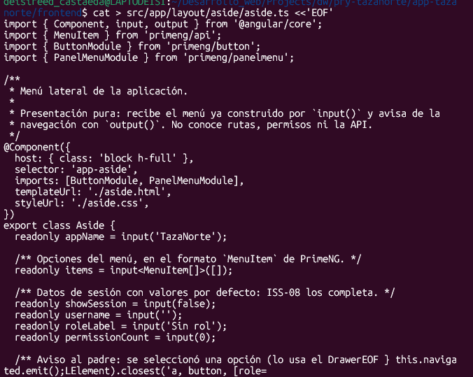

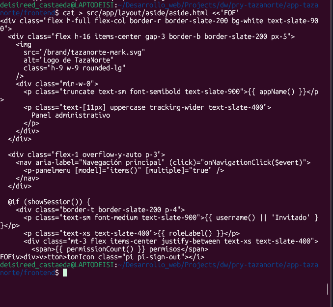

### El helper que decide el ancho

`src/app/core/utils/media-query.ts`

```         
import { DestroyRef, Signal, inject, signal } from '@angular/core';  /**  * Observa una media query CSS y la expone como signal de solo lectura.  */ export function watchMediaQuery(query: string): Signal<boolean> {   const destroyRef = inject(DestroyRef);    const media =     typeof window !== 'undefined' && typeof window.matchMedia === 'function'       ? window.matchMedia(query)       : null;    const matches = signal(media?.matches ?? false);    if (media) {     const listener = (event: MediaQueryListEvent): void => matches.set(event.matches);     media.addEventListener('change', listener);     destroyRef.onDestroy(() => media.removeEventListener('change', listener));   }    return matches.asReadonly(); } 
```

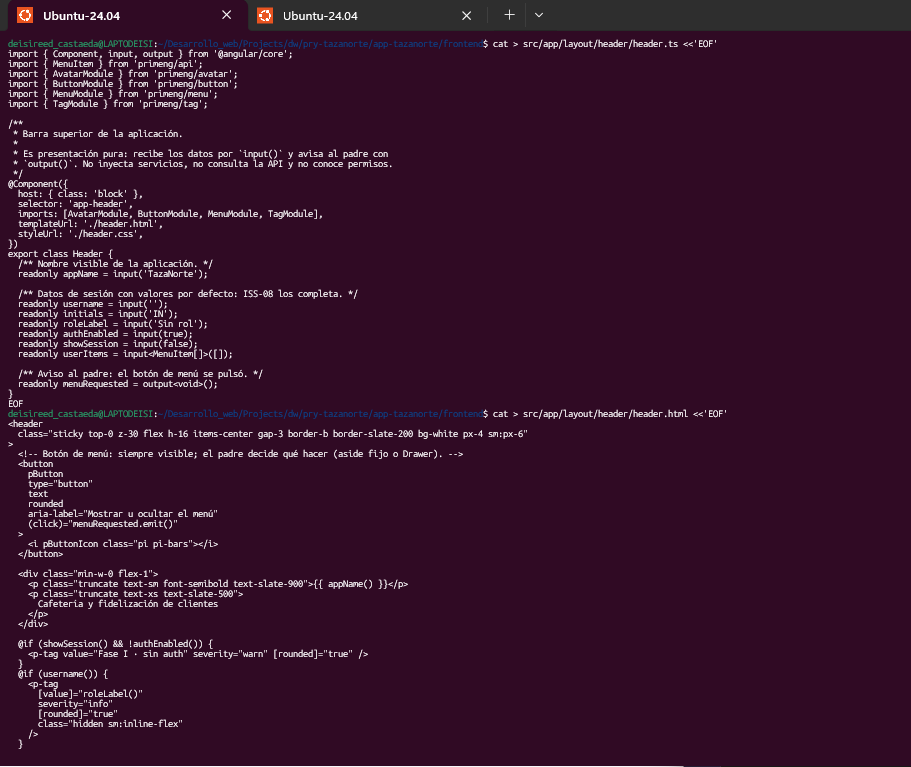

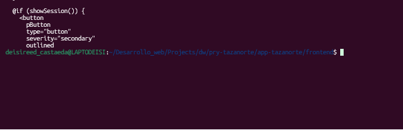

`src/app/features/construir/construir.html`

```         
<div class="flex min-h-screen flex-col bg-slate-100">   <app-header (menuRequested)="onMenuToggle()" />    <div class="flex flex-1">     <!--       Escritorio: Aside fijo que el botón del Header puede ocultar.       Por debajo de lg no se pinta: el menú vive en el Drawer.     -->     @if (!sidebarCollapsed()) {       <aside class="hidden w-72 shrink-0 lg:block">         <app-aside [items]="items" (navigated)="mobileOpen.set(false)" />       </aside>     }      <main id="contenido" class="min-w-0 flex-1 p-4 sm:p-6">       <p-card class="block">         <h1 class="text-2xl font-semibold text-slate-900">{{ title() }}</h1>         <p class="mt-3 text-slate-600">           Bienvenido a StoreLab. Elige una opción del menú para explorar la estructura.         </p>         <p class="mt-2 text-sm text-slate-500">           Esta primera pantalla usa datos locales. Los formularios y la conexión con           Express se incorporan después.         </p>       </p-card>     </main>   </div>    <app-footer /> </div>  <!-- Móvil: el mismo Aside, otra disposición. --> <p-drawer [(visible)]="mobileOpen" header="Menú" position="left" styleClass="w-72">   <app-aside [items]="items" (navigated)="mobileOpen.set(false)" /> </p-drawer> 
```

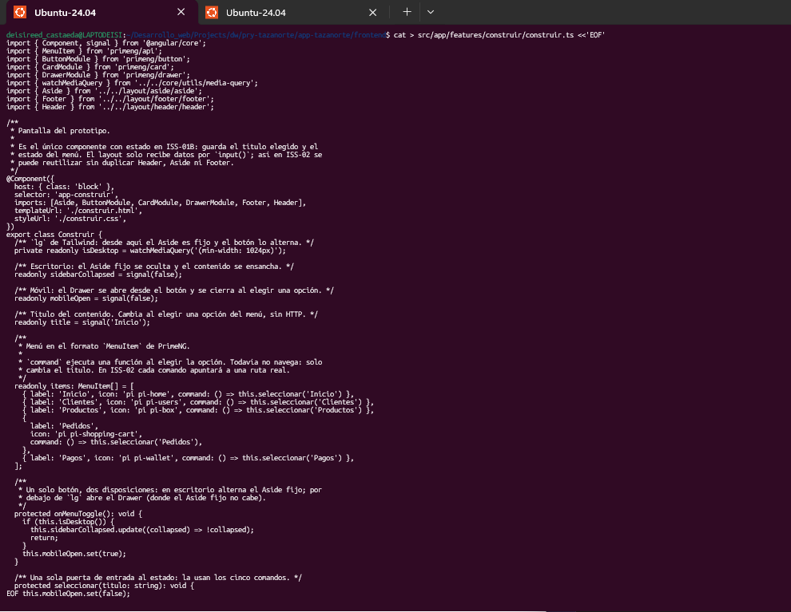

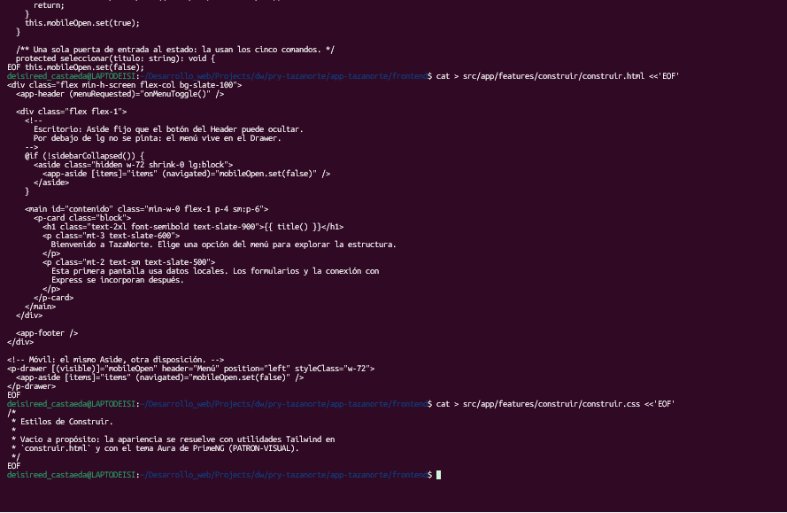

## 1.5 `App` pasa a ser punto de entrada con `router-outlet`

`src/app/app.ts`

```         
import { Component } from '@angular/core'; import { RouterOutlet } from '@angular/router';  /**  * Componente principal (`<app-root>`).  *  * Desde ISS-01B es solo el punto de entrada: el router elige qué componente se  * dibuja dentro de `<router-outlet />` según la URL.  */ @Component({   host: { class: 'block' },   selector: 'app-root',   imports: [RouterOutlet],   templateUrl: './app.html',   styleUrl: './app.css', }) export class App {} 
```

`src/app/app.html`

```         
<!-- El router dibuja aquí el componente de la ruta activa (app.routes.ts). --> <router-outlet /> 
```

`src/app/app.routes.ts`

```         
import { Routes } from '@angular/router';  /**  * Rutas de la aplicación.  *  * ISS-01B presenta el router con una pantalla real. `loadComponent` descarga  * `Construir` solo cuando se visita su URL: el bundle inicial no lo incluye.  */ export const routes: Routes = [   {     path: 'construir',     loadComponent: () =>       import('./features/construir/construir').then((m) => m.Construir),   },   { path: '', pathMatch: 'full', redirectTo: 'construir' },   { path: '**', redirectTo: 'construir' }, ]; 
```

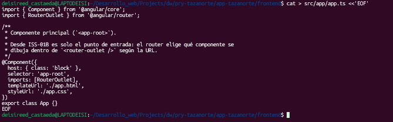

### Prueba del punto de entrada

`src/app/app.spec.ts`

```         
import { TestBed } from '@angular/core/testing'; import { provideRouter } from '@angular/router'; import { App } from './app';  describe('App', () => {   beforeEach(async () => {     await TestBed.configureTestingModule({       imports: [App],       // Sin rutas: esta prueba comprueba el punto de entrada, no las pantallas.       providers: [provideRouter([])],     }).compileComponents();   });    it('should create the app', () => {     const fixture = TestBed.createComponent(App);     expect(fixture.componentInstance).toBeTruthy();   });    it('should render the router outlet', async () => {     const fixture = TestBed.createComponent(App);     await fixture.whenStable();     const compilado = fixture.nativeElement as HTMLElement;     expect(compilado.querySelector('router-outlet')).toBeTruthy();   }); }); 
```

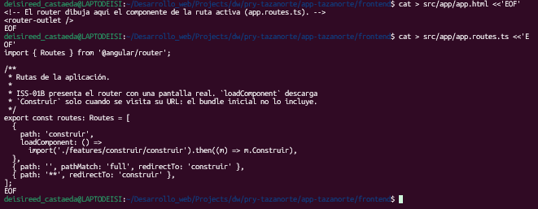

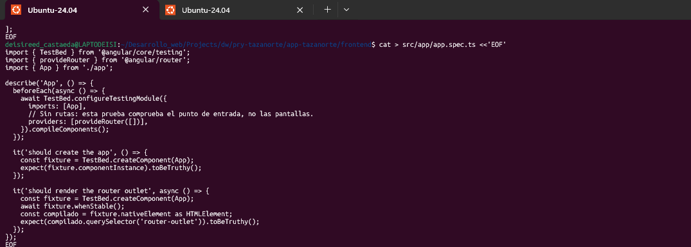

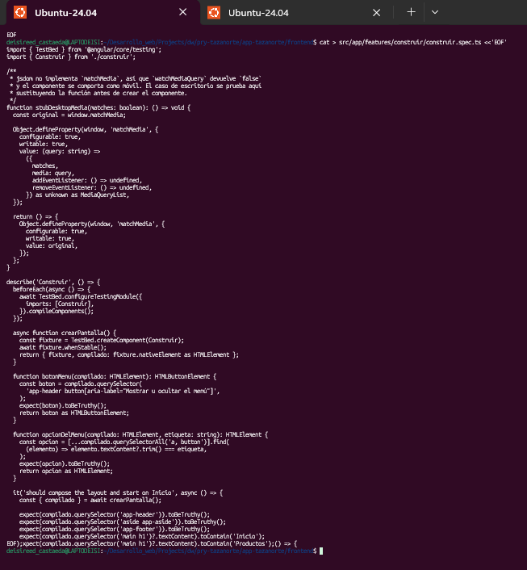

## 1.6 Comprobar antes de avanzar

```         
npm start 
```


# Fase I: Frontend — ISS-02 — Núcleo: environment, modelos, servicios y layout

## 2.1 `environment`: una sola URL para todo el frente

Crea los dos archivos y registra el reemplazo. Si ya existen, edítalos sin repetir el generador.

`src/environments/environment.ts` — lo usa `ng build`, es el **base**:

```         
/**  * Entorno de producción (`ng build`).  *  * `apiUrl` termina en `/api` SIN slash final: con uno, las llamadas saldrían  * como `//clientes` y Express las trataría como otra ruta.  *  * `requireAuth`: mitad frontal del interruptor de fases. Nadie lo lee hasta  * ISS-08 (Fase II). Se empareja con `AUTH_ENABLED` del backend: mover una sola  * mitad produce `401 Missing Bearer token` (ISS-11 §11.1).  *  * `primeUiLicense`: clave **Community** de PrimeUI (PrimeNG 22). Solicítala en  * https://primeui.dev · requisitos en https://primeui.dev/licenses. Déjala en `''`  * si aún no la tienes (aviso en consola; la app funciona). No subas claves  * comerciales al repo.  */ export const environment = {   production: true,   appName: 'StoreLab Express II',   apiUrl: 'http://localhost:4000/api',   requireAuth: true,   primeUiLicense: '', }; 
```

`src/environments/environment.development.ts` — lo usa `ng serve` y `npm test`:

```         
/**  * En el día a día del laboratorio es **este** archivo el que importa Angular  * (vía `fileReplacements`). Pega aquí la misma `primeUiLicense` que en producción.  */ export const environment = {   production: false,   appName: 'StoreLab Express II',   apiUrl: 'http://localhost:4000/api',   requireAuth: true,   primeUiLicense: '', }; 
```


### 2.1.1 Licencia PrimeUI (`primeUiLicense`)

Tras ISS-01, `app.config.ts` registra PrimeNG así:

```         
providePrimeNG({   license: environment.primeUiLicense || undefined,   // ... }); 
```

**Pasos:**

1.  Solicita la **Community License** (gratuita para estudiantes) en [https://primeui.dev](https://primeui.dev/).

2.  Copia la clave del correo (cadena larga, suele empezar por `eyJ…`).

3.  Pégala en `primeUiLicense` de **`environment.development.ts`** (para `ng serve`).

4.  Repite el mismo valor en **`environment.ts`** (para `ng build` / entrega).

5.  Reinicia `ng serve` y recarga el navegador: desaparecen `[PrimeUI] No license key configured` y la banda *Invalid PrimeUI License*.

Si trabajas sin clave, mantén `primeUiLicense: ''` y documenta el aviso en la evidencia (ISS-01 §1.4.1).

`angular.json` → `projects.<proyecto>.architect.build.configurations.development`:

```         
"development": {   "optimization": false,   "extractLicenses": false,   "sourceMap": true,   "fileReplacements": [     {       "replace": "src/environments/environment.ts",       "with": "src/environments/environment.development.ts"     }   ] } 
```

## 2.2 Modelos: reflejar el backend, no inventarlo

```         
ng generate interface core/models/api --type=model --defaults ng generate interface core/models/client --type=model --defaults ng generate interface core/models/product-type --type=model --defaults ng generate interface core/models/product --type=model --defaults ng generate interface core/models/sale --type=model --defaults ng generate interface core/models/product-sale --type=model --defaults ng generate interface core/models/user --type=model --defaults ng generate interface core/models/role --type=model --defaults ng generate interface core/models/resource --type=model --defaults ng generate interface core/models/role-user --type=model --defaults ng generate interface core/models/resource-role --type=model --defaults ng generate interface core/models/auth --type=model --defaults ng generate interface core/models/dashboard --type=model --defaults 
```

Cada comando crea un `*.model.ts` con una interfaz vacía. **Reemplaza también el nombre exportado**: el archivo se llama `client.model.ts`, pero el export es `Client`, no `Client`.


### `api.model.ts` — los tipos que comparten todos

```         
export type Status = 'active' | 'inactive'; export type Money = number | string;  export interface ApiError {   error: string;   detail?: string; }  /** Firma mínima de los objetos Sequelize que devuelve el backend. */ export interface Timestamps {   createdAt?: string;   updatedAt?: string; }  export function toNumber(value: Money | null | undefined): number {   const parsed = Number(value ?? 0);   return Number.isFinite(parsed) ? parsed : 0; } 
```

**Por qué `Money` es una unión.** Sequelize define `price`, `total`, `unit_price` como `DECIMAL(12,2)`. Según el motor y el driver, ese valor llega como `number` o como `string` (`"12.50"`). Si el modelo dijera solo `number`, TypeScript mentiría y una suma como `price + tax` concatenaría texto. `toNumber()` convierte en un solo lugar.

### Las entidades

`src/app/core/models/client.model.ts`

```         
import { Status, Timestamps } from './api.model';  /** Tabla `clients` — /api/clientes */ export interface Client extends Timestamps {   id: number;   name: string;   address: string | null;   phone: string | null;   email: string | null;   status: Status; }  /** El backend acepta password en Client (residual del ISS-03), pero la UI no lo usa. */ export interface ClientPayload {   name: string;   address?: string | null;   phone?: string | null;   email?: string | null;   status?: Status; } 
```

`product-type.model.ts`, `product.model.ts`, `product-sale.model.ts`.

```         
export interface ProductType extends Timestamps {   id: number;   name: string;   description: string | null;   status: Status; }  export interface ProductTypePayload {   name: string;   description?: string | null;   status?: Status; } 
```

```         
export interface Product extends Timestamps {   id: number;   name: string;   brand: string;   price: Money;          // DECIMAL → puede llegar como string   min_stock: number;   quantity: number;   product_type_id: number;   status: Status; }  export interface ProductPayload {   name: string;   brand: string;   price: number;         // al escribir siempre es number   min_stock: number;   quantity: number;   product_type_id: number;   status?: Status; } 
```

```         
export interface ProductSale extends Timestamps {   id: number;   sale_id: number;   product_id: number;   quantity: number;   unit_price: Money;   line_total: Money;   status: Status; }  export interface ProductSalePayload {   sale_id: number;   product_id: number;   quantity: number;   status?: Status; } 
```

`sale.model.ts` — la cabecera y sus dos payloads.

```         
export interface Sale extends Timestamps {   id: number;   sale_date: string;   subtotal: Money;   tax: Money;   discounts: Money;   total: Money;   client_id: number;   status: Status;   /** El backend incluye el detalle con `include: [{ model: ProductSale, as: 'items' }]`. */   items?: ProductSale[]; }  export interface SaleItemInput {   product_id: number;   quantity: number; }  export interface SaleCreatePayload {   client_id: number;   tax?: number;   discounts?: number;   sale_date?: string;   items: SaleItemInput[]; }  export interface SaleUpdatePayload {   client_id?: number;   tax?: number;   discounts?: number;   sale_date?: string; } 
```

> **`SaleCreatePayload` no lleva `total`.** El total lo calcula Express a partir de las líneas y del stock real. Enviarlo desde la UI sería confiar en el cliente para un dato contable.

`user.model.ts`, `role.model.ts`, `resource.model.ts`.

```         
/** Tabla `users` — /api/usuarios. Nunca incluye `password`. */ export interface User extends Timestamps {   id: number;   username: string;   email: string;   avatar: string | null;   status: Status; }  export interface UserPayload {   username: string;   email: string;   /** Obligatorio al crear; opcional al editar (si viene vacío se conserva el hash). */   password?: string;   avatar?: string | null;   status?: Status; } 
```

```         
export interface Role extends Timestamps {   id: number;   name: string;          // el backend lo normaliza a MAYÚSCULAS   description: string | null;   status: Status; }  export interface RolePayload {   name: string;   description?: string | null;   status?: Status; } 
```

```         
export type HttpMethod = 'GET' | 'POST' | 'PUT' | 'PATCH' | 'DELETE';  export const HTTP_METHODS: HttpMethod[] = ['GET', 'POST', 'PUT', 'PATCH', 'DELETE'];  /** Tabla `resources` — /api/recursos (catálogo de 58 pares method+path). */ export interface Resource extends Timestamps {   id: number;   path: string;   method: HttpMethod;   description: string | null;   status: Status; }  export interface ResourcePayload {   path: string;   method: HttpMethod;   description?: string | null;   status?: Status; } 
```

`role-user.model.ts` y `resource-role.model.ts` — los dos pivotes.

```         
/** Pivote `role_users` — /api/asignaciones-rol */ export interface RoleUser extends Timestamps {   id: number;   user_id: number;   role_id: number;   status: Status;   user?: { id: number; username: string; email: string } | null;   role?: { id: number; name: string } | null; } 
```

```         
/** Pivote `resource_roles` — /api/concesiones-rol. Cada fila ES un permiso. */ export interface ResourceRole extends Timestamps {   id: number;   resource_id: number;   role_id: number;   status: Status;   role?: { id: number; name: string } | null;   resource?: {     id: number;     method: HttpMethod;     path: string;     description: string | null;   } | null; } 
```

`auth.model.ts` y `dashboard.model.ts` — se declaran ahora, se consumen en ISS-08 e ISS-07.

```         
export interface SessionTokens {   access_token: string;   token_type: 'Bearer';   expires_in: number;   refresh_token: string;   refresh_expires_in: number; }  export interface EffectivePermission {   resource_id: number;   method: HttpMethod;   path: string;   description: string | null;   role_id: number;   role_name: string; } 
```

```         
export interface DashboardStats {   clients: number;   productTypes: number;   products: number;   lowStock: number;   sales: number;   revenue: number; }  export interface DashboardData {   stats: DashboardStats;   lowStockProducts: Product[];   latestSales: Sale[]; } 
```

**La regla que se repite en todos los modelos.** `status` aparece en la interfaz de lectura y como opcional en el `Payload` de **creación**, pero los DTO de `PUT`/`PATCH` lo excluyen: el estado solo cambia con `PATCH /:id/deactivate`. Si el formulario de edición enviara `status`, el backend lo ignoraría o respondería 400 — y la UI estaría prometiendo algo que no puede hacer.


## 


## 2.3 Servicios HTTP por feature: desenvolver la respuesta

```         
ng generate service features/clients/client-api --skip-tests --defaults ng generate service features/product-types/product-type-api --skip-tests --defaults ng generate service features/products/product-api --skip-tests --defaults ng generate service features/sales/sale-api --skip-tests --defaults ng generate service features/product-sales/product-sale-api --skip-tests --defaults ng generate service features/admin/users/user-api --skip-tests --defaults ng generate service features/admin/roles/role-api --skip-tests --defaults ng generate service features/admin/resources/resource-api --skip-tests --defaults ng generate service features/admin/role-users/role-user-api --skip-tests --defaults ng generate service features/admin/resource-roles/resource-role-api --skip-tests --defaults ng generate service core/services/notification --skip-tests --defaults 
```

> **`--skip-tests` aquí sí es deliberado:** los servicios se prueban en un mismo `client-api.spec.ts` con `HttpTestingController` (más abajo), no con un stub vacío por archivo.

### `client-api.ts` — el patrón completo

```         
import { HttpClient } from '@angular/common/http'; import { Injectable, inject } from '@angular/core'; import { Observable, map } from 'rxjs'; import { environment } from '../../../environments/environment'; import { Client, ClientPayload } from '../../core/models/client.model';  /** Contrato exacto de `features/business/clients` en Express. */ @Injectable({ providedIn: 'root' }) export class ClientApi {   private readonly http = inject(HttpClient);   private readonly base = `${environment.apiUrl}/clientes`;    list(): Observable<Client[]> {     return this.http       .get<{ clients: Client[] }>(this.base)       .pipe(map((response) => response.clients));   }    get(id: number): Observable<Client> {     return this.http       .get<{ client: Client }>(`${this.base}/${id}`)       .pipe(map((response) => response.client));   }    create(payload: ClientPayload): Observable<Client> {     return this.http       .post<{ client: Client }>(this.base, payload)       .pipe(map((response) => response.client));   }    /** PATCH /api/clientes/:id — actualización parcial (la que usa el formulario). */   update(id: number, payload: Partial<ClientPayload>): Observable<Client> {     return this.http       .patch<{ client: Client }>(`${this.base}/${id}`, payload)       .pipe(map((response) => response.client));   }    /** PUT /api/clientes/:id — reemplazo completo (se muestra en el ISS de ventas). */   replace(id: number, payload: ClientPayload): Observable<Client> {     return this.http       .put<{ client: Client }>(`${this.base}/${id}`, payload)       .pipe(map((response) => response.client));   }    /** Baja lógica: status = inactive. */   deactivate(id: number): Observable<unknown> {     return this.http.patch(`${this.base}/${id}/deactivate`, {});   }    /** Baja física: DELETE. */   remove(id: number): Observable<unknown> {     return this.http.delete(`${this.base}/${id}`);   } } 
```

**Dónde se desenvuelve.** En el `.pipe(map(...))` del servicio, no en el componente:

```         
GET /api/clientes   → Express responde  { "clients": [ {...}, {...} ] }   → ClientApi.map      devuelve [ {...}, {...} ]        ← Observable<Client[]>   → el componente      recibe Client[] y lo pinta 
```

Si el componente recibiera la envoltura, **cada** pantalla tendría que recordar el nombre de la clave —y `assignments`/`grants` romperían esa memoria.

### Los otros servicios, en una línea cada uno

```         
// product-type-api.ts private readonly base = `${environment.apiUrl}/tipos-producto`; list(): Observable<ProductType[]> {   return this.http.get<{ product_types: ProductType[] }>(this.base)     .pipe(map((r) => r.product_types)); } 
```

```         
// sale-api.ts — POST devuelve { sale, items }; el stock ya está descontado create(payload: SaleCreatePayload): Observable<Sale> {   return this.http.post<{ sale: Sale; items: unknown[] }>(this.base, payload)     .pipe(map((r) => r.sale)); } 
```

```         
// product-sale-api.ts — PATCH solo acepta quantity update(id: number, payload: { quantity: number }): Observable<ProductSale> {   return this.http.patch<{ product_sale: ProductSale }>(`${this.base}/${id}`, payload)     .pipe(map((r) => r.product_sale)); } 
```

```         
// role-user-api.ts — envoltura { assignments }, no { role_users } list(): Observable<RoleUser[]> {   return this.http.get<{ assignments: RoleUser[] }>(this.base)     .pipe(map((r) => r.assignments)); } 
```

```         
// resource-role-api.ts — filtros por query y envoltura { grants } list(filters?: { role_id?: number; resource_id?: number }): Observable<ResourceRole[]> {   let params = new HttpParams();   if (filters?.role_id) { params = params.set('role_id', filters.role_id); }   if (filters?.resource_id) { params = params.set('resource_id', filters.resource_id); }   return this.http.get<{ grants: ResourceRole[] }>(this.base, { params })     .pipe(map((r) => r.grants)); } 
```

### Prueba del servicio con `HttpTestingController`

`src/app/features/clients/client-api.spec.ts`

```         
import { provideHttpClient } from '@angular/common/http'; import {   HttpTestingController,   provideHttpClientTesting, } from '@angular/common/http/testing'; import { TestBed } from '@angular/core/testing'; import { environment } from '../../../environments/environment'; import { Client } from '../../core/models/client.model'; import { ClientApi } from './client-api';  const BASE = `${environment.apiUrl}/clientes`;  describe('ClientApi', () => {   let api: ClientApi;   let http: HttpTestingController;    beforeEach(() => {     TestBed.configureTestingModule({       providers: [provideHttpClient(), provideHttpClientTesting()],     });     api = TestBed.inject(ClientApi);     http = TestBed.inject(HttpTestingController);   });    afterEach(() => http.verify());    it('should unwrap { clients } into Client[]', () => {     let resultado: Client[] | undefined;     api.list().subscribe((clients) => (resultado = clients));      const peticion = http.expectOne(BASE);     expect(peticion.request.method).toBe('GET');     peticion.flush({ clients: [CLIENTE] });      expect(resultado).toEqual([CLIENTE]);   });    it('should build URLs from environment.apiUrl (no trailing slash)', () => {     expect(environment.apiUrl.endsWith('/api')).toBe(true);     api.list().subscribe();     http.expectOne('http://localhost:4000/api/clientes').flush({ clients: [] });   }); }); 
```

`HttpTestingController` no necesita el backend levantado: simula la respuesta y permite afirmar **dos** cosas: la URL construida y que la envoltura desaparece. `http.verify()` falla si quedó una petición sin responder, así que también detecta llamadas de más.


## 2.4 Utilidades transversales: `toApiMessage` y `NotificationService`

`src/app/core/utils/api-error.ts`

```         
import { HttpErrorResponse } from '@angular/common/http';  /**  * Traduce el error HTTP del backend a un texto para el usuario.  * Express responde `{ error, detail? }`; los 403 de RBAC son opacos a propósito.  */ export function toApiMessage(error: unknown): string {   if (error instanceof HttpErrorResponse) {     const body = error.error as { error?: string; detail?: string } | string | null;      if (error.status === 0) {       return 'No se pudo conectar con el backend. Verifica que esté en http://localhost:4000.';     }     if (typeof body === 'string' && body.trim()) {       return body;     }     if (body && typeof body === 'object' && body.error) {       return body.detail ? `${body.error} — ${body.detail}` : body.error;     }     return error.message;   }   return error instanceof Error ? error.message : 'Error inesperado'; } 
```

`status === 0` merece su propia rama porque **no** es un error del servidor: es un error de red o de CORS. Mostrar «Unknown Error» ahí deja al estudiante buscando el fallo en el lugar equivocado.

`src/app/core/services/notification.ts`

```         
import { Injectable, inject } from '@angular/core'; import { MessageService } from 'primeng/api';  /** Azúcar sintáctica sobre MessageService para no repetir `severity/life`. */ @Injectable({ providedIn: 'root' }) export class NotificationService {   private readonly messages = inject(MessageService);    success(summary: string, detail?: string): void {     this.messages.add({ severity: 'success', summary, detail, life: 3000 });   }    info(summary: string, detail?: string): void {     this.messages.add({ severity: 'info', summary, detail, life: 3500 });   }    warn(summary: string, detail?: string): void {     this.messages.add({ severity: 'warn', summary, detail, life: 4500 });   }    error(summary: string, detail?: string): void {     this.messages.add({ severity: 'error', summary, detail, life: 6000 });   } } 
```

`NotificationService` **no** reemplaza a `MessageService`: lo envuelve. La diferencia es que la duración deja de ser una decisión repetida en cada componente —un error debe leerse más tiempo que un «guardado»— y queda en un solo archivo.


## 2.5 Componentes compartidos: `PageHeader`, `EmptyState`, `StatusTag`

```         
ng generate component shared/ui/page-header --skip-tests --defaults ng generate component shared/ui/empty-state --skip-tests --defaults ng generate component shared/ui/status-tag --skip-tests --defaults 
```

`src/app/shared/ui/page-header/page-header.ts`

```         
import { Component, input } from '@angular/core';  @Component({   host: { class: 'block' },   selector: 'app-page-header',   templateUrl: './page-header.html',   styleUrl: './page-header.css', }) export class PageHeader {   readonly title = input.required<string>();   readonly subtitle = input<string>(''); } 
```

```         
<header class="mb-6 flex flex-col gap-4 md:flex-row md:items-end md:justify-between">   <div>     <h1 class="text-2xl font-semibold tracking-tight text-slate-900">{{ title() }}</h1>     @if (subtitle()) {       <p class="mt-1 max-w-2xl text-sm text-slate-500">{{ subtitle() }}</p>     }   </div>   <div class="flex flex-wrap items-center gap-2">     <ng-content />   </div> </header> 
```

Uso desde una pantalla de negocio:

```         
<app-page-header title="Clientes" subtitle="Alta, edición y baja de clientes.">   <button pButton label="Nuevo"></button> </app-page-header> 
```

`input.required` es la decisión importante: una pantalla **sin título** no se puede identificar, así que el compilador debe impedirla. `subtitle` sí es opcional, y el `@if` evita dejar un `<p>` vacío con margen.

`src/app/shared/ui/empty-state/empty-state.ts`

```         
@Component({   host: { class: 'block' },   selector: 'app-empty-state',   templateUrl: './empty-state.html',   styleUrl: './empty-state.css', }) export class EmptyState {   readonly icon = input<string>('pi pi-inbox');   readonly title = input<string>('Sin registros');   readonly message = input<string>('Todavía no hay datos para mostrar.'); } 
```

```         
<div class="flex flex-col items-center justify-center gap-2 px-6 py-12 text-center">   <div class="flex h-12 w-12 items-center justify-center rounded-full bg-slate-100 text-slate-500">     <i [class]="icon()" class="text-xl"></i>   </div>   <p class="mt-2 text-sm font-semibold text-slate-700">{{ title() }}</p>   <p class="max-w-sm text-sm text-slate-500">{{ message() }}</p>   <div class="mt-3"><ng-content /></div> </div> 
```

`src/app/shared/ui/status-tag/status-tag.ts`

```         
import { Component, computed, input } from '@angular/core'; import { TagModule } from 'primeng/tag'; import { Status } from '../../../core/models/api.model';  @Component({   host: { class: 'inline-block' },   selector: 'app-status-tag',   imports: [TagModule],   templateUrl: './status-tag.html',   styleUrl: './status-tag.css', }) export class StatusTag {   readonly status = input.required<Status>();    readonly label = computed(() => (this.status() === 'active' ? 'Activo' : 'Inactivo'));   readonly severity = computed<'success' | 'danger'>(() =>     this.status() === 'active' ? 'success' : 'danger',   ); } 
```

```         
<p-tag [value]="label()" [severity]="severity()" [rounded]="true" /> 
```

**Por qué `computed` y no un método.** Un método se reevaluaría en cada ciclo de detección; un `computed` guarda el resultado y solo se recalcula cuando `status()` cambia. La prueba lo demuestra: al hacer `setInput('status', 'inactive')`, texto y severidad cambian sin tocar la plantilla.

`src/app/shared/ui/status-tag/status-tag.spec.ts`

```         
it('should react when the input changes to inactive', async () => {   const fixture = TestBed.createComponent(StatusTag);   fixture.componentRef.setInput('status', 'active');   await fixture.whenStable();    fixture.componentRef.setInput('status', 'inactive');   await fixture.whenStable();    expect(fixture.componentInstance.label()).toBe('Inactivo');   expect(fixture.componentInstance.severity()).toBe('danger'); }); 
```


## 2.6 `Shell`: conservar el esqueleto al navegar

```         
ng generate component layout/shell --skip-tests --defaults 
```

`src/app/layout/shell/shell.ts`

```         
import { Component, signal } from '@angular/core'; import { RouterOutlet } from '@angular/router'; import { MenuItem } from 'primeng/api'; import { ConfirmDialogModule } from 'primeng/confirmdialog'; import { DrawerModule } from 'primeng/drawer'; import { ToastModule } from 'primeng/toast'; import { watchMediaQuery } from '../../core/utils/media-query'; import { Aside } from '../aside/aside'; import { Footer } from '../footer/footer'; import { Header } from '../header/header';  /**  * Layout persistente de la aplicación.  *  * El Header, el Aside y el Footer se montan **una sola vez**; solo la región  * central cambia con `<router-outlet />`. Reutilizar el layout evita  * remontar el menú (y perder el scroll o el foco) al navegar.  *  * Fase I: sin `AuthService` ni `SessionStore`. Las rutas de negocio se agregan  * como hijas de `Shell` desde ISS-03; la sesión, en ISS-08.  */ @Component({   host: { class: 'block' },   selector: 'app-shell',   imports: [RouterOutlet, Header, Aside, Footer, ConfirmDialogModule, DrawerModule, ToastModule],   templateUrl: './shell.html',   styleUrl: './shell.css', }) export class Shell {   /** `lg` de Tailwind: desde aquí el Aside es fijo y el botón lo alterna. */   private readonly isDesktop = watchMediaQuery('(min-width: 1024px)');    /** Escritorio: Aside fijo visible u oculto. */   readonly sidebarCollapsed = signal(false);    /** Móvil: Drawer abierto. */   readonly mobileOpen = signal(false);    /**    * Menú mínimo de la Fase I (ISS-02). En el proyecto consolidado ISS-08/09    * sustituyen este arreglo por `navGroups` + `NAV` en    * `layout/shell/nav.config.ts` (Operación, Seguridad, permisos y sesión).    */   readonly items: MenuItem[] = [     { label: 'Clientes', icon: 'pi pi-users', routerLink: '/clientes' },     { label: 'Prototipo', icon: 'pi pi-desktop', routerLink: '/construir' },   ];    /**    * Un solo botón, dos disposiciones: en escritorio alterna el Aside fijo; por    * debajo de `lg` abre el Drawer.    */   protected onMenuToggle(): void {     if (this.isDesktop()) {       this.sidebarCollapsed.update((collapsed) => !collapsed);       return;     }     this.mobileOpen.set(true);   } } 
```

`src/app/layout/shell/shell.html`

```         
<div class="flex min-h-screen flex-col bg-slate-100">   <app-header (menuRequested)="onMenuToggle()" />    <div class="flex flex-1">     <!--       Escritorio: Aside fijo que el botón del Header puede ocultar.       Por debajo de lg no se pinta: el menú vive en el Drawer.     -->     @if (!sidebarCollapsed()) {       <aside class="hidden w-72 shrink-0 lg:block">         <app-aside [items]="items" (navigated)="mobileOpen.set(false)" />       </aside>     }      <main id="contenido" class="min-w-0 flex-1 p-4 sm:p-6">       <div class="mx-auto w-full max-w-7xl">         <router-outlet />       </div>     </main>   </div>    <app-footer /> </div>  <!-- Móvil: el mismo Aside, otra disposición. --> <p-drawer [(visible)]="mobileOpen" header="Menú" position="left" styleClass="w-72">   <app-aside [items]="items" (navigated)="mobileOpen.set(false)" /> </p-drawer>  <!-- Anfitriones de las notificaciones y confirmaciones del CRUD (ISS-03). --> <p-toast position="top-right" /> <p-confirmdialog /> 
```

### Rutas

`src/app/app.routes.ts`

```         
import { Routes } from '@angular/router';  export const routes: Routes = [   {     path: 'construir',     loadComponent: () =>       import('./features/construir/construir').then((m) => m.Construir),   },   {     path: '',     loadComponent: () => import('./layout/shell/shell').then((m) => m.Shell),     children: [       // La primera pantalla de negocio es la redirección por defecto.       // ISS-07 la cambiará por el dashboard.       { path: '', pathMatch: 'full', redirectTo: 'clientes' },       {         path: 'clientes',         title: 'Clientes · StoreLab',         loadComponent: () =>           import('./features/clients/client-list/client-list').then((m) => m.ClientList),       },     ],   },   { path: '**', redirectTo: 'construir' }, ]; 
```

`Shell` se carga con `loadComponent`: el build lo confirma emitiendo un chunk `shell` aparte del bundle inicial.

`src/app/layout/shell/shell.spec.ts`

```         
it('should compose header, aside, main, footer and the router outlet', async () => {   const { compilado } = await crearShell();    expect(compilado.querySelector('app-header')).toBeTruthy();   expect(compilado.querySelector('aside app-aside')).toBeTruthy();   expect(compilado.querySelector('main#contenido router-outlet')).toBeTruthy();   expect(compilado.querySelector('app-footer')).toBeTruthy(); });  it('should open the mobile drawer from the header button', async () => {   const { fixture, compilado } = await crearShell();    const boton = compilado.querySelector(     'app-header button[aria-label="Mostrar u ocultar el menú"]',   ) as HTMLButtonElement;   boton.click();   fixture.detectChanges();   await fixture.whenStable();    expect(fixture.componentInstance.mobileOpen()).toBe(true); }); 
```


## 2.7 Registrar `HttpClient` sin interceptores de sesión

`src/app/app.config.ts` — debajo de los imports y antes de `MessageService`:

```         
import { provideHttpClient } from '@angular/common/http';  // ...      // Habilita la inyección de HttpClient en los servicios `*Api`.     // Sin interceptores de sesión: el authInterceptor llega en ISS-08.     provideHttpClient(),      MessageService,     ConfirmationService, 
```


## 2.8 Comprobar antes de avanzar

```         
ng build npm test -- --watch=false npm start 
```


## Verificación del ISS

```         
# 1. Compila y separa los chunks diferidos ng build  # 2. La URL del backend existe una sola vez grep -n "apiUrl" src/environments/environment.ts src/environments/environment.development.ts  # 3. Los modelos existen y coinciden con el backend ls src/app/core/models/*.model.ts  # 4. Los servicios desenvuelven con map grep -rn "\.pipe(map" src/app/features src/app/core | wc -l  # 5. HttpClient registrado, sin interceptores grep -n "provideHttpClient" src/app/app.config.ts grep -rn "withInterceptors" src/app/app.config.ts || echo "sin interceptores: correcto"  # 6. Las envolturas especiales están bien escritas grep -n "assignments\|grants" src/app/features/admin/*/*-api.ts  # 7. Los CSS compartidos no tienen reglas for f in src/app/shared/ui/*/*.css src/app/layout/shell/shell.css; do   grep -q '[{}]' "$f" && echo "REGLAS EN $f" done  # 8. Pruebas npm test -- --watch=false 
```

# ISS-03 · CRUD de clientes con Signals

## Objetivo

Implementar el primer CRUD completo: **listar, crear, editar, desactivar y eliminar** clientes contra `/api/clientes`. Es el patrón que se replicará en los siguientes ISS; entiéndelo bien antes de copiarlo.

> **Encaje en las dos fases.** Esta ISS es **Fase I (Business)**: construye el CRUD completo **sin** login, interceptor, guards ni directiva de permisos. Eso es Fase II (ISS-08 sesión, ISS-09 protección). Para probar la Fase I usa una copia del backend **anterior a su ISS-13** o un **stub local** con el contrato `{ clients }` / `{ client }`.
>
> El backend consolidado (`app-storelab-express-ii`) ya protege `/api/clientes` con `authenticate` + `authorize`: sin `Authorization: Bearer <token>` responde `401 Missing Bearer token`. Si abres esta pantalla contra él con `AUTH_ENABLED=true` verás ese texto en el `p-message`; **no es un fallo del CRUD**, es un backend en modo Fase II. Sirve como evidencia del criterio 6 (un error del backend se muestra al usuario) y se resuelve al terminar ISS-08/ISS-09. Para probar el CRUD ahora, pon `AUTH_ENABLED=false` en el `.env` del backend: deja OPEN solo las rutas de negocio (ISS-13 §18.7 del backend, resumen en ISS-11 §11.1).

## 3.1 Generar componentes con CLI

```         
ng generate component features/clients/client-list --skip-tests --defaults ng generate component features/clients/client-form --skip-tests --defaults 
```

El CLI crea cuatro archivos por componente:

```         
features/clients/ ├── client-api.ts                 # ya existe (ISS-02) ├── client-api.spec.ts            # ya existe (ISS-02) ├── client-form/ │   ├── client-form.ts │   ├── client-form.html │   ├── client-form.css │   └── client-form.spec.ts       # se escribe completo en esta ISS └── client-list/     ├── client-list.ts     ├── client-list.html     ├── client-list.css     └── client-list.spec.ts       # se escribe completo en esta ISS 
```

El `--skip-tests` no es para evitar pruebas: las dos pruebas de esta ISS son más largas que la plantilla del CLI y la sustituyen.

**Criterio de aceptación:** los componentes existen y son standalone (`imports: [...]` en el decorador, sin `NgModule`).


## 3.2 Utilidad de filtro local

PrimeNG 22 eliminó el input `globalFilter` de `p-table`. En su lugar filtramos el arreglo con una función pura y entregamos el resultado a `[value]`.

`src/app/core/utils/filter-rows.ts`

```         
/**  * Filtro local reutilizable para tablas PrimeNG 22.  *  * PrimeNG 22 eliminó el input `globalFilter` de `p-table`, así que filtramos el  * arreglo **antes** de entregarlo a `[value]`. Es una función pura: no depende  * del DOM, de la tabla ni de Angular, y por eso se prueba sin montar nada.  */ export function filterRows<T>(   rows: readonly T[],   query: string,   pick: (row: T) => Array<string | number | null | undefined>, ): T[] {   const term = query.trim().toLowerCase();    // Sin término se devuelve una copia: el llamador puede mutar el resultado sin   // tocar el arreglo original que vive en el signal.   if (!term) {     return [...rows];   }    return rows.filter((row) =>     pick(row).some((value) => (value ?? '').toString().toLowerCase().includes(term)),   ); } 
```

Ventaja didáctica: el filtro es **una función pura**, fácil de testear, sin depender de la tabla ni del DOM.


## 3.3 Formulario reactivo reutilizable

El mismo componente sirve para crear y editar. Recibe `client` y `resetKey` como `input()`, y emite `saved` / `cancelled` como `output()`.

### `client-form.ts`

```         
import { Component, effect, inject, input, output } from '@angular/core'; import { NonNullableFormBuilder, ReactiveFormsModule, Validators } from '@angular/forms'; import { ButtonModule } from 'primeng/button'; import { InputTextModule } from 'primeng/inputtext'; import { MessageModule } from 'primeng/message'; import { SelectModule } from 'primeng/select'; import { TextareaModule } from 'primeng/textarea'; import { Status } from '../../../core/models/api.model'; import { Client, ClientPayload } from '../../../core/models/client.model';  /**  * Formulario de cliente, reutilizado para crear y editar.  *  * No llama a la API: recibe `client` (o `null` para crear) y emite el payload  * con `saved`. El padre decide entre `POST` y `PATCH` y controla el diálogo, así  * que este componente sirve igual dentro de un Dialog que en una página.  */ @Component({   host: { class: 'block' },   selector: 'app-client-form',   imports: [     MessageModule,     ReactiveFormsModule,     ButtonModule,     InputTextModule,     SelectModule,     TextareaModule,   ],   templateUrl: './client-form.html',   styleUrl: './client-form.css', }) export class ClientForm {   /** Cliente a editar. `null` deja el formulario en modo creación. */   readonly client = input<Client | null>(null);    /**    * Cambia cada vez que el padre abre el diálogo.    *    * Sin esto, reabrir «Nuevo cliente» tras cancelar conservaría lo escrito:    * `client` sigue siendo `null`, así que el `effect()` no volvería a correr.    * Es una llave explícita para reiniciar, no un estado duplicado.    */   readonly resetKey = input(0);    /** Petición en curso: deshabilita el botón y muestra su spinner. */   readonly saving = input(false);    readonly saved = output<ClientPayload>();   readonly cancelled = output<void>();    private readonly fb = inject(NonNullableFormBuilder);    readonly statusOptions = [     { label: 'Activo', value: 'active' },     { label: 'Inactivo', value: 'inactive' },   ];    readonly form = this.fb.group({     name: ['', [Validators.required, Validators.maxLength(120)]],     address: [''],     phone: [''],     email: ['', [Validators.email]],     status: ['active' as Status, [Validators.required]],   });    constructor() {     // `effect()` reacciona al input `client()`: el mismo formulario sirve para     // crear y editar sin `ngOnChanges` ni comparar objetos a mano.     effect(() => {       const current = this.client();       // `resetKey` se lee a propósito: abrir de nuevo el diálogo debe vaciar el       // formulario aunque `client` siga siendo `null`.       this.resetKey();        this.form.reset({         name: current?.name ?? '',         address: current?.address ?? '',         phone: current?.phone ?? '',         email: current?.email ?? '',         status: current?.status ?? 'active',       });        // El backend solo cambia `status` con PATCH /deactivate. Si el campo       // siguiera habilitado, el formulario prometería algo que el backend ignora.       if (current) {         this.form.controls.status.disable();       } else {         this.form.controls.status.enable();       }     });   }    submit(): void {     if (this.form.invalid) {       this.form.markAllAsTouched();       return;     }      const value = this.form.getRawValue();     const payload: ClientPayload = {       name: value.name.trim(),       address: value.address.trim() || null,       phone: value.phone.trim() || null,       email: value.email.trim() || null,     };      // `status` solo se envía al crear: en edición lo gobierna /deactivate.     this.saved.emit(this.client() ? payload : { ...payload, status: value.status });   } } 
```

### `client-form.html`

```         
<form [formGroup]="form" (ngSubmit)="submit()" class="space-y-4">   <div>     <label for="client-name" class="mb-1 block text-sm font-medium text-slate-700">       Nombre <span class="text-red-500">*</span>     </label>     <input       id="client-name"       pInputText       formControlName="name"       placeholder="Tienda La Esquina"       autocomplete="organization"       class="w-full"     />     @if (form.controls.name.touched && form.controls.name.invalid) {       <p-message severity="error" size="small" variant="simple" styleClass="mt-1">         El nombre es obligatorio (máximo 120 caracteres).       </p-message>     }   </div>    <div class="grid gap-4 sm:grid-cols-2">     <div>       <label for="client-phone" class="mb-1 block text-sm font-medium text-slate-700">         Teléfono       </label>       <input         id="client-phone"         pInputText         formControlName="phone"         placeholder="300 000 0000"         autocomplete="tel"         class="w-full"       />     </div>      <div>       <label for="client-email" class="mb-1 block text-sm font-medium text-slate-700">         Email       </label>       <input         id="client-email"         type="email"         pInputText         formControlName="email"         placeholder="cliente@correo.com"         autocomplete="email"         class="w-full"       />       @if (form.controls.email.touched && form.controls.email.invalid) {         <p-message severity="error" size="small" variant="simple" styleClass="mt-1">           Formato de email inválido.         </p-message>       }     </div>   </div>    <div>     <label for="client-address" class="mb-1 block text-sm font-medium text-slate-700">       Dirección     </label>     <textarea       id="client-address"       pTextarea       formControlName="address"       rows="2"       placeholder="Calle 1 # 2-3"       class="w-full"     ></textarea>   </div>    <div>     <label for="client-status" class="mb-1 block text-sm font-medium text-slate-700">       Estado     </label>     <p-select       inputId="client-status"       formControlName="status"       [options]="statusOptions"       optionLabel="label"       optionValue="value"       [fluid]="true"     />     @if (client()) {       <p class="mt-1 text-xs text-slate-500">         El estado de un cliente existente solo cambia con la baja lógica.       </p>     }   </div>    <div class="flex justify-end gap-2 border-t border-slate-100 pt-4">     <button pButton type="button" severity="secondary" outlined (click)="cancelled.emit()">       <span pButtonLabel>Cancelar</span>     </button>     <button pButton type="submit" [loading]="saving()">       <i pButtonIcon class="pi pi-check"></i>       <span pButtonLabel>Guardar</span>     </button>   </div> </form> 
```

`client-form.css` queda **sin reglas**.


## 3.4 Lista con estado en Signals

`client-list.ts` mantiene:

```         
rows            → Client[]      datos del backend loading         → boolean       spinner de la tabla saving          → boolean       spinner del botón Guardar error           → string|null   mensaje de la última petición filter          → string        texto del buscador visibleRows     → computed()    rows filtrados dialogVisible   → boolean       diálogo abierto editing         → Client|null   null = crear resetKey        → number        se incrementa al abrir el diálogo title           → computed()    «Nuevo cliente» / «Editar cliente» 
```

### `client-list.ts`

```         
import { Component, computed, inject, signal } from '@angular/core'; import { ConfirmationService } from 'primeng/api'; import { ButtonModule } from 'primeng/button'; import { DialogModule } from 'primeng/dialog'; import { InputTextModule } from 'primeng/inputtext'; import { MessageModule } from 'primeng/message'; import { TableModule } from 'primeng/table'; import { TagModule } from 'primeng/tag'; import { TooltipModule } from 'primeng/tooltip'; import { Client, ClientPayload } from '../../../core/models/client.model'; import { NotificationService } from '../../../core/services/notification'; import { toApiMessage } from '../../../core/utils/api-error'; import { filterRows } from '../../../core/utils/filter-rows'; import { EmptyState } from '../../../shared/ui/empty-state/empty-state'; import { PageHeader } from '../../../shared/ui/page-header/page-header'; import { StatusTag } from '../../../shared/ui/status-tag/status-tag'; import { ClientApi } from '../client-api'; import { ClientForm } from '../client-form/client-form';  /**  * Lista de clientes con todas las operaciones del CRUD.  *  * Todo el estado vive en signals: la tabla y los contadores se repintan solos y  * `visibleRows` se recalcula solo cuando cambian `rows()` o `filter()`.  */ @Component({   host: { class: 'block' },   selector: 'app-client-list',   imports: [     ButtonModule,     DialogModule,     EmptyState,     InputTextModule,     MessageModule,     PageHeader,     StatusTag,     TableModule,     TagModule,     TooltipModule,     ClientForm,   ],   templateUrl: './client-list.html',   styleUrl: './client-list.css', }) export class ClientList {   private readonly api = inject(ClientApi);   private readonly notify = inject(NotificationService);   private readonly confirmation = inject(ConfirmationService);    /** Datos del backend (`GET /api/clientes` solo devuelve `active`). */   readonly rows = signal<Client[]>([]);   readonly loading = signal(true);   readonly saving = signal(false);   readonly error = signal<string | null>(null);   readonly filter = signal('');    /** Resultado de aplicar el buscador; `computed` lo memoriza. */   readonly visibleRows = computed(() =>     filterRows(this.rows(), this.filter(), (client) => [       client.name,       client.email,       client.phone,       client.address,     ]),   );    readonly dialogVisible = signal(false);   readonly editing = signal<Client | null>(null);   readonly resetKey = signal(0);    readonly title = computed(() => (this.editing() ? 'Editar cliente' : 'Nuevo cliente'));    constructor() {     this.load();   }    /** `GET /api/clientes`: recarga la tabla y limpia el error anterior. */   load(): void {     this.loading.set(true);     this.error.set(null);      this.api.list().subscribe({       next: (rows) => {         this.rows.set(rows);         this.loading.set(false);       },       error: (error: unknown) => {         this.rows.set([]);         this.error.set(toApiMessage(error));         this.loading.set(false);       },     });   }    openCreate(): void {     this.editing.set(null);     this.resetKey.update((key) => key + 1);     this.dialogVisible.set(true);   }    openEdit(client: Client): void {     this.editing.set(client);     this.resetKey.update((key) => key + 1);     this.dialogVisible.set(true);   }    /**    * El mismo manejador para crear y editar: el `editing()` decide el verbo.    * Tras el éxito se cierra el diálogo y se recarga (el backend es la verdad).    */   save(payload: ClientPayload): void {     const current = this.editing();     this.saving.set(true);      const request = current ? this.api.update(current.id, payload) : this.api.create(payload);      request.subscribe({       next: () => {         this.saving.set(false);         this.dialogVisible.set(false);         this.notify.success(current ? 'Cliente actualizado' : 'Cliente creado');         this.load();       },       error: (error: unknown) => {         this.saving.set(false);         this.notify.error('No se pudo guardar', toApiMessage(error));       },     });   } } 
```


## 3.5 Plantilla de la lista

`src/app/features/clients/client-list/client-list.html`

```         
<app-page-header   title="Clientes"   subtitle="El backend solo lista los clientes activos; la baja lógica cambia su estado." >   <p-tag [value]="rows().length + ' activos'" severity="info" [rounded]="true" />   <button pButton type="button" (click)="openCreate()">     <i pButtonIcon class="pi pi-plus"></i>     <span pButtonLabel>Nuevo cliente</span>   </button> </app-page-header>  @if (error()) {   <p-message severity="error" styleClass="mb-4 w-full">     {{ error() }}   </p-message> }  <div class="rounded-xl border border-slate-200 bg-white">   <p-table     [value]="visibleRows()"     [loading]="loading()"     [paginator]="visibleRows().length > 10"     [rows]="10"     dataKey="id"     tableStyleClass="min-w-3xl"   >     <ng-template #caption>       <div class="flex items-center gap-2">         <i class="pi pi-search text-slate-400"></i>         <input           pInputText           type="search"           aria-label="Buscar clientes"           placeholder="Buscar por nombre, email, teléfono o dirección…"           [value]="filter()"           (input)="filter.set($any($event.target).value)"           class="w-full"         />       </div>       @if (filter()) {         <p class="mt-2 text-xs text-slate-500">           {{ visibleRows().length }} de {{ rows().length }} coinciden con «{{ filter() }}».         </p>       }     </ng-template>      <ng-template #header>       <tr>         <th pSortableColumn="name">           <div class="flex items-center gap-1">Nombre <p-sort-icon field="name" /></div>         </th>         <th pSortableColumn="email">           <div class="flex items-center gap-1">Contacto <p-sort-icon field="email" /></div>         </th>         <th>Dirección</th>         <th>Estado</th>         <th class="w-40 text-right">Acciones</th>       </tr>     </ng-template>      <ng-template #body let-client>       <tr>         <td>           <p class="font-medium text-slate-800">{{ client.name }}</p>           <p class="text-xs text-slate-400">#{{ client.id }}</p>         </td>         <td>           <p class="text-sm text-slate-700">{{ client.email || '—' }}</p>           <p class="text-xs text-slate-400">{{ client.phone || 'Sin teléfono' }}</p>         </td>         <td class="text-sm text-slate-600">{{ client.address || '—' }}</td>         <td><app-status-tag [status]="client.status" /></td>         <td>           <div class="flex justify-end gap-1">             <button               pButton               type="button"               text               rounded               severity="secondary"               icon="pi pi-pencil"               aria-label="Editar cliente"               pTooltip="Editar"               (click)="openEdit(client)"             ></button>             <button               pButton               type="button"               text               rounded               severity="warn"               icon="pi pi-ban"               aria-label="Dar de baja al cliente"               pTooltip="Baja lógica"               (click)="deactivate(client)"             ></button>             <button               pButton               type="button"               text               rounded               severity="danger"               icon="pi pi-trash"               aria-label="Eliminar cliente"               pTooltip="Eliminar"               (click)="remove(client)"             ></button>           </div>         </td>       </tr>     </ng-template>      <ng-template #emptymessage>       <tr>         <td colspan="5">           @if (filter()) {             <app-empty-state               icon="pi pi-search"               title="Sin coincidencias"               message="Ningún cliente coincide con la búsqueda. Borra el filtro para ver todos."             />           } @else {             <app-empty-state               icon="pi pi-users"               title="Sin clientes activos"               message="Crea el primero con el botón «Nuevo cliente» o ejecuta el seeder del backend."             />           }         </td>       </tr>     </ng-template>   </p-table> </div> 
```

### `p-dialog` para crear/editar

**Debajo** de la tabla:

```         
<p-dialog   [visible]="dialogVisible()"   (visibleChange)="dialogVisible.set($event)"   [header]="title()"   [modal]="true"   [draggable]="false"   [resizable]="false"   [dismissableMask]="true"   styleClass="w-full max-w-2xl mx-4" >   <app-client-form     [client]="editing()"     [saving]="saving()"     [resetKey]="resetKey()"     (saved)="save($event)"     (cancelled)="dialogVisible.set(false)"   /> </p-dialog> 
```

> 

## 3.6 Baja lógica vs baja física

```         
/** Baja lógica: `PATCH /:id/deactivate`. El registro deja de listarse. */ deactivate(client: Client): void {   this.confirmation.confirm({     header: 'Baja lógica',     message: `¿Desactivar a ${client.name}? Su estado pasará a inactivo.`,     icon: 'pi pi-exclamation-triangle',     acceptLabel: 'Desactivar',     rejectLabel: 'Cancelar',     acceptButtonStyleClass: 'p-button-warning',     accept: () => {       this.api.deactivate(client.id).subscribe({         next: () => {           this.notify.warn('Cliente desactivado');           this.load();         },         error: (error: unknown) => {           this.notify.error('No se pudo desactivar', toApiMessage(error));         },       });     },   }); }  /** Baja física: `DELETE /:id`. No se puede deshacer. */ remove(client: Client): void {   this.confirmation.confirm({     header: 'Eliminar definitivamente',     message: `Se borrará ${client.name} de la base de datos. Esta acción no se puede deshacer.`,     icon: 'pi pi-trash',     acceptLabel: 'Eliminar',     rejectLabel: 'Cancelar',     acceptButtonStyleClass: 'p-button-danger',     accept: () => {       this.api.remove(client.id).subscribe({         next: () => {           this.notify.success('Cliente eliminado');           this.load();         },         error: (error: unknown) => {           this.notify.error('No se pudo eliminar', toApiMessage(error));         },       });     },   }); } 
```

**Criterio de aceptación:** el listado posterior a `deactivate` ya no muestra el cliente (el backend filtra `status: active`). El `remove` sí lo borra de la tabla para siempre.


## 3.7 Ruta y menú

**Dentro de `children` de `Shell`, como primera hija** en `app.routes.ts`:

```         
{   path: '',   loadComponent: () => import('./layout/shell/shell').then((m) => m.Shell),   children: [     { path: '', pathMatch: 'full', redirectTo: 'clientes' },     {       path: 'clientes',       title: 'Clientes · StoreLab',       loadComponent: () =>         import('./features/clients/client-list/client-list').then((m) => m.ClientList),     },   ], }, 
```

La redirección vacía deja de apuntar al prototipo: ahora `/` abre la primera pantalla de negocio. ISS-07 la cambiará por el dashboard.

En `shell.ts`, el menú gana la entrada real:

```         
readonly items: MenuItem[] = [   { label: 'Clientes', icon: 'pi pi-users', routerLink: '/clientes' },   { label: 'Prototipo', icon: 'pi pi-desktop', routerLink: '/construir' }, ]; 
```

`routerLink` (no `command`) es lo que hace que PanelMenu navegue de verdad y marque la opción activa. El prototipo se conserva como referencia visual hasta que ISS-07 traiga el dashboard.

En **Fase II** (ISS-09) se le añade `canActivate: [permissionGuard]` y `data: { permission: 'GET /api/clientes' }` a la ruta, y el menú se filtra.


## Pruebas

Tres archivos, cada uno con una responsabilidad distinta:

Las peticiones se simulan con `HttpTestingController`: se verifica **el verbo, la URL y el cuerpo** que el componente envía, sin backend ni base de datos.

```         
it('should PATCH the edited client and send no status', async () => {   const { lista } = await crearLista();    lista.openEdit(CLIENTES[0]);   lista.save({ name: 'Tienda La Esquina', phone: '3100000000' });    const cambio = http.expectOne(`${BASE}/1`);   expect(cambio.request.method).toBe('PATCH');   expect(cambio.request.body).toEqual({ name: 'Tienda La Esquina', phone: '3100000000' });   cambio.flush({ client: CLIENTES[0] });    http.expectOne(BASE).flush({ clients: CLIENTES }); // recarga posterior }); 
```

```         
it('should call deactivate after the confirmation is accepted', async () => {   const { lista } = await crearLista();   aceptarConfirmacion(); // espía que ejecuta `accept()` de inmediato    lista.deactivate(CLIENTES[0]);    const baja = http.expectOne(`${BASE}/1/deactivate`);   expect(baja.request.method).toBe('PATCH');   baja.flush({ message: 'Client deactivated (logical delete)' });   http.expectOne(BASE).flush({ clients: CLIENTES.slice(1) }); }); 
```

> **`ConfirmationService.confirm` devuelve el servicio.** El espía debe hacer `return confirmation` o TypeScript rechaza el `mockImplementation`: la firma es `confirm(confirmation): ConfirmationService` porque es encadenable.

## Comprobación funcional (Fase I, sin auth)

```         
# 1. Listar. Contra el stub o el backend anterior a ISS-13: 200 sin cabeceras. curl -s http://localhost:4000/api/clientes | head -c 400  # 2. Comprobar un cliente concreto curl -s http://localhost:4000/api/clientes/1 
```

En DevTools → Network, la petición `PATCH /api/clientes/1` debe llevar el cuerpo correcto y responder `200`. **Sin** cabecera `Authorization`: en Fase I no existe todavía.

> **Si usas el backend consolidado**, la misma llamada responde `401 {"error":"Missing Bearer token"}`. No añadas el token a mano para «hacer pasar» la Fase I: el objetivo es que el CRUD esté terminado y probado antes de abrir la Fase II. El token, el interceptor y el login son ISS-08.

## Verificación del ISS

```         
# 1. La utilidad de filtro es pura y está probada grep -n "export function filterRows" src/app/core/utils/filter-rows.ts  # 2. El formulario no llama a la API: solo emite grep -n "output<ClientPayload>\|output<void>" \   src/app/features/clients/client-form/client-form.ts  # 3. La lista usa computed y no tiene métodos de filtrado imperativos grep -n "computed(" src/app/features/clients/client-list/client-list.ts grep -n "applyFilter" src/app/features/clients/client-list/client-list.ts || echo "sin applyFilter: correcto"  # 4. Las plantillas de la tabla usan la API de PrimeNG 22 grep -n "#caption\|#header\|#body\|#emptymessage" \   src/app/features/clients/client-list/client-list.html grep -n "pTemplate=" src/app/features/clients/client-list/client-list.html || echo "sin pTemplate: correcto"  # 5. La ruta existe y el menú apunta a ella grep -n "clientes" src/app/app.routes.ts src/app/layout/shell/shell.ts  # 6. Los CSS siguen sin reglas (ninguno contiene llaves) for f in src/app/features/clients/**/*.css; do   grep -q '[{}]' "$f" && echo "REGLAS EN $f" done  # 7. Pruebas y build npm test -- --watch=false ng build 
```


](images/clipboard-1789096749.png)


# Fase I: Business — ISS-04 — CRUD de tipos de producto

> 

## Objetivo

Repetir el patrón de ISS-03 con una entidad más simple (`/api/tipos-producto`). El objetivo didáctico es **interiorizar el patrón** (servicio → estado con signals → formulario → lista) antes de añadir relaciones en ISS-05.

> **Alcance de fase.** Todo lo de esta ISS es **Fase I (Business)**: sin login, interceptor, guards ni `*appHasPermission`. La protección de esta pantalla se añade en **ISS-09**, sin reescribir el componente.

## 4.1 Endpoint y contrato

## 4.2 Generar con CLI

```         
ng generate component features/product-types/product-type-list --skip-tests --defaults ng generate component features/product-types/product-type-form --skip-tests --defaults 
```


## 4.3 Servicio

```         
cat > src/app/features/product-types/product-type-api.ts <<'EOF' import { HttpClient } from '@angular/common/http'; import { Injectable, inject } from '@angular/core'; import { Observable, map } from 'rxjs'; import { environment } from '../../../environments/environment'; import { ProductType, ProductTypePayload } from '../../core/models/product-type.model';  /** /api/tipos-producto — la respuesta usa snake_case `product_types`. */ @Injectable({ providedIn: 'root' }) export class ProductTypeApi {   private readonly http = inject(HttpClient);   private readonly base = `${environment.apiUrl}/tipos-producto`;    list(): Observable<ProductType[]> {     return this.http       .get<{ product_types: ProductType[] }>(this.base)       .pipe(map((response) => response.product_types));   }    get(id: number): Observable<ProductType> {     return this.http       .get<{ product_type: ProductType }>(`${this.base}/${id}`)       .pipe(map((response) => response.product_type));   }    create(payload: ProductTypePayload): Observable<ProductType> {     return this.http       .post<{ product_type: ProductType }>(this.base, payload)       .pipe(map((response) => response.product_type));   }    update(id: number, payload: Partial<ProductTypePayload>): Observable<ProductType> {     return this.http       .patch<{ product_type: ProductType }>(`${this.base}/${id}`, payload)       .pipe(map((response) => response.product_type));   }    deactivate(id: number): Observable<unknown> {     return this.http.patch(`${this.base}/${id}/deactivate`, {});   }    remove(id: number): Observable<unknown> {     return this.http.delete(`${this.base}/${id}`);   } } EOF 
```


## 4.4 Formulario

```         
cat > src/app/features/product-types/product-type-form/product-type-form.ts <<'EOF' import { MessageModule } from 'primeng/message'; import { Component, effect, inject, input, output } from '@angular/core'; import { NonNullableFormBuilder, ReactiveFormsModule, Validators } from '@angular/forms'; import { ButtonModule } from 'primeng/button'; import { InputTextModule } from 'primeng/inputtext'; import { SelectModule } from 'primeng/select'; import { TextareaModule } from 'primeng/textarea'; import { Status } from '../../../core/models/api.model'; import { ProductType, ProductTypePayload } from '../../../core/models/product-type.model';  @Component({   host: { class: 'block' },   selector: 'app-product-type-form',   imports: [     MessageModule,     ReactiveFormsModule,     ButtonModule,     InputTextModule,     SelectModule,     TextareaModule,   ],   templateUrl: './product-type-form.html',   styleUrl: './product-type-form.css', }) export class ProductTypeForm {   readonly productType = input<ProductType | null>(null);    /** Llave para reiniciar el formulario al reabrir «Nuevo tipo». */   readonly resetKey = input(0);   readonly saving = input(false);    readonly saved = output<ProductTypePayload>();   readonly cancelled = output<void>();    private readonly fb = inject(NonNullableFormBuilder);    readonly statusOptions = [     { label: 'Activo', value: 'active' },     { label: 'Inactivo', value: 'inactive' },   ];    readonly form = this.fb.group({     name: ['', [Validators.required, Validators.maxLength(120)]],     description: [''],     status: ['active' as Status, [Validators.required]],   });    constructor() {     effect(() => {       const current = this.productType();       this.resetKey(); // reabrir el diálogo debe vaciar el formulario       this.form.reset({         name: current?.name ?? '',         description: current?.description ?? '',         status: current?.status ?? 'active',       });        // PATCH/PUT no aceptan `status`: el estado solo cambia con /deactivate.       if (current) {         this.form.controls.status.disable();       } else {         this.form.controls.status.enable();       }     });   }    submit(): void {     if (this.form.invalid) {       this.form.markAllAsTouched();       return;     }     const value = this.form.getRawValue();     this.saved.emit({       name: value.name.trim(),       description: value.description.trim() || null,       ...(this.productType() ? {} : { status: value.status }),     });   } } EOF 
```

```         
cat > src/app/features/product-types/product-type-form/product-type-form.html <<'EOF' <form [formGroup]="form" (ngSubmit)="submit()" class="space-y-4">   <div>     <label for="type-name" class="mb-1 block text-sm font-medium">Nombre *</label>     <input id="type-name" pInputText formControlName="name" placeholder="Aseo" class="w-full" />     @if (form.controls.name.touched && form.controls.name.invalid) {       <p-message severity="error" size="small" variant="simple"         >El nombre es obligatorio.</p-message       >     }   </div>    <div>     <label for="type-description" class="mb-1 block text-sm font-medium">Descripción</label>     <textarea       id="type-description"       pTextarea       formControlName="description"       rows="3"       placeholder="Productos de limpieza y cuidado personal"       class="w-full"     ></textarea>   </div>    <div>     <label for="type-status" class="mb-1 block text-sm font-medium">Estado</label>     <p-select       [fluid]="true"       inputId="type-status"       formControlName="status"       [options]="statusOptions"       optionLabel="label"       optionValue="value"     />   </div>    <div class="flex justify-end gap-2 border-t border-slate-100 pt-4">     <button pButton type="button" severity="secondary" outlined (click)="cancelled.emit()">       <span pButtonLabel>Cancelar</span>     </button>     <button pButton type="submit" [loading]="saving()">       <i pButtonIcon class="pi pi-check"></i><span pButtonLabel>Guardar</span>     </button>   </div> </form> EOF 
```


## 4.5 Lista

La lista es idéntica en estructura a `ClientList`. Cambia solo:

Estado:

```         
readonly rows = signal<ProductType[]>([]); readonly filter = signal(''); readonly visibleRows = computed(() =>   filterRows(this.rows(), this.filter(), (row) => [row.name, row.description]), ); readonly dialogVisible = signal(false); readonly editing = signal<ProductType | null>(null); readonly resetKey = signal(0); readonly title = computed(() => (this.editing() ? 'Editar tipo' : 'Nuevo tipo')); 
```

`resetKey` cumple el mismo papel que en ISS-03: `editing()` vuelve a `null` al reabrir «Nuevo tipo», así que sin una llave que cambie el `effect()` del formulario no se reinicia y conservaría lo último escrito.

Plantilla (resumen):

```         
<app-page-header title="Tipos de producto" subtitle="Catálogo base de los productos.">   <p-tag [value]="rows().length + ' activos'" severity="info" [rounded]="true" />   <button pButton label="Nuevo tipo" icon="pi pi-plus" (click)="openCreate()"></button> </app-page-header>  <p-table [value]="visibleRows()" [loading]="loading()" dataKey="id">   <ng-template #header>     <tr>       <th pSortableColumn="name">Nombre <p-sort-icon field="name" /></th>       <th>Descripción</th>       <th>Estado</th>       <th class="text-right">Acciones</th>     </tr>   </ng-template>   <ng-template #body let-row>     <tr>       <td>{{ row.name }}</td>       <td>{{ row.description || '—' }}</td>       <td><app-status-tag [status]="row.status" /></td>       <td class="text-right">         <button pButton text rounded icon="pi pi-pencil" (click)="openEdit(row)"></button>       </td>     </tr>   </ng-template> </p-table> 
```

> **Dos cosas que no se copian de ISS-03 sin pensar.** 1. La directiva `*appHasPermission` **no** aparece aquí: es de Fase II (ISS-09). En Fase I los botones se ven siempre; ISS-09 los envuelve sin tocar la lógica. 2. Las plantillas de `p-table` en PrimeNG 22 son variables (`#header`, `#body`). Con `pTemplate` la tabla se pinta vacía y sin error. Ver el PARCHE de ISS-03.


## 4.6 Ruta

**Debajo** de la ruta `clientes`:

```         
{   path: 'tipos-producto',   title: 'Tipos de producto · StoreLab',   loadComponent: () =>     import('./features/product-types/product-type-list/product-type-list').then(       (m) => m.ProductTypeList,     ), }, 
```

## Comprobación

```         
curl -s http://localhost:4000/api/tipos-producto | head -c 300 
```


# Fase I: Business — ISS-05 — CRUD de productos y relación con tipos

## Objetivo

Implementar `/api/productos` introduciendo la primera **relación many-to-one**: cada producto pertenece a un `ProductType`. El formulario debe cargar los tipos activos y el listado debe mostrar el nombre del tipo, no solo el `id`.

> **Alcance de fase.** Fase I (Business): sin login ni permisos. La pantalla se protege en **ISS-09** y sus botones se envuelven allí con `*appHasPermission`.

## 5.1 Modelo y reglas del backend

```         
export interface Product extends Timestamps {   id: number;   name: string;   brand: string;   price: Money;        // DECIMAL → number | string   min_stock: number;   quantity: number;   product_type_id: number;   status: Status; } 
```

## 5.2 Generar con CLI

```         
ng generate component features/products/product-list --skip-tests --defaults ng generate component features/products/product-form --skip-tests --defaults 
```


## 5.3 Servicio

```         
cat > src/app/features/products/product-api.ts <<'EOF' import { HttpClient } from '@angular/common/http'; import { Injectable, inject } from '@angular/core'; import { Observable, map } from 'rxjs'; import { environment } from '../../../environments/environment'; import { Product, ProductPayload } from '../../core/models/product.model';  /** /api/productos — el backend valida que el ProductType esté activo. */ @Injectable({ providedIn: 'root' }) export class ProductApi {   private readonly http = inject(HttpClient);   private readonly base = `${environment.apiUrl}/productos`;    list(): Observable<Product[]> {     return this.http       .get<{ products: Product[] }>(this.base)       .pipe(map((response) => response.products));   }    get(id: number): Observable<Product> {     return this.http       .get<{ product: Product }>(`${this.base}/${id}`)       .pipe(map((response) => response.product));   }    create(payload: ProductPayload): Observable<Product> {     return this.http       .post<{ product: Product }>(this.base, payload)       .pipe(map((response) => response.product));   }    update(id: number, payload: Partial<ProductPayload>): Observable<Product> {     return this.http       .patch<{ product: Product }>(`${this.base}/${id}`, payload)       .pipe(map((response) => response.product));   }    deactivate(id: number): Observable<unknown> {     return this.http.patch(`${this.base}/${id}/deactivate`, {});   }    remove(id: number): Observable<unknown> {     return this.http.delete(`${this.base}/${id}`);   } } EOF 
```

## 


## 5.4 Cargar productos y tipos en paralelo

`forkJoin` espera a los dos observables y entrega un objeto tipado. Es más rápido que dos llamadas secuenciales y evita pintar la tabla dos veces.

```         
import { forkJoin, of } from 'rxjs';  readonly rows = signal<Product[]>([]); readonly types = signal<ProductType[]>([]);  load(): void {   this.loading.set(true);   this.error.set(null);   forkJoin({     products: this.api.list(),     // SELLER no tiene GET /api/tipos-producto: evita el 403 evitable.     types: this.session.canPermission('GET /api/tipos-producto')       ? this.typesApi.list()       : of([]),   }).subscribe({     next: ({ products, types }) => {       this.rows.set(products);       this.types.set(types);       this.loading.set(false);     },     error: (error: unknown) => {       this.error.set(toApiMessage(error));       this.loading.set(false);     },   }); } 
```


### Mapa `id → nombre` con `computed`

La tabla solo tiene `product_type_id`. Para mostrar “Aseo” necesitamos resolverlo sin buscar en un arreglo por cada fila (O(n²)). Construimos un `Map` una vez:

```         
readonly typeName = computed(() => {   const map = new Map(this.types().map((type) => [type.id, type.name]));   return (id: number) => map.get(id) ?? `Tipo #${id}`; }); 
```

Uso en plantilla:

```         
<p-tag [value]="typeName()(row.product_type_id)" severity="secondary" [rounded]="true" /> 
```

> `typeName()` devuelve una función. Es intencional: `computed` reconstruye el `Map` solo cuando cambian los tipos, y la función resuelve cada fila.


## 5.5 Stock bajo con `computed`

```         
readonly lowStockCount = computed(   () => this.rows().filter((product) => product.quantity <= product.min_stock).length, ); 
```

En el header:

```         
<p-tag   [value]="lowStockCount() + ' con stock bajo'"   severity="warn"   [rounded]="true" /> 
```

Esta señal se reutiliza en el dashboard de ISS-07.


## 5.6 Formulario

```         
cat > src/app/features/products/product-form/product-form.ts <<'EOF' import { MessageModule } from 'primeng/message'; import { Component, effect, inject, input, output } from '@angular/core'; import { NonNullableFormBuilder, ReactiveFormsModule, Validators } from '@angular/forms'; import { ButtonModule } from 'primeng/button'; import { InputNumberModule } from 'primeng/inputnumber'; import { InputTextModule } from 'primeng/inputtext'; import { SelectModule } from 'primeng/select'; import { Status } from '../../../core/models/api.model'; import { Product, ProductPayload } from '../../../core/models/product.model'; import { ProductType } from '../../../core/models/product-type.model';  @Component({   host: { class: 'block' },   selector: 'app-product-form',   imports: [     MessageModule,     ReactiveFormsModule,     ButtonModule,     InputNumberModule,     InputTextModule,     SelectModule,   ],   templateUrl: './product-form.html',   styleUrl: './product-form.css', }) export class ProductForm {   readonly product = input<Product | null>(null);   readonly productTypes = input<ProductType[]>([]);   readonly saving = input(false);    readonly saved = output<ProductPayload>();   readonly cancelled = output<void>();    private readonly fb = inject(NonNullableFormBuilder);    readonly statusOptions = [     { label: 'Activo', value: 'active' },     { label: 'Inactivo', value: 'inactive' },   ];    readonly form = this.fb.group({     name: ['', [Validators.required, Validators.maxLength(120)]],     brand: ['', [Validators.required, Validators.maxLength(120)]],     price: [0, [Validators.required, Validators.min(0.01)]],     min_stock: [0, [Validators.required, Validators.min(0)]],     quantity: [0, [Validators.required, Validators.min(0)]],     product_type_id: [null as number | null, [Validators.required]],     status: ['active' as Status, [Validators.required]],   });    constructor() {     effect(() => {       const current = this.product();       this.form.reset({         name: current?.name ?? '',         brand: current?.brand ?? '',         price: Number(current?.price ?? 0),         min_stock: current?.min_stock ?? 0,         quantity: current?.quantity ?? 0,         product_type_id: current?.product_type_id ?? null,         status: current?.status ?? 'active',       });        // PATCH/PUT no aceptan `status`: el estado solo cambia con /deactivate.       if (current) {         this.form.controls.status.disable();       } else {         this.form.controls.status.enable();       }     });   }    submit(): void {     const value = this.form.getRawValue();     if (this.form.invalid || value.product_type_id === null) {       this.form.markAllAsTouched();       return;     }      this.saved.emit({       name: value.name.trim(),       brand: value.brand.trim(),       price: Number(value.price),       min_stock: Number(value.min_stock),       quantity: Number(value.quantity),       product_type_id: value.product_type_id,       ...(this.product() ? {} : { status: value.status }),     });   } } EOF 
```

### Plantilla clave

```         
<p-select [fluid]="true"   inputId="product-type"   formControlName="product_type_id"   [options]="productTypes()"   optionLabel="name"   optionValue="id"   placeholder="Selecciona un tipo activo"   [filter]="true" />  <p-inputnumber [fluid]="true"   inputId="product-price"   formControlName="price"   mode="decimal"   [min]="0.01"   [minFractionDigits]="2"   [maxFractionDigits]="2" /> 
```

`optionValue="id"` hace que el formulario guarde un **number**, no el objeto completo. Es exactamente lo que espera `product_type_id` en el payload.


## 5.7 Lista: moneda y semáforo de stock

```         
import { CurrencyPipe } from '@angular/common';  @Component({   imports: [CurrencyPipe, /* … */], }) 
```

```         
<td>{{ row.price | currency: 'USD' : 'symbol' : '1.2-2' }}</td>  <td>   <p-tag     [value]="row.quantity.toString()"     [severity]="row.quantity === 0 ? 'danger' : row.quantity <= row.min_stock ? 'warn' : 'success'"     [rounded]="true"   /> </td> 
```

## 5.8 Ruta

**Debajo** de `tipos-producto`:

```         
{   path: 'productos',   title: 'Productos · StoreLab',   loadComponent: () =>     import('./features/products/product-list/product-list').then((m) => m.ProductList), }, 
```


## 


## Comprobación

```         
# Tipos disponibles curl -s http://localhost:4000/api/tipos-producto | head -c 300  # Productos curl -s http://localhost:4000/api/productos | head -c 500 
```


# Fase I: Business — ISS-06 — Ventas transaccionales y detalle

## Objetivo

Registrar una venta completa en **una sola petición**:

> **Alcance de fase.** Fase I (Business): sin login ni permisos. ISS-09 añadirá el permiso de ruta `POST /api/ventas` y el botón de registrar venta.

```         
POST /api/ventas {   "client_id": 1,   "tax": 19,   "discounts": 0,   "items": [     { "product_id": 3, "quantity": 2 },     { "product_id": 7, "quantity": 1 }   ] } 
```

## 6.1 Generar con CLI

```         
ng generate component features/sales/sale-list --skip-tests --defaults ng generate component features/sales/sale-form --skip-tests --defaults 
```


## 6.2 Servicio

```         
cat > src/app/features/sales/sale-api.ts <<'EOF' import { HttpClient } from '@angular/common/http'; import { Injectable, inject } from '@angular/core'; import { Observable, map } from 'rxjs'; import { environment } from '../../../environments/environment'; import { Sale, SaleCreatePayload, SaleUpdatePayload } from '../../core/models/sale.model';  /** /api/ventas — POST es transaccional (cabecera + detalle + stock). */ @Injectable({ providedIn: 'root' }) export class SaleApi {   private readonly http = inject(HttpClient);   private readonly base = `${environment.apiUrl}/ventas`;    list(): Observable<Sale[]> {     return this.http.get<{ sales: Sale[] }>(this.base).pipe(map((response) => response.sales));   }    get(id: number): Observable<Sale> {     return this.http       .get<{ sale: Sale }>(`${this.base}/${id}`)       .pipe(map((response) => response.sale));   }    /** POST transaccional: devuelve `{ sale, items }`; el stock ya está descontado. */   create(payload: SaleCreatePayload): Observable<Sale> {     return this.http       .post<{ sale: Sale; items: unknown[] }>(this.base, payload)       .pipe(map((response) => response.sale));   }    update(id: number, payload: SaleUpdatePayload): Observable<Sale> {     return this.http       .patch<{ sale: Sale }>(`${this.base}/${id}`, payload)       .pipe(map((response) => response.sale));   }    /** Cancelación: la venta y sus líneas pasan a inactive y el backend restaura el stock. */   deactivate(id: number): Observable<unknown> {     return this.http.patch(`${this.base}/${id}/deactivate`, {});   }    /** DELETE físico: borra primero product_sales y luego la cabecera. */   remove(id: number): Observable<unknown> {     return this.http.delete(`${this.base}/${id}`);   } } EOF 
```


## 6.3 Formulario de venta con Signals

El formulario **no usa `FormGroup`**: las líneas son un arreglo dinámico y los totales son derivados. Los signals son más directos aquí.

### Estado

```         
type DraftLine = { product_id: number; quantity: number };  readonly clients = signal<Client[]>([]); readonly products = signal<Product[]>([]); readonly loading = signal(true); readonly saving = signal(false); readonly error = signal<string | null>(null);  readonly clientId = signal<number | null>(null); readonly tax = signal(0); readonly discounts = signal(0);  readonly lines = signal<DraftLine[]>([]); readonly selectedProductId = signal<number | null>(null); readonly quantity = signal(1); 
```

### Mapas y totales derivados

```         
readonly productById = computed(() => {   const map = new Map(this.products().map((product) => [product.id, product]));   return map; });  readonly selectedProduct = computed(() => {   const id = this.selectedProductId();   return id === null ? null : (this.productById().get(id) ?? null); });  /** Subtotal calculado desde el precio actual del producto. */ readonly subtotal = computed(() =>   this.lines().reduce((sum, line) => {     const product = this.productById().get(line.product_id);     return sum + Number(product?.price ?? 0) * line.quantity;   }, 0), );  readonly total = computed(   () => this.subtotal() + Number(this.tax() ?? 0) - Number(this.discounts() ?? 0), ); 
```

> `Number(product?.price ?? 0)` es obligatorio porque `DECIMAL` puede llegar como string (`"12.50"`). Si sumas strings, obtienes `"012.5015.00"`.

### Cargar catálogos

```         
load(): void {   this.loading.set(true);   this.error.set(null);   forkJoin({     clients: this.clientsApi.list(),     products: this.productsApi.list(),   }).subscribe({     next: ({ clients, products }) => {       this.clients.set(clients);       this.products.set(products);       this.loading.set(false);     },     error: (error: unknown) => {       this.error.set(toApiMessage(error));       this.loading.set(false);     },   }); } 
```

### Añadir línea con validación de stock

La validación del cliente es **preventiva**: da feedback inmediato. El backend vuelve a validar con la transacción; si el stock cambió entre la carga y el POST, responde error y la venta no se crea.

```         
addLine(): void {   const productId = this.selectedProductId();   const requested = Number(this.quantity());   this.error.set(null);    if (productId === null) {     this.error.set('Selecciona un producto.');     return;   }   if (!Number.isFinite(requested) || requested < 1) {     this.error.set('La cantidad debe ser al menos 1.');     return;   }    const product = this.productById().get(productId);   if (!product) {     return;   }    const already = this.lines()     .filter((line) => line.product_id === productId)     .reduce((sum, line) => sum + line.quantity, 0);    if (already + requested > product.quantity) {     this.error.set(       `Stock insuficiente de «${product.name}»: disponible ${product.quantity}, solicitado ${already + requested}.`,     );     return;   }    this.lines.update((lines) => {     const found = lines.find((line) => line.product_id === productId);     if (!found) {       return [...lines, { product_id: productId, quantity: requested }];     }     return lines.map((line) =>       line.product_id === productId         ? { ...line, quantity: line.quantity + requested }         : line,     );   });    this.selectedProductId.set(null);   this.quantity.set(1); } 
```

**Por qué agrupar líneas del mismo producto:** el backend calcula una línea por `product_id`. Enviar dos líneas del mismo producto complica el descuento de stock y los totales. El frontend las suma antes de enviar.

### Guardar

```         
save(): void {   const clientId = this.clientId();   if (clientId === null) {     this.error.set('Selecciona un cliente activo.');     return;   }   if (this.lines().length === 0) {     this.error.set('La venta requiere al menos una línea.');     return;   }    this.saving.set(true);   this.error.set(null);    this.api     .create({       client_id: clientId,       tax: Number(this.tax() ?? 0),       discounts: Number(this.discounts() ?? 0),       items: this.lines(),     })     .subscribe({       next: (sale) => {         this.saving.set(false);         this.notify.success(`Venta #${sale.id} registrada`, 'Stock y totales actualizados.');         void this.router.navigate(['/ventas']);       },       error: (error: unknown) => {         this.saving.set(false);         const message = toApiMessage(error);         this.error.set(message);         this.notify.error('La venta no se registró', message);       },     }); } 
```


## 6.4 Plantilla: tres bloques

1.  **Cliente** — `p-select` con `[ngModel]` y `(ngModelChange)`.

2.  **Líneas** — selector de producto, cantidad, botón Agregar y tabla de borrador.

3.  **Totales** — resumen sticky con subtotal, impuesto, descuento y total.

### Cliente

```         
<p-select [fluid]="true"   [ngModel]="clientId()"   (ngModelChange)="clientId.set($event)"   [options]="clients()"   optionLabel="name"   optionValue="id"   [filter]="true"   placeholder="Selecciona un cliente"   [loading]="loading()" /> 
```

### Agregar producto

```         
<p-select [fluid]="true"   inputId="sale-product"   [ngModel]="selectedProductId()"   (ngModelChange)="selectedProductId.set($event)"   [options]="products()"   optionLabel="name"   optionValue="id"   [filter]="true"   placeholder="Buscar producto" />  <p-inputnumber [fluid]="true"   inputId="sale-qty"   [ngModel]="quantity()"   (ngModelChange)="quantity.set($event ?? 1)"   [min]="1"   [showButtons]="true" />  <button pButton type="button" label="Agregar" icon="pi pi-plus" (click)="addLine()"></button> 
```

### Tabla de borrador

```         
<p-table [value]="lines()" tableStyleClass="min-w-3xl">   <ng-template #header>     <tr>       <th>Producto</th>       <th class="text-right">Precio</th>       <th class="text-right">Cantidad</th>       <th class="text-right">Total línea</th>       <th class="w-12"></th>     </tr>   </ng-template>   <ng-template #body let-line let-index="rowIndex">     <tr>       <td>{{ productById().get(line.product_id)?.name || ('Producto #' + line.product_id) }}</td>       <td class="text-right">{{ productById().get(line.product_id)?.price | currency: 'USD' : 'symbol' : '1.2-2' }}</td>       <td class="text-right">{{ line.quantity }}</td>       <td class="text-right">{{ lineTotal(line) | currency: 'USD' : 'symbol' : '1.2-2' }}</td>       <td class="text-right">         <button pButton text rounded severity="danger" icon="pi pi-times" (click)="removeLine(index)"></button>       </td>     </tr>   </ng-template> </p-table> 
```

> **`#header` / `#body`, no `pTemplate`.** PrimeNG 22 busca variables de plantilla; con `pTemplate` la tabla se pinta vacía sin error. El detalle está en el PARCHE de ISS-03.

### Totales

```         
<dl class="mt-4 space-y-2 text-sm">   <div class="flex justify-between">     <dt class="text-slate-500">Subtotal</dt>     <dd class="font-medium">{{ subtotal() | currency: 'USD' : 'symbol' : '1.2-2' }}</dd>   </div>   <div class="flex justify-between">     <dt class="text-slate-500">Impuesto</dt>     <dd>{{ tax() | currency: 'USD' : 'symbol' : '1.2-2' }}</dd>   </div>   <div class="flex justify-between">     <dt class="text-slate-500">Descuento</dt>     <dd>-{{ discounts() | currency: 'USD' : 'symbol' : '1.2-2' }}</dd>   </div>   <div class="flex justify-between border-t border-slate-200 pt-2 text-base">     <dt class="font-semibold">Total</dt>     <dd class="font-semibold">{{ total() | currency: 'USD' : 'symbol' : '1.2-2' }}</dd>   </div> </dl> 
```


## 6.5 Listado de ventas

```         
readonly clientName = computed(() => {   const map = new Map(this.clients().map((client) => [client.id, client.name]));   return (id: number) => map.get(id) ?? `Cliente #${id}`; });  items(sale: Sale): number {   return (sale.items ?? []).reduce((sum, item) => sum + item.quantity, 0); } 
```


## 6.6 Rutas

**Debajo** de `productos`:

```         
{   path: 'ventas',   title: 'Ventas · StoreLab',   loadComponent: () =>     import('./features/sales/sale-list/sale-list').then((m) => m.SaleList), }, {   path: 'ventas/nueva',   title: 'Nueva venta · StoreLab',   loadComponent: () =>     import('./features/sales/sale-form/sale-form').then((m) => m.SaleForm), }, 
```

# Fase I: Business — ISS-07 — Detalle de ventas, dashboard y cierre

> **Vigencia · revisión local del 23-oct-2026.** ProductSaleList solo consulta y presenta líneas; no existe product-sale-form. SaleDetail sí obtiene una venta por ActivatedRoute y SaleApi. Los criterios de edición de líneas y diálogo de detalle describen objetivos didácticos pendientes, no pantallas entregadas. **Los criterios no cumplidos permanecen pendientes; no equivalen a evidencia de implementación.**
>
> **Vigencia · revisión local del 23-oct-2026.** SaleDetail es una pantalla de ruta: lee `id` con ActivatedRoute e invoca SaleApi.get. El ejemplo presentacional de la guía es un paso didáctico, no la implementación final. Dashboard usa umbral fijo 5 y consulta el permiso `GET api/product-types/`, que no coincide con `GET /api/tipos-producto` del catálogo Express. El conteo de tipos puede quedar en cero con auth activa; pendiente de corregir y probar en la aplicación. Los bloques de código de la guía pueden representar incrementos; los archivos locales citados son la referencia consolidada.
>
> **Vigencia · revisión local del 23-oct-2026.** Los pasos describen una construcción incremental en una copia de práctica. El código consolidado puede incluir fases posteriores. Los resultados importados son reportes de la fuente, no pruebas repetidas en esta actualización. Véase [estado y trazabilidad](https://tecnogua.com/academic/site/frontend2026/express/estado-vigente/).
>
> **Convención visual:** PrimeNG con Aura para controles y datos; Tailwind para flex, grid, espaciado y adaptación a pantalla. Sin CSS propio ni PrimeFlex. Las tarjetas nuevas usan `p-card` e importan `CardModule` de `primeng/card`. Si usas `p-message` para validación, importa `MessageModule` de `primeng/message`. Consulta [el patrón visual](https://tecnogua.com/academic/site/frontend2026/express/construir/patron-visual/) antes de copiar una pantalla.

**Fase I — Business** · **Bloqueado por:** ISS-06 · **Cierra Fase I** · **Habilita:** ISS-08

## Antes de construir: Reutilización y datos derivados

Primero muestra el detalle con inputs; luego integra SaleDetail en su diálogo; finalmente incorpora el dashboard con datos derivados de la API.

**Evidencia de aprendizaje:** Explica qué consulta la API y qué calcula computed; compara indicadores con datos reales.

**Equipo y terminal:** Ubuntu WSL, terminal del editor, carpeta del frontend. Los ejemplos que crean o reemplazan archivos se ejecutan en una copia de práctica; en el workspace consolidado inspecciona y ajusta los archivos existentes.

## Objetivo

Cerrar la Fase I con tres piezas:

1.  **Detalle de ventas** (`/api/detalle-ventas`) como CRUD independiente de líneas.

2.  **Componente `SaleDetail`** que presenta cabecera + `items`.

3.  **Dashboard** que agrega clientes, tipos, productos y ventas con signals.

Al terminar, la aplicación cubre todo el negocio. Contra el backend **antes de su ISS-13** funciona sin autenticación. Si apuntas al backend consolidado verás `401`: es lo esperado; el login llega en **ISS-08**, al abrir la Fase II.

## 7.1 Detalle de ventas: endpoint delicado

| **Operación** | **Ruta** | **Efecto en stock/totales** |
|:-----------------------|:-----------------------|:-----------------------|
| `GET /api/detalle-ventas` | Lista líneas | Ninguno |
| `POST /api/detalle-ventas` | Crea línea | Descuenta stock y recalcula la venta |
| `PATCH /api/detalle-ventas/:id` | Cambia `quantity` (único campo editable) | Ajusta stock y totales |
| `PATCH /api/detalle-ventas/:id/deactivate` | Baja lógica | Restaura stock y recalcula la venta |
| `DELETE /api/detalle-ventas/:id` | Baja física | Elimina la línea y restaura stock |

> **Decisión de diseño:** el flujo normal de negocio es crear la venta completa con `POST /api/ventas` (ISS-06). `/detalle-ventas` existe para el laboratorio y para corregir líneas. Si agregas una línea aquí, el backend recalcula la cabecera. No lo uses para “crear una venta desde cero”.
>
> **Frontera con Fase II.** Las rutas Express de escritura existen, pero el catálogo RBAC del backend **solo concede `GET /api/detalle-ventas`**. Contra el backend consolidado, `POST`/`PATCH`/`DELETE` de esta pantalla responderán `403` incluso con `admin`. En Fase I se implementan y se prueban completos; ISS-09 los oculta por permiso (solo lectura) y deja la escritura en `POST /api/ventas`. Si tu entrega necesita CRUD de detalle en Fase II, primero amplía `resource-catalog.ts` en el backend.

## 7.2 Generar con CLI

```         
ng generate component features/product-sales/product-sale-list --skip-tests --defaults ng generate component features/product-sales/product-sale-form --skip-tests --defaults ng generate component features/sales/sale-detail --skip-tests --defaults ng generate component features/dashboard --skip-tests --defaults 
```

## 7.3 Servicio de detalle

```         
cat > src/app/features/product-sales/product-sale-api.ts <<'EOF' import { HttpClient } from '@angular/common/http'; import { Injectable, inject } from '@angular/core'; import { Observable, map } from 'rxjs'; import { environment } from '../../../environments/environment'; import { ProductSale, ProductSalePayload } from '../../core/models/product-sale.model';  /** /api/detalle-ventas — agregar/editar líneas ajusta stock y totales. */ @Injectable({ providedIn: 'root' }) export class ProductSaleApi {   private readonly http = inject(HttpClient);   private readonly base = `${environment.apiUrl}/detalle-ventas`;    list(): Observable<ProductSale[]> {     return this.http       .get<{ product_sales: ProductSale[] }>(this.base)       .pipe(map((response) => response.product_sales));   }    get(id: number): Observable<ProductSale> {     return this.http       .get<{ product_sale: ProductSale }>(`${this.base}/${id}`)       .pipe(map((response) => response.product_sale));   }    create(payload: ProductSalePayload): Observable<ProductSale> {     return this.http       .post<{ product_sale: ProductSale }>(this.base, payload)       .pipe(map((response) => response.product_sale));   }    /** PATCH solo acepta `quantity`: el estado se cambia con `/deactivate`. */   update(id: number, payload: { quantity: number }): Observable<ProductSale> {     return this.http       .patch<{ product_sale: ProductSale }>(`${this.base}/${id}`, payload)       .pipe(map((response) => response.product_sale));   }    deactivate(id: number): Observable<unknown> {     return this.http.patch(`${this.base}/${id}/deactivate`, {});   }    remove(id: number): Observable<unknown> {     return this.http.delete(`${this.base}/${id}`);   } } EOF 
```


## 7.4 Formulario de línea

En **edición** solo se permite cambiar `quantity`; `sale_id`, `product_id` y `status` se deshabilitan porque el backend no los actualiza por PATCH (el estado solo cambia con `PATCH /:id/deactivate`).

```         
readonly form = this.fb.group({   sale_id: [null as number | null, [Validators.required]],   product_id: [null as number | null, [Validators.required]],   quantity: [1, [Validators.required, Validators.min(1)]],   status: ['active' as Status, [Validators.required]], });  constructor() {   effect(() => {     const current = this.line();     this.form.reset({       sale_id: current?.sale_id ?? null,       product_id: current?.product_id ?? null,       quantity: current?.quantity ?? 1,       status: current?.status ?? 'active',     });      if (current) {       this.form.controls.sale_id.disable();       this.form.controls.product_id.disable();       this.form.controls.status.disable();     } else {       this.form.controls.sale_id.enable();       this.form.controls.product_id.enable();       this.form.controls.status.enable();     }   }); } 
```

El payload de edición se construye solo con lo editable:

```         
this.saved.emit({   sale_id: value.sale_id,   product_id: value.product_id,   quantity: Number(value.quantity),   // `status` solo al crear; en edición se usa /deactivate.   ...(this.line() ? {} : { status: value.status }), }); 
```

En `ProductSaleList.save(value)`:

```         
const request = current   ? this.api.update(current.id, { quantity: value.quantity })   : this.api.create(value); 
```


## 7.5 `SaleDetail`: cabecera + líneas

`SaleDetail` es un componente **presentacional** (no llama al backend). Recibe la venta ya cargada desde `SaleList` y resuelve nombres de producto con un `Map`.

```         
export class SaleDetail {   readonly sale = input.required<Sale>();   readonly products = input<Product[]>([]);    readonly productName = computed(() => {     const map = new Map(this.products().map((product) => [product.id, product.name]));     return (id: number) => map.get(id) ?? `Producto #${id}`;   });    readonly itemCount = computed(() =>     (this.sale().items ?? []).reduce((sum, item) => sum + item.quantity, 0),   ); } 
```

Uso desde `SaleList`:

```         
<p-dialog   [visible]="detailVisible()"   (visibleChange)="detailVisible.set($event)"   [header]="detailTitle()"   [modal]="true"   styleClass="w-full max-w-2xl mx-4" >   @if (selected(); as sale) {     <app-sale-detail [sale]="sale" [products]="products()" />   } </p-dialog> 
```

> `input.required<Sale>()` garantiza que el padre no olvide pasar la venta. Si el `@if` es falso, el componente no se instancia y no hay error.


## 7.6 Dashboard: cuatro peticiones en paralelo

```         
readonly loading = signal(true); readonly error = signal<string | null>(null);  readonly clients = signal<Client[]>([]); readonly products = signal<Product[]>([]); readonly sales = signal<Sale[]>([]); readonly typeCount = signal(0);  readonly lowStock = computed(() =>   this.products().filter((product) => product.quantity <= product.min_stock), );  readonly revenue = computed(() =>   this.sales().reduce((sum, sale) => sum + toNumber(sale.total), 0), );  readonly latestSales = computed(() =>   [...this.sales()]     .sort((a, b) => new Date(b.sale_date).getTime() - new Date(a.sale_date).getTime())     .slice(0, 5), ); 
```

Carga:

```         
forkJoin({   clients: this.clientsApi.list(),   // SELLER no tiene GET /api/tipos-producto: evita el 403 y deja el KPI en 0.   types: this.session.canPermission('GET /api/tipos-producto')     ? this.typesApi.list()     : of([]),   products: this.productsApi.list(),   sales: this.salesApi.list(), }).subscribe({   next: ({ clients, types, products, sales }) => {     this.clients.set(clients);     this.typeCount.set(types.length);     this.products.set(products);     this.sales.set(sales);     this.loading.set(false);   },   error: (error: unknown) => {     this.error.set(toApiMessage(error));     this.loading.set(false);   }, }); 
```

### `toNumber`: normalizar DECIMAL

```         
export function toNumber(value: Money | null | undefined): number {   if (value === null || value === undefined) {     return 0;   }   return typeof value === 'number' ? value : Number.parseFloat(value) || 0; } 
```

Sin `toNumber`, `revenue()` podría concatenar strings y mostrar un total absurdo. Es la misma trampa que en ISS-06, pero aquí se centraliza.


# Fase II: Auth con RBAC — ISS-08 — Autenticación JWT, perfil y permisos efectivos

## 8.1 El contrato real (no lo inventes)

| **Endpoint** | **Modalidad** | **Respuesta** |
|:-----------------------|:-----------------------|:-----------------------|
| `POST /api/sesion/login` | OPEN | **Solo tokens** |
| `POST /api/sesion/refresh` | OPEN (refresh en el cuerpo) | Solo tokens (rotados) |
| `POST /api/sesion/logout` | OPEN (refresh en el cuerpo) | `{ message }` |
| `GET /api/sesion/perfil` | JWT | `{ user }` |
| `GET /api/permisos` | JWT | `{ permissions }` |

```         
// POST /api/sesion/login  →  SessionTokensDto {   "access_token": "eyJ...",   "token_type": "Bearer",   "expires_in": 900,   "refresh_token": "9f2c...",   "refresh_expires_in": 604800 } 
```

```         
// GET /api/permisos  →  { permissions: EffectivePermissionDto[] } {   "permissions": [     {       "resource_id": 1,       "method": "GET",       "path": "/api/clientes",       "description": "Listar clientes",       "role_id": 1,       "role_name": "ADMIN"     }   ] } 
```

> **Error clásico:** esperar `user`, `roles` y `resources` en el login (como en otros laboratorios). Aquí el login **solo** emite tokens. El frontend debe encadenar `forkJoin(perfil, permisos)` después de guardarlos.

### Modelo de seguridad

```         
access_token  → JWT HS256 corto (JWT_ACCESS_TTL = 900 s).                 Se valida con firma, iss y aud; NO lleva roles. refresh_token → opaco (64 bytes base64url). Se guarda solo su SHA-256.                 Vive en refresh_tokens con family_id y expires_at. 
```

- Cada `refresh` **rota**: invalida el presentado y emite uno nuevo en la misma familia. La ventana se reinicia (ventana deslizante).

- Si se presenta un refresh ya rotado → **reuse detection**: el backend revoca **toda la familia** y responde `401`.

- `logout` revoca **el refresh presentado** (idempotente). No revoca la familia.

- Desactivar el usuario invalida sus tokens en la siguiente petición (`authenticate` revalida `status` en la base).

Consecuencia para el frontend: **nunca** dispares dos refresh en paralelo. El interceptor usa `refreshInFlight` para compartir la misma llamada.

> **Advertencia didáctica:** guardar tokens en `localStorage` es vulnerable a XSS. En producción se prefieren cookies `HttpOnly` + `Secure` + `SameSite`. Aquí se usa `localStorage` para que el laboratorio sea observable en DevTools.


## 8.2 Activar Fase II

En **ambos** archivos de entorno:

```         
export const environment = {   production: false, // true en environment.ts   appName: 'StoreLab Express II',   apiUrl: 'http://localhost:4000/api',   requireAuth: true, }; 
```

Con `true`, `SessionStore.canPermission()` deja de ser permisivo y el login es obligatorio. **La otra mitad del interruptor está en el backend:** su `.env` debe tener `AUTH_ENABLED=true` (ISS-13 §18.7 de `app-storelab-express-ii`). Si el backend quedó en modo laboratorio, el frontend pide login pero la API acepta peticiones sin token; si el frontend queda en `false` con el backend protegido, todo responde `401 Missing Bearer token`.

## 8.3 Modelos de sesión

```         
cat > src/app/core/models/auth.model.ts <<'EOF' import { HttpMethod } from './resource.model'; import { User } from './user.model';  /** POST /api/sesion/login — `identifier` acepta username o email. */ export interface LoginRequest {   identifier: string;   password: string; }  /** Respuesta de login y refresh: SOLO el par de tokens. */ export interface SessionTokens {   access_token: string;   token_type: 'Bearer';   expires_in: number;   refresh_token: string;   refresh_expires_in: number; }  /** GET /api/sesion/perfil */ export interface ProfilePayload {   user: User; }  /** Una fila de role_users → roles → resource_roles → resources (todo activo). */ export interface EffectivePermission {   resource_id: number;   method: HttpMethod;   path: string;   description: string | null;   role_id: number;   role_name: string; }  /** GET /api/permisos · GET /api/usuarios/:id/permisos */ export interface PermissionsPayload {   permissions: EffectivePermission[]; }  /** Estado compuesto que mantiene SessionStore. */ export interface AccessPayload {   user: User;   permissions: EffectivePermission[]; } EOF 
```


## 8.3A Generar interceptores funcionales

```         
ng generate interceptor core/interceptors/auth --functional --skip-tests --defaults ng generate interceptor core/interceptors/error --functional --skip-tests --defaults 
```

Generan auth-interceptor.ts y error-interceptor.ts. Reemplaza el passthrough del CLI por la implementación de esta ISS antes de registrarlos. No se usa `ng generate service` para interceptores. Para construir las rutas finales de esta ISS, genera también los guards de ISS-09 antes de importar sus símbolos; esa ISS explica sus decisiones de autorización. No repitas un generador cuyo archivo ya completaste.


## 8.4 HttpClient e interceptores

**En `app.config.ts`**, añade imports **encima de** `export const appConfig`:

```         
import { provideHttpClient, withInterceptors } from '@angular/common/http'; import { authInterceptor } from './core/interceptors/auth-interceptor'; import { errorInterceptor } from './core/interceptors/error-interceptor'; 
```

**Dentro de `providers`**, debajo de `provideBrowserGlobalErrorListeners()`:

```         
// El orden importa: auth añade el Bearer y reintenta; error traduce fallos. provideHttpClient(withInterceptors([authInterceptor, errorInterceptor])), 
```

```         
Componente → authInterceptor (añade token, reintenta 401)            → errorInterceptor (toast de 403/500/offline)            → HttpBackend → Express 
```


## 8.5 `SessionStore`

```         
cat > src/app/core/services/session-store.ts <<'EOF' import { Injectable, computed, signal } from '@angular/core'; import { environment } from '../../../environments/environment'; import { AccessPayload, EffectivePermission, SessionTokens } from '../models/auth.model'; import { HttpMethod, Resource } from '../models/resource.model'; import { Role } from '../models/role.model'; import { User } from '../models/user.model';  const STORAGE_KEY = 'storelab.session.v1';  interface PersistedSession {   accessToken: string;   refreshToken: string;   user: User | null;   permissions: EffectivePermission[]; }  /**  * Única fuente de verdad de la sesión en el cliente.  * Todo se expone como signals de solo lectura y se deriva con computed().  *  * Contrato del backend `app-storelab-express-ii`:  *  - `POST /api/sesion/login`  → solo tokens.  *  - `GET  /api/sesion/perfil` → `{ user }`.  *  - `GET  /api/permisos`      → `{ permissions: EffectivePermission[] }`.  *  * Seguridad: el backend sigue siendo la autoridad. `can()` solo decide qué  * pintar en la UI; aunque se fuerce el menú, Express responde 401/403.  */ @Injectable({ providedIn: 'root' }) export class SessionStore {   /**    * Mitad frontal del interruptor de fases.    * - `false`: guards permisivos, directiva siempre visible, sin `Bearer`.    * - `true`: Fase II. Debe emparejarse con `AUTH_ENABLED=true` en el backend.    * La autoridad real sigue siendo Express; esto solo decide qué pintar.    */   readonly authEnabled = environment.requireAuth;    private readonly _accessToken = signal<string | null>(null);   private readonly _refreshToken = signal<string | null>(null);   private readonly _user = signal<User | null>(null);   private readonly _permissions = signal<EffectivePermission[]>([]);    readonly accessToken = this._accessToken.asReadonly();   readonly refreshToken = this._refreshToken.asReadonly();   readonly user = this._user.asReadonly();   readonly permissions = this._permissions.asReadonly();    readonly isAuthenticated = computed(() => this._accessToken() !== null);    /** Roles derivados de los permisos efectivos (role_name único). */   readonly roleNames = computed(() =>     [...new Set(this._permissions().map((permission) => permission.role_name))].sort(),   );    /**    * `Role[]` derivado para las plantillas que ya consumían `session.roles()`.    * No hay endpoint de roles propio del usuario: el rol llega en cada permiso.    */   readonly roles = computed<Role[]>(() => {     const byId = new Map<number, Role>();     for (const permission of this._permissions()) {       if (!byId.has(permission.role_id)) {         byId.set(permission.role_id, {           id: permission.role_id,           name: permission.role_name,           description: null,           status: 'active',         });       }     }     return [...byId.values()];   });    /**    * `Resource[]` derivado de los permisos efectivos.    * Se conserva la forma de `Resource` para reutilizar tablas y `can()`.    */   readonly resources = computed<Resource[]>(() =>     this._permissions().map((permission) => ({       id: permission.resource_id,       method: permission.method,       path: permission.path,       description: permission.description,       status: 'active' as const,     })),   );    /** Set de strings "MÉTODO /api/ruta" para consultas O(1) en la UI. */   readonly permissionsIndex = computed(     () => new Set(this._permissions().map((item) => `${item.method} ${item.path}`)),   );    readonly permissionCount = computed(() => this._permissions().length);    constructor() {     this.restore();   }    /** Login y refresh comparten la misma forma: solo tokens. */   setTokens(tokens: SessionTokens): void {     this._accessToken.set(tokens.access_token);     this._refreshToken.set(tokens.refresh_token);     this.persist();   }    /** Perfil + permisos efectivos (login y "Actualizar permisos"). */   setAccess(access: AccessPayload): void {     this._user.set(access.user);     this._permissions.set(access.permissions ?? []);     this.persist();   }    clear(): void {     this._accessToken.set(null);     this._refreshToken.set(null);     this._user.set(null);     this._permissions.set([]);     try {       localStorage.removeItem(STORAGE_KEY);     } catch {       /* almacenamiento no disponible */     }   }    /**    * ¿La sesión tiene un permiso concreto?    * - Sin auth (fase I) siempre permite.    * - Compara `MÉTODO` y `path`; soporta `:id` del catálogo Resource.    */   can(method: HttpMethod | string, path: string): boolean {     if (!this.authEnabled) {       return true;     }     const verb = method.toUpperCase();     const requestPath = path.split('?')[0];     return this._permissions().some(       (permission) =>         permission.method === verb && pathMatches(permission.path, requestPath),     );   }    canPermission(permission: string): boolean {     if (!this.authEnabled) {       return true;     }     const separator = permission.indexOf(' ');     if (separator < 0) {       return false;     }     return this.can(permission.slice(0, separator), permission.slice(separator + 1));   }    hasRole(name: string): boolean {     return this.roleNames().includes(name.toUpperCase());   }    private restore(): void {     try {       const raw = localStorage.getItem(STORAGE_KEY);       if (!raw) {         return;       }       const data = JSON.parse(raw) as PersistedSession;       // Sesiones guardadas por una versión anterior (roles/resources) no sirven.       if (!Array.isArray(data.permissions)) {         this.clear();         return;       }       this._accessToken.set(data.accessToken ?? null);       this._refreshToken.set(data.refreshToken ?? null);       this._user.set(data.user ?? null);       this._permissions.set(data.permissions ?? []);     } catch {       this.clear();     }   }    private persist(): void {     const data: PersistedSession = {       accessToken: this._accessToken() ?? '',       refreshToken: this._refreshToken() ?? '',       user: this._user(),       permissions: this._permissions(),     };     try {       localStorage.setItem(STORAGE_KEY, JSON.stringify(data));     } catch {       /* modo privado o cuota llena: la sesión sigue en memoria */     }   } }  /** `/api/usuarios/:id` debe reconocer `/api/usuarios/7`. */ function pathMatches(pattern: string, path: string): boolean {   const escaped = pattern     .replace(/[.*+?^${}()|[\]\\]/g, '\\$&')     .replace(/\/:[^/]+/g, '/[^/]+');   return new RegExp(`^${escaped}$`).test(path); } EOF 
```

> El archivo real incluye `restore()` y `persist()` completos. Lo esencial: **persistimos `permissions`, no `roles` ni `resources`**, porque los últimos se derivan con `computed`.


## 8.6 `AuthService`

```         
cat > src/app/core/services/auth.ts <<'EOF' import { HttpClient } from '@angular/common/http'; import { Injectable, inject } from '@angular/core'; import { Observable, catchError, finalize, forkJoin, map, of, switchMap, tap, throwError } from 'rxjs'; import { environment } from '../../../environments/environment'; import {   AccessPayload,   LoginRequest,   PermissionsPayload,   ProfilePayload,   SessionTokens, } from '../models/auth.model'; import { SessionStore } from './session-store';  /**  * Cliente del feature Session del backend `app-storelab-express-ii`.  *  * | Endpoint | Modalidad | Devuelve |  * |---|---|---|  * | `POST /api/sesion/login`   | OPEN | `SessionTokens` (solo tokens) |  * | `GET  /api/sesion/perfil`  | JWT  | `{ user }` |  * | `GET  /api/permisos`       | JWT  | `{ permissions }` (permisos efectivos) |  * | `POST /api/sesion/refresh` | OPEN (refresh token) | `SessionTokens` |  * | `POST /api/sesion/logout`  | OPEN (refresh token) | `{ message }` |  *  * El login NO devuelve usuario ni permisos: tras guardar los tokens se consulta  * el perfil y la matriz efectiva en dos peticiones JWT (`forkJoin`).  */ @Injectable({ providedIn: 'root' }) export class AuthService {   private readonly http = inject(HttpClient);   private readonly session = inject(SessionStore);   private readonly base = `${environment.apiUrl}/sesion`;   private readonly permissionsUrl = `${environment.apiUrl}/permisos`;    /** Login + carga de identidad/permisos. */   login(credentials: LoginRequest): Observable<AccessPayload> {     return this.http.post<SessionTokens>(`${this.base}/login`, credentials).pipe(       tap((tokens) => this.session.setTokens(tokens)),       switchMap(() =>         this.me().pipe(           // Si perfil o permisos fallan, no dejes una sesión a medias.           catchError((error: unknown) => {             this.session.clear();             return throwError(() => error);           }),         ),       ),     );   }    /**    * `GET /api/sesion/perfil` + `GET /api/permisos`.    * Se usa tras el login y en "Actualizar permisos" del menú.    */   me(): Observable<AccessPayload> {     return forkJoin({       profile: this.http.get<ProfilePayload>(`${this.base}/perfil`),       permissions: this.http.get<PermissionsPayload>(this.permissionsUrl),     }).pipe(       map(({ profile, permissions }) => ({         user: profile.user,         permissions: permissions.permissions,       })),       tap((access) => this.session.setAccess(access)),     );   }    /** Renueva el par de tokens; el refresh token anterior queda rotado. */   refresh(): Observable<SessionTokens> {     const refresh_token = this.session.refreshToken();     if (!refresh_token) {       return throwError(() => new Error('No hay refresh token en la sesión'));     }     return this.http       .post<SessionTokens>(`${this.base}/refresh`, { refresh_token })       .pipe(tap((tokens) => this.session.setTokens(tokens)));   }    /**    * Cierra la sesión del refresh token presentado. Siempre limpia el estado    * local, aunque el backend no responda (por ejemplo, si ya expiró).    */   logout(): Observable<unknown> {     const refresh_token = this.session.refreshToken();     return this.http.post(`${this.base}/logout`, { refresh_token }).pipe(       catchError(() => of(null)),       finalize(() => this.session.clear()),     );   } } EOF 
```

### `switchMap` tras el login

`tap` guarda los tokens, pero `switchMap(() => this.me())` **encadena** la carga del perfil y los permisos. `login()` no emite hasta que `me()` responde: el componente navega al dashboard con la sesión completa, sin parpadeos ni menús vacíos.


##  8.7 Interceptor con refresh single-flight

```         
cat > src/app/core/interceptors/auth-interceptor.ts <<'EOF' import { HttpErrorResponse, HttpInterceptorFn } from '@angular/common/http'; import { inject } from '@angular/core'; import { Router } from '@angular/router'; import { Observable, catchError, finalize, shareReplay, switchMap, throwError } from 'rxjs'; import { environment } from '../../../environments/environment'; import { SessionTokens } from '../models/auth.model'; import { AuthService } from '../services/auth'; import { SessionStore } from '../services/session-store';  /**  * Una sola renovación en vuelo para todas las peticiones concurrentes.  * Si 3 peticiones reciben 401 a la vez, solo se llama una vez a /sesion/refresh.  */ let refreshInFlight: Observable<SessionTokens> | null = null;  export const authInterceptor: HttpInterceptorFn = (req, next) => {   const session = inject(SessionStore);   const auth = inject(AuthService);   const router = inject(Router);    // OPEN: login, refresh y logout llevan credencial en el cuerpo, no Bearer.   const isPublicAuthCall =     req.url.includes('/sesion/login') ||     req.url.includes('/sesion/refresh') ||     req.url.includes('/sesion/logout');    const accessToken = session.accessToken();    const request =     accessToken && !isPublicAuthCall       ? req.clone({ setHeaders: { Authorization: `Bearer ${accessToken}` } })       : req;    return next(request).pipe(     catchError((error: unknown) => {       if (!(error instanceof HttpErrorResponse) || error.status !== 401 || isPublicAuthCall) {         return throwError(() => error);       }        // Fase I: no hay refresh ni login; se propaga el error tal cual.       if (!environment.requireAuth) {         return throwError(() => error);       }        if (!session.refreshToken()) {         redirectToLogin(session, router);         return throwError(() => error);       }        refreshInFlight ??= auth.refresh().pipe(         catchError((refreshError: unknown) => {           redirectToLogin(session, router);           return throwError(() => refreshError);         }),         finalize(() => {           refreshInFlight = null;         }),         shareReplay({ bufferSize: 1, refCount: false }),       );        // Reintenta la petición original con el access renovado.       return refreshInFlight.pipe(         switchMap(() => {           const renewed = session.accessToken();           const retried = req.clone({             setHeaders: renewed ? { Authorization: `Bearer ${renewed}` } : {},           });           return next(retried);         }),       );     }),   ); };  function redirectToLogin(session: SessionStore, router: Router): void {   session.clear();   const returnUrl = router.url.startsWith('/login') ? '/dashboard' : router.url;   void router.navigate(['/login'], { queryParams: { returnUrl } }); } EOF 
```

| **Pieza** | **Por qué** |
|:-----------------------------------|:-----------------------------------|
| `isPublicAuthCall` | login/refresh/logout no llevan Bearer ni se reintentan |
| `req.clone(...)` | Las peticiones HTTP son inmutables |
| `refreshInFlight ??= ...` | Si ya hay un refresh, se comparte el observable |
| `finalize` | Libera el candado aunque el refresh falle |
| `shareReplay({ refCount: false })` | Varios suscriptores reciben **una** respuesta |
| `switchMap` | Espera el refresh y reintenta la petición original |

**Criterio de aceptación:** con dos peticiones simultáneas y access vencido, en Network debe verse **un solo** `POST /api/sesion/refresh` y **dos** reintentos.


## 8.8 Login

```         
ng generate component features/auth/login --skip-tests --defaults 
```

```         
readonly form = this.fb.group({   identifier: ['', [Validators.required]],   password: ['', [Validators.required]], });  submit(): void {   if (this.form.invalid) {     this.form.markAllAsTouched();     return;   }   this.loading.set(true);   this.error.set(null);    const { identifier, password } = this.form.getRawValue();   // `identifier` acepta username o email; el backend deduce device_info del User-Agent.   this.auth.login({ identifier, password }).subscribe({     next: () => {       const requested = this.route.snapshot.queryParamMap.get('returnUrl') ?? '/dashboard';       const returnUrl =         requested.startsWith('/') && !requested.startsWith('/login') ? requested : '/dashboard';       void this.router.navigateByUrl(returnUrl);     },     error: (error: unknown) => {       this.loading.set(false);       this.error.set(toApiMessage(error));     },   }); } 
```

### `returnUrl`: abrir la URL pedida después del login

Si el usuario entra a `/ventas` sin sesión, `authGuard` lo manda a `/login?returnUrl=/ventas`. El login lee ese parámetro y navega ahí. La validación `startsWith('/')` evita **open redirects** a dominios externos.


## 8.9 Perfil y logout

```         
ng generate component features/auth/profile --skip-tests --defaults ng generate component features/auth/forbidden --skip-tests --defaults 
```

`Profile` muestra usuario, roles y permisos efectivos, y permite:

- **Refrescar desde el backend** → `AuthService.me()` (`/perfil` + `/permisos`).

- **Salir** → `POST /api/sesion/logout` y limpieza local.

```         
refresh(): void {   this.refreshing.set(true);   this.auth.me().subscribe({     next: () => {       this.refreshing.set(false);       this.notify.success('Sesión sincronizada', 'Perfil y permisos recargados.');     },     error: () => this.refreshing.set(false),   }); }  logout(): void {   this.auth.logout().subscribe({     next: () => {       this.notify.info('Sesión cerrada');       void this.router.navigate(['/login']);     },   }); } 
```

`auth.logout()` limpia la sesión incluso si el backend falla (`finalize`). Es deliberado: el usuario debe poder salir aunque el servidor esté caído.

### Sesiones propias (opcional)

El backend expone además `GET /api/sesiones`, `PATCH /api/sesiones/:id/deactivate`, `PATCH /api/sesiones/deactivate-all` y `DELETE /api/sesiones` (modalidad JWT, sin RBAC). Son útiles para una pantalla "Mis dispositivos"; no son necesarias para el recorrido principal.


## 8.10 Rutas de Fase II

**Debajo** de los imports en `app.routes.ts`:

```         
import { authGuard } from './core/guards/auth-guard'; import { guestGuard } from './core/guards/guest-guard'; 
```

```         
{   path: 'login',   title: 'Iniciar sesión · StoreLab',   canActivate: [guestGuard],   loadComponent: () => import('./features/auth/login/login').then((m) => m.Login), }, {   path: '',   canActivate: [authGuard],   loadComponent: () => import('./layout/shell/shell').then((m) => m.Shell),   children: [ /* … */ ], }, 
```

> `guestGuard` evita que un usuario ya autenticado vuelva al login. Se implementa en ISS-09.


# Fase II: Auth con RBAC — ISS-09 — Guards y RBAC en las pantallas Business

## 9.0 Generar guards y directiva

```         
ng generate guard core/guards/auth --functional --implements=CanActivate --skip-tests --defaults ng generate guard core/guards/guest --functional --implements=CanActivate --skip-tests --defaults ng generate guard core/guards/permission --functional --implements=CanActivate --skip-tests --defaults ng generate directive shared/directives/has-permission --skip-tests --defaults 
```

## 9.1 `authGuard`

```         
mkdir -p src/app/core/guards cat > src/app/core/guards/auth-guard.ts <<'EOF' import { inject } from '@angular/core'; import { CanActivateFn, Router } from '@angular/router'; import { environment } from '../../../environments/environment'; import { SessionStore } from '../services/session-store';  /** ¿Quién eres? Si no hay access token, a /login con returnUrl. */ export const authGuard: CanActivateFn = (_route, state) => {   const session = inject(SessionStore);   const router = inject(Router);    if (!environment.requireAuth || session.isAuthenticated()) {     return true;   }    return router.createUrlTree(['/login'], { queryParams: { returnUrl: state.url } }); }; EOF 
```

## 9.2 `guestGuard`

```         
cat > src/app/core/guards/guest-guard.ts <<'EOF' import { inject } from '@angular/core'; import { CanActivateFn, Router } from '@angular/router'; import { environment } from '../../../environments/environment'; import { SessionStore } from '../services/session-store';  /** Un usuario ya autenticado no necesita volver a /login. */ export const guestGuard: CanActivateFn = () => {   const session = inject(SessionStore);   const router = inject(Router);    if (!environment.requireAuth || !session.isAuthenticated()) {     return true;   }    return router.createUrlTree(['/dashboard']); }; EOF 
```

## 9.3 `permissionGuard`

```         
cat > src/app/core/guards/permission-guard.ts <<'EOF' import { inject } from '@angular/core'; import { CanActivateFn, Router } from '@angular/router'; import { environment } from '../../../environments/environment'; import { SessionStore } from '../services/session-store';  /**  * ¿Qué puedes hacer? Se declara en la ruta:  *   data: { permission: 'GET /api/clientes' }  * Es una ayuda visual; Express vuelve a validar con Auth.authorize.  */ export const permissionGuard: CanActivateFn = (route) => {   const session = inject(SessionStore);   const router = inject(Router);    if (!environment.requireAuth) {     return true;   }    const permission = route.data?.['permission'] as string | undefined;   if (!permission || session.canPermission(permission)) {     return true;   }    return router.createUrlTree(['/forbidden'], {     queryParams: { permission },   }); }; EOF 
```

### `authOnlyGuard`: pantallas que no existen en la Fase I

```         
import { inject } from '@angular/core'; import { CanActivateFn, Router } from '@angular/router'; import { SessionStore } from '../services/session-store';  export const authOnlyGuard: CanActivateFn = () => {   const session = inject(SessionStore);   const router = inject(Router);    if (session.authEnabled) {     return true;   }    return router.createUrlTree(['/dashboard']); }; 
```

Se aplica **antes** de `permissionGuard` en `/perfil` y en las cinco rutas `/admin/*`:

```         
{   path: 'admin/usuarios',   canActivate: [authOnlyGuard, permissionGuard],   data: { permission: 'GET /api/usuarios' },   loadComponent: () => import('./features/admin/users/user-list/user-list').then((m) => m.UserList), }, 
```

> `authOnlyGuard` lee `SessionStore.authEnabled`, que es la copia de `environment.requireAuth` que ya consume el Shell. Los otros guards leen el environment directamente; ambas fuentes valen lo mismo y el test lo verifica.

## 9.4 Matriz de rutas de Fase II

**Encima de** cada `loadComponent` de las rutas **ya existentes** (las de Fase I), añade `canActivate` y `data`:

| **Ruta**          | **Permiso**               |
|:------------------|:--------------------------|
| `/clientes`       | `GET /api/clientes`       |
| `/tipos-producto` | `GET /api/tipos-producto` |
| `/productos`      | `GET /api/productos`      |
| `/ventas`         | `GET /api/ventas`         |
| `/ventas/nueva`   | `POST /api/ventas`        |
| `/detalle-ventas` | `GET /api/detalle-ventas` |
| `/dashboard`      | `GET /api/ventas`         |

Las rutas `/admin/*` **no se declaran aquí**: sus componentes se crean en ISS-10. Al declararlas allí, se les pone el mismo `permissionGuard` y su `data`:

| **Ruta**              | **Permiso**                 | **Se declara en** |
|:----------------------|:----------------------------|:------------------|
| `/admin/usuarios`     | `GET /api/usuarios`         | ISS-10            |
| `/admin/roles`        | `GET /api/roles`            | ISS-10            |
| `/admin/recursos`     | `GET /api/recursos`         | ISS-10            |
| `/admin/asignaciones` | `GET /api/asignaciones-rol` | ISS-10            |
| `/admin/permisos`     | `GET /api/concesiones-rol`  | ISS-10            |

Ejemplo completo (la ruta de clientes ya existe desde ISS-03):

```         
{   path: 'clientes',   title: 'Clientes · StoreLab',   canActivate: [permissionGuard],   data: { permission: 'GET /api/clientes' },   loadComponent: () =>     import('./features/clients/client-list/client-list').then((m) => m.ClientList), }, 
```

`/perfil` y `/forbidden` **no** llevan `permissionGuard`: todo usuario autenticado debe poder ver su sesión y la pantalla de acceso denegado.

## 9.5 Directiva `*appHasPermission`

Conservada como ampliación en ISS-02; créala ahora si seguiste el recorrido básico. Su fuente es `SessionStore.canPermission()`:

```         
<ng-container *appHasPermission="'POST /api/clientes'">   <button pButton label="Nuevo cliente" icon="pi pi-plus"></button> </ng-container> 
```

### Diferencia con `@if`

| **`@if`** | **`*appHasPermission`** |
|:-----------------------------------|:-----------------------------------|
| Evalúa una condición cualquiera | Evalúa un permiso RBAC |
| Reacciona si la expresión lee signals de sesión | `effect()` reacciona a `permissions()` |
| El template queda en el DOM compilado | Crea/destruye la vista embebida |

### Permisos exactos por acción (pantallas de Fase I)

```         
<ng-container *appHasPermission="'PATCH /api/clientes/:id'">…</ng-container> <ng-container *appHasPermission="'DELETE /api/clientes/:id'">…</ng-container> 
```

Business: estas son las operaciones que el catálogo del backend (`src/features/auth/resources/resource-catalog.ts`) **sí** concede, y por tanto las únicas que la UI puede ofrecer.

| **Pantalla** | **Crear** | **Editar** | **Baja lógica** | **Baja física** |
|:--------------|:--------------|:--------------|:--------------|:--------------|
| Clientes | `POST /api/clientes` | `PATCH /api/clientes/:id` | `PATCH /api/clientes/:id/deactivate` | `DELETE /api/clientes/:id` |
| Tipos de producto | `POST /api/tipos-producto` | `PATCH /api/tipos-producto/:id` | `PATCH /api/tipos-producto/:id/deactivate` | `DELETE /api/tipos-producto/:id` |
| Productos | `POST /api/productos` | `PATCH /api/productos/:id` | `PATCH /api/productos/:id/deactivate` | `DELETE /api/productos/:id` |
| Ventas | `POST /api/ventas` | — | — | — |
| Detalle de ventas | — | — | — | — |

Auth: el bloque 3 (ISS-10) usa la misma mecánica.

| **Pantalla** | **Crear** | **Editar** | **Baja lógica** | **Baja física** |
|:--------------|:--------------|:--------------|:--------------|:--------------|
| Usuarios | `POST /api/usuarios` | `PATCH /api/usuarios/:id` | `PATCH /api/usuarios/:id/deactivate` | `DELETE /api/usuarios/:id` |
| Roles | `POST /api/roles` | `PATCH /api/roles/:id` | `PATCH /api/roles/:id/deactivate` | `DELETE /api/roles/:id` |
| Recursos | `POST /api/recursos` | `PATCH /api/recursos/:id` | `PATCH /api/recursos/:id/deactivate` | `DELETE /api/recursos/:id` |
| Asignaciones | `POST /api/asignaciones-rol` | — | `PATCH /api/asignaciones-rol/:id/deactivate` | — |
| Concesiones | `POST /api/concesiones-rol` | — | `PATCH /api/concesiones-rol/:id/deactivate` | — |

Los pivotes **no** tienen DELETE físico: retirar es baja lógica y reactivar es `PATCH /:id/reactivate` (auditoría).

> **Ventas y detalle: límite real del backend.** El catálogo RBAC concede de ventas solo `GET /api/ventas`, `GET /api/ventas/:id` y `POST /api/ventas`; del detalle, solo `GET /api/detalle-ventas`. Aunque las rutas Express acepten `PATCH`, `DELETE` y `/:id/deactivate`, **no existen recursos** para concederlas, así que `authorize` respondería `403` incluso a `ADMIN`.
>
> Consecuencia para la UI en Fase II: - Ventas: se conserva **listar** y **registrar**; no se muestran editar, cancelar ni eliminar. Cancelar una venta no es una operación expuesta por el modelo RBAC. - Detalle: solo `GET /api/detalle-ventas`; las acciones de escritura de ISS-07 se ocultan. El detalle se administra creando la venta completa (`POST /api/ventas`) y se consulta con `GET /api/ventas/:id`.
>
> En Fase I, contra un backend sin middlewares, esas acciones funcionan: por eso no se borran del código, se ocultan por permiso. Si el curso necesita CRUD de ventas en Fase II, primero hay que ampliar `resource-catalog.ts` en el backend.

### Checklist de protección de las pantallas business

| **Ruta** | **`canActivate` + `data.permission`** | **Botones a envolver** |
|:-----------------------|:-----------------------|:-----------------------|
| `/clientes` | `permissionGuard` · `GET /api/clientes` | crear, editar, baja lógica, eliminar |
| `/tipos-producto` | `permissionGuard` · `GET /api/tipos-producto` | crear, editar, baja lógica, eliminar |
| `/productos` | `permissionGuard` · `GET /api/productos` | crear, editar, baja lógica, eliminar |
| `/ventas` | `permissionGuard` · `GET /api/ventas` | nueva venta (`POST /api/ventas`) |
| `/ventas/nueva` | `permissionGuard` · `POST /api/ventas` | guardar venta |
| `/detalle-ventas` | `permissionGuard` · `GET /api/detalle-ventas` | ninguno (solo lectura) |
| `/dashboard` | `permissionGuard` · `GET /api/ventas` | ninguna acción; solo lectura agregada |

> **El dashboard no inventa permisos.** No existe `GET /api/dashboard`: sus datos salen de las listas de negocio. Se protege con el permiso más débil que necesita (`GET /api/ventas`); si un usuario no puede leer una fuente, esa tarjeta se oculta con `*appHasPermission` en vez de romper la pantalla.

## 9.6 Menú lateral con `computed`

Catálogo de rutas y permisos en `src/app/layout/shell/nav.config.ts` (`NAV`). El Shell filtra cada grupo con `SessionStore.canPermission()` y oculta **Seguridad** cuando `authEnabled` es `false` (modo laboratorio).

```         
readonly navGroups = computed<MenuItem[]>(() =>   NAV.filter((group) => !group.authOnly || this.session.authEnabled)     .map((group) => ({     label: group.label,     items: group.items       .filter((item) => !item.permission || this.session.canPermission(item.permission))       .map<MenuItem>((item) => ({         label: item.label,         icon: item.icon,         routerLink: item.routerLink,         routerLinkActiveOptions: { exact: item.routerLink === '/ventas' },       })),   })).filter((group) => (group.items?.length ?? 0) > 0), ); 
```

`computed` se recalcula cuando cambia `permissions()`. Después de `AuthService.me()`, el menú se ajusta sin recargar la página.

### Topbar y menú de usuario

- Avatar con iniciales (`computed`).

- Tag con roles (`roleLabel`, derivado de `roleNames()`).

- Menú popup: **Mi sesión**, **Actualizar permisos**, **Cerrar sesión**.

- `p-toast` y `p-confirmdialog` globales en el shell.

> **Error clásico:** `<p-menu #userMenu [model]="userMenu()">` hace que la referencia de plantilla `#userMenu` tape el método `userMenu()` y Angular reporte `Type 'Menu' has no call signatures`. Usa `#userMenuPanel`.

## 9.7 `/forbidden`: explicar el 403

`Forbidden` lee `permission` del query param y lo muestra:

```         
readonly permission = this.route.snapshot.queryParamMap.get('permission'); 
```

```         
@if (permission) {   <div class="rounded-xl bg-slate-900 px-4 py-3">     <p class="text-[11px] uppercase text-slate-400">Permiso requerido</p>     <code class="text-sm text-emerald-300">{{ permission }}</code>   </div> } 
```

Esto convierte un “no puedo entrar” en una pista accionable: pide a un admin que cree la fila en `resource_roles` (pantalla `/admin/permisos`).

## Criterios de aceptación (ISS-09)

1.  Sin sesión, cualquier ruta protegida redirige a login con `returnUrl`.

2.  Con sesión, `/login` redirige al dashboard (`guestGuard`).

3.  `admin` (58 permisos) ve todo el menú **de negocio**; el bloque Seguridad se añade con ISS-10.

4.  `seller` (7 permisos) ve solo **Panel**, **Clientes**, **Productos** y **Ventas**; no ve Tipos de producto ni Detalle de ventas.

5.  Escribir a mano `/tipos-producto` con `seller` lleva a `/forbidden` y muestra el permiso faltante (`GET /api/tipos-producto`).

6.  Los botones de escritura desaparecen si falta el `POST`/`PATCH`/`DELETE`.

7.  Tras “Actualizar permisos”, el menú y los botones cambian sin recargar.

8.  **Las cinco pantallas de Fase I siguen funcionando sin cambios de lógica:** `admin` las usa igual que antes y `seller` las ve en modo lectura donde corresponde.

9.  **No hay botones que el backend vaya a rechazar:** ventas y detalle solo muestran las operaciones que concede `resource-catalog.ts` (ver la nota de límite real del backend).

10. `ng serve` compila sin errores.

11. Con `requireAuth: false` (modo laboratorio) el grupo **Seguridad** no aparece y `/perfil` o `/admin/*` por URL redirigen a `/dashboard` (`authOnlyGuard`).

## Comprobación al cerrar ISS-09 (solo rutas business)

1.  Login `admin` → menú de negocio completo.

2.  Logout.

3.  Login `seller` → menú reducido: sin Tipos de producto y sin Detalle de ventas.

4.  Intenta `/tipos-producto` por URL → `/forbidden` con el permiso faltante.

5.  En `/clientes`, `seller` no ve “Nuevo cliente” ni las acciones de escritura.

6.  En `/ventas`, `seller` sí ve “Nueva venta” (`POST /api/ventas` es suyo).

## Comprobación con dos usuarios (al cerrar ISS-10)

1.  Login `admin` → menú completo (Operación + Seguridad).

2.  Logout.

3.  Login `seller` → menú reducido, sin bloque Seguridad.

4.  Intenta `/admin/usuarios` por URL → `/forbidden`.

5.  En `admin`, concede `GET /api/usuarios` a `SELLER` en `/admin/permisos`, vuelve a `seller`, pulsa **Actualizar permisos** → aparece “Usuarios”.

## Prueba de que el backend manda

Con `seller`, abre DevTools → Console y ejecuta un `fetch` al endpoint prohibido:

```         
fetch('http://localhost:4000/api/usuarios', {   headers: {     Authorization:       'Bearer ' + JSON.parse(localStorage.getItem('storelab.session.v1')).accessToken,   }, }).then((r) => console.log(r.status)); 
```

Debe imprimir `403`. La UI no es la seguridad; el backend sí.

**Siguiente:** ISS-10 construye la administración completa del RBAC.

## Correspondencia con el código

Esta guía es la que contiene los comandos (`ng new`, `ng generate`, `cat >`) y la explicación paso a paso para construir el frontend desde cero. El código no se duplica en `docs/`: la referencia completa son los archivos reales del proyecto, enlazados al final de esta ISS.

Los ejemplos breves muestran incrementos y no sustituyen todos los archivos del componente. Las configuraciones de las primeras etapas omiten deliberadamente la sesión y las rutas que se construyen después; en el proyecto consolidado la seguridad final está activa. No combines imports de una etapa final con stubs que todavía no implementaste.

## Código completo de referencia

Los fragmentos de esta ISS se estudian por incrementos. Estos archivos contienen la implementación consolidada, incluida la seguridad de la fase final:

- src/app/core/guards/auth-guard.ts (`src/app/core/guards/auth-guard.ts`).

- src/app/core/guards/guest-guard.ts (`src/app/core/guards/guest-guard.ts`).

- src/app/core/guards/permission-guard.ts (`src/app/core/guards/permission-guard.ts`).

- src/app/core/guards/auth-only-guard.ts (`src/app/core/guards/auth-only-guard.ts`).

- src/app/core/guards/rbac-guards.spec.ts (`src/app/core/guards/rbac-guards.spec.ts` — no existe en la copia inspeccionada).

- src/app/shared/directives/has-permission.ts (`src/app/shared/directives/has-permission.ts`).

- src/app/shared/directives/has-permission.spec.ts (`src/app/shared/directives/has-permission.spec.ts` — no existe en la copia inspeccionada).

- src/app/layout/shell/nav.config.ts (`src/app/layout/shell/nav.config.ts`).

- src/app/layout/shell/shell.ts (`src/app/layout/shell/shell.ts`).

- src/app/layout/shell/shell.html (`src/app/layout/shell/shell.html`).

> **Unidad ISS-10 · Administración RBAC: usuarios, roles, recursos y pivotes** — capa **🛠 CONSTRUIR**
>
> [🧠 Comprender este bloque →](https://tecnogua.com/academic/site/frontend2026/express/aprender/ISS-10-administracion-rbac/) · [↑ Ruta Frontend-Express](https://tecnogua.com/academic/site/frontend2026/express/)Fase II: Auth con RBAC — ISS-08 — Autenticación JWT, perfil y permisos efectivos
>
> > **Vigencia · revisión local del 23-oct-2026.** Login guarda tokens y carga perfil/permisos con forkJoin; si esa carga falla, limpia la sesión. El refresh comparte un observable en vuelo. `requireAuth=false` evita el reintento de refresh, pero el interceptor aún adjunta un token previamente guardado: limpiar la sesión es necesario al demostrar Fase I sin Bearer. Los bloques de código de la guía pueden representar incrementos; los archivos locales citados son la referencia consolidada.
> >
> > **Vigencia · revisión local del 23-oct-2026.** Los pasos describen una construcción incremental en una copia de práctica. El código consolidado puede incluir fases posteriores. Los resultados importados son reportes de la fuente, no pruebas repetidas en esta actualización. Véase [estado y trazabilidad](https://tecnogua.com/academic/site/frontend2026/express/estado-vigente/).
> >
> > **Convención visual:** PrimeNG con Aura para controles y datos; Tailwind para flex, grid, espaciado y adaptación a pantalla. Sin CSS propio ni PrimeFlex. Las tarjetas nuevas usan `p-card` e importan `CardModule` de `primeng/card`. Si usas `p-message` para validación, importa `MessageModule` de `primeng/message`. Consulta [el patrón visual](https://tecnogua.com/academic/site/frontend2026/express/construir/patron-visual/) antes de copiar una pantalla.
>
> **Fase II — Auth + RBAC** · **Bloque 1 de 3 (sesión)** · **Bloqueado por:** ISS-07 · **Habilita:** ISS-09
>
> > **Backend de referencia:** `app-storelab-express-ii` → `docs/manual/16-ISS-14-auth-refresh-tokens.md` y `docs/manual/17-ISS-15-auth-session.md`.
>
> ## Antes de construir: Sesión después de dominar el CRUD
>
> Estudia tokens → perfil → permisos en ese orden. Conecta login, luego persistencia, luego refresh. Header y Aside reciben los nuevos datos desde Shell.
>
> **Evidencia de aprendizaje:** Comprueba que /construir sigue abriendo sin sesión y que no invoca perfil, permisos ni refresh.
>
> **Equipo y terminal:** Ubuntu WSL, terminal del editor, carpeta del frontend. Los ejemplos que crean o reemplazan archivos se ejecutan en una copia de práctica; en el workspace consolidado inspecciona y ajusta los archivos existentes.
>
> ## Objetivo
>
> Activar la Fase II contra el contrato real del backend:
>
> > **Fase II · bloque 1 de 3 — Sesión.** Esta ISS entrega **el formulario de sesión** (`/login`), el almacenamiento de tokens/perfil/permisos y el interceptor que refresca. La protección de las pantallas de negocio es **ISS-09**; los formularios de usuarios, roles, recursos y pivotes son **ISS-10**. Al terminar esta ISS el CRUD de Fase I ya funciona contra el backend consolidado, pero todavía sin guards ni botones filtrados.
>
> 1.  `environment.requireAuth = true` **y** `AUTH_ENABLED=true` en el `.env` del backend. Son las dos mitades del mismo interruptor: con una sola activa, las peticiones de negocio reciben `401` (detalle en ISS-11 §11.1).
>
> 2.  `AuthService` contra `/api/sesion/login`, `/perfil`, `/refresh`, `/logout` y `/api/permisos`.
>
> 3.  `SessionStore` guarda **tokens**, **perfil** y **permisos efectivos**.
>
> 4.  `authInterceptor` añade `Bearer` y recupera un `401` con **un solo** refresh.
>
> 5.  Login con `returnUrl`, pantalla de perfil y cierre de sesión.
>
> ## 8.1 El contrato real (no lo inventes)
>
> | **Endpoint** | **Modalidad** | **Respuesta** |
> |:-----------------------|:-----------------------|:-----------------------|
> | `POST /api/sesion/login` | OPEN | **Solo tokens** |
> | `POST /api/sesion/refresh` | OPEN (refresh en el cuerpo) | Solo tokens (rotados) |
> | `POST /api/sesion/logout` | OPEN (refresh en el cuerpo) | `{ message }` |
> | `GET /api/sesion/perfil` | JWT | `{ user }` |
> | `GET /api/permisos` | JWT | `{ permissions }` |
>
> ```         
> // POST /api/sesion/login  →  SessionTokensDto {   "access_token": "eyJ...",   "token_type": "Bearer",   "expires_in": 900,   "refresh_token": "9f2c...",   "refresh_expires_in": 604800 } 
> ```
>
> ```         
> // GET /api/permisos  →  { permissions: EffectivePermissionDto[] } {   "permissions": [     {       "resource_id": 1,       "method": "GET",       "path": "/api/clientes",       "description": "Listar clientes",       "role_id": 1,       "role_name": "ADMIN"     }   ] } 
> ```
>
> > **Error clásico:** esperar `user`, `roles` y `resources` en el login (como en otros laboratorios). Aquí el login **solo** emite tokens. El frontend debe encadenar `forkJoin(perfil, permisos)` después de guardarlos.
>
> ### Modelo de seguridad
>
> ```         
> access_token  → JWT HS256 corto (JWT_ACCESS_TTL = 900 s).                 Se valida con firma, iss y aud; NO lleva roles. refresh_token → opaco (64 bytes base64url). Se guarda solo su SHA-256.                 Vive en refresh_tokens con family_id y expires_at. 
> ```
>
> - Cada `refresh` **rota**: invalida el presentado y emite uno nuevo en la misma familia. La ventana se reinicia (ventana deslizante).
>
> - Si se presenta un refresh ya rotado → **reuse detection**: el backend revoca **toda la familia** y responde `401`.
>
> - `logout` revoca **el refresh presentado** (idempotente). No revoca la familia.
>
> - Desactivar el usuario invalida sus tokens en la siguiente petición (`authenticate` revalida `status` en la base).
>
> Consecuencia para el frontend: **nunca** dispares dos refresh en paralelo. El interceptor usa `refreshInFlight` para compartir la misma llamada.
>
> > **Advertencia didáctica:** guardar tokens en `localStorage` es vulnerable a XSS. En producción se prefieren cookies `HttpOnly` + `Secure` + `SameSite`. Aquí se usa `localStorage` para que el laboratorio sea observable en DevTools.
>
> ## 8.2 Activar Fase II
>
> En **ambos** archivos de entorno:
>
> ```         
> export const environment = {   production: false, // true en environment.ts   appName: 'StoreLab Express II',   apiUrl: 'http://localhost:4000/api',   requireAuth: true, }; 
> ```
>
> Con `true`, `SessionStore.canPermission()` deja de ser permisivo y el login es obligatorio. **La otra mitad del interruptor está en el backend:** su `.env` debe tener `AUTH_ENABLED=true` (ISS-13 §18.7 de `app-storelab-express-ii`). Si el backend quedó en modo laboratorio, el frontend pide login pero la API acepta peticiones sin token; si el frontend queda en `false` con el backend protegido, todo responde `401 Missing Bearer token`.
>
> ## 8.3 Modelos de sesión
>
> ```         
> cat > src/app/core/models/auth.model.ts <<'EOF' import { HttpMethod } from './resource.model'; import { User } from './user.model';  /** POST /api/sesion/login — `identifier` acepta username o email. */ export interface LoginRequest {   identifier: string;   password: string; }  /** Respuesta de login y refresh: SOLO el par de tokens. */ export interface SessionTokens {   access_token: string;   token_type: 'Bearer';   expires_in: number;   refresh_token: string;   refresh_expires_in: number; }  /** GET /api/sesion/perfil */ export interface ProfilePayload {   user: User; }  /** Una fila de role_users → roles → resource_roles → resources (todo activo). */ export interface EffectivePermission {   resource_id: number;   method: HttpMethod;   path: string;   description: string | null;   role_id: number;   role_name: string; }  /** GET /api/permisos · GET /api/usuarios/:id/permisos */ export interface PermissionsPayload {   permissions: EffectivePermission[]; }  /** Estado compuesto que mantiene SessionStore. */ export interface AccessPayload {   user: User;   permissions: EffectivePermission[]; } EOF 
> ```
>
> ## 8.3A Generar interceptores funcionales
>
> ```         
> ng generate interceptor core/interceptors/auth --functional --skip-tests --defaults ng generate interceptor core/interceptors/error --functional --skip-tests --defaults 
> ```
>
> Generan auth-interceptor.ts y error-interceptor.ts. Reemplaza el passthrough del CLI por la implementación de esta ISS antes de registrarlos. No se usa `ng generate service` para interceptores. Para construir las rutas finales de esta ISS, genera también los guards de ISS-09 antes de importar sus símbolos; esa ISS explica sus decisiones de autorización. No repitas un generador cuyo archivo ya completaste.
>
> ## 8.4 HttpClient e interceptores
>
> **En `app.config.ts`**, añade imports **encima de** `export const appConfig`:
>
> ```         
> import { provideHttpClient, withInterceptors } from '@angular/common/http'; import { authInterceptor } from './core/interceptors/auth-interceptor'; import { errorInterceptor } from './core/interceptors/error-interceptor'; 
> ```
>
> **Dentro de `providers`**, debajo de `provideBrowserGlobalErrorListeners()`:
>
> ```         
> // El orden importa: auth añade el Bearer y reintenta; error traduce fallos. provideHttpClient(withInterceptors([authInterceptor, errorInterceptor])), 
> ```
>
> ```         
> Componente → authInterceptor (añade token, reintenta 401)            → errorInterceptor (toast de 403/500/offline)            → HttpBackend → Express 
> ```
>
> ## 8.5 `SessionStore`
>
> ```         
> cat > src/app/core/services/session-store.ts <<'EOF' import { Injectable, computed, signal } from '@angular/core'; import { environment } from '../../../environments/environment'; import { AccessPayload, EffectivePermission, SessionTokens } from '../models/auth.model'; import { HttpMethod, Resource } from '../models/resource.model'; import { Role } from '../models/role.model'; import { User } from '../models/user.model';  const STORAGE_KEY = 'storelab.session.v1';  interface PersistedSession {   accessToken: string;   refreshToken: string;   user: User | null;   permissions: EffectivePermission[]; }  /**  * Única fuente de verdad de la sesión en el cliente.  * Todo se expone como signals de solo lectura y se deriva con computed().  *  * Contrato del backend `app-storelab-express-ii`:  *  - `POST /api/sesion/login`  → solo tokens.  *  - `GET  /api/sesion/perfil` → `{ user }`.  *  - `GET  /api/permisos`      → `{ permissions: EffectivePermission[] }`.  *  * Seguridad: el backend sigue siendo la autoridad. `can()` solo decide qué  * pintar en la UI; aunque se fuerce el menú, Express responde 401/403.  */ @Injectable({ providedIn: 'root' }) export class SessionStore {   /**    * Mitad frontal del interruptor de fases.    * - `false`: guards permisivos, directiva siempre visible, sin `Bearer`.    * - `true`: Fase II. Debe emparejarse con `AUTH_ENABLED=true` en el backend.    * La autoridad real sigue siendo Express; esto solo decide qué pintar.    */   readonly authEnabled = environment.requireAuth;    private readonly _accessToken = signal<string | null>(null);   private readonly _refreshToken = signal<string | null>(null);   private readonly _user = signal<User | null>(null);   private readonly _permissions = signal<EffectivePermission[]>([]);    readonly accessToken = this._accessToken.asReadonly();   readonly refreshToken = this._refreshToken.asReadonly();   readonly user = this._user.asReadonly();   readonly permissions = this._permissions.asReadonly();    readonly isAuthenticated = computed(() => this._accessToken() !== null);    /** Roles derivados de los permisos efectivos (role_name único). */   readonly roleNames = computed(() =>     [...new Set(this._permissions().map((permission) => permission.role_name))].sort(),   );    /**    * `Role[]` derivado para las plantillas que ya consumían `session.roles()`.    * No hay endpoint de roles propio del usuario: el rol llega en cada permiso.    */   readonly roles = computed<Role[]>(() => {     const byId = new Map<number, Role>();     for (const permission of this._permissions()) {       if (!byId.has(permission.role_id)) {         byId.set(permission.role_id, {           id: permission.role_id,           name: permission.role_name,           description: null,           status: 'active',         });       }     }     return [...byId.values()];   });    /**    * `Resource[]` derivado de los permisos efectivos.    * Se conserva la forma de `Resource` para reutilizar tablas y `can()`.    */   readonly resources = computed<Resource[]>(() =>     this._permissions().map((permission) => ({       id: permission.resource_id,       method: permission.method,       path: permission.path,       description: permission.description,       status: 'active' as const,     })),   );    /** Set de strings "MÉTODO /api/ruta" para consultas O(1) en la UI. */   readonly permissionsIndex = computed(     () => new Set(this._permissions().map((item) => `${item.method} ${item.path}`)),   );    readonly permissionCount = computed(() => this._permissions().length);    constructor() {     this.restore();   }    /** Login y refresh comparten la misma forma: solo tokens. */   setTokens(tokens: SessionTokens): void {     this._accessToken.set(tokens.access_token);     this._refreshToken.set(tokens.refresh_token);     this.persist();   }    /** Perfil + permisos efectivos (login y "Actualizar permisos"). */   setAccess(access: AccessPayload): void {     this._user.set(access.user);     this._permissions.set(access.permissions ?? []);     this.persist();   }    clear(): void {     this._accessToken.set(null);     this._refreshToken.set(null);     this._user.set(null);     this._permissions.set([]);     try {       localStorage.removeItem(STORAGE_KEY);     } catch {       /* almacenamiento no disponible */     }   }    /**    * ¿La sesión tiene un permiso concreto?    * - Sin auth (fase I) siempre permite.    * - Compara `MÉTODO` y `path`; soporta `:id` del catálogo Resource.    */   can(method: HttpMethod | string, path: string): boolean {     if (!this.authEnabled) {       return true;     }     const verb = method.toUpperCase();     const requestPath = path.split('?')[0];     return this._permissions().some(       (permission) =>         permission.method === verb && pathMatches(permission.path, requestPath),     );   }    canPermission(permission: string): boolean {     if (!this.authEnabled) {       return true;     }     const separator = permission.indexOf(' ');     if (separator < 0) {       return false;     }     return this.can(permission.slice(0, separator), permission.slice(separator + 1));   }    hasRole(name: string): boolean {     return this.roleNames().includes(name.toUpperCase());   }    private restore(): void {     try {       const raw = localStorage.getItem(STORAGE_KEY);       if (!raw) {         return;       }       const data = JSON.parse(raw) as PersistedSession;       // Sesiones guardadas por una versión anterior (roles/resources) no sirven.       if (!Array.isArray(data.permissions)) {         this.clear();         return;       }       this._accessToken.set(data.accessToken ?? null);       this._refreshToken.set(data.refreshToken ?? null);       this._user.set(data.user ?? null);       this._permissions.set(data.permissions ?? []);     } catch {       this.clear();     }   }    private persist(): void {     const data: PersistedSession = {       accessToken: this._accessToken() ?? '',       refreshToken: this._refreshToken() ?? '',       user: this._user(),       permissions: this._permissions(),     };     try {       localStorage.setItem(STORAGE_KEY, JSON.stringify(data));     } catch {       /* modo privado o cuota llena: la sesión sigue en memoria */     }   } }  /** `/api/usuarios/:id` debe reconocer `/api/usuarios/7`. */ function pathMatches(pattern: string, path: string): boolean {   const escaped = pattern     .replace(/[.*+?^${}()|[\]\\]/g, '\\$&')     .replace(/\/:[^/]+/g, '/[^/]+');   return new RegExp(`^${escaped}$`).test(path); } EOF 
> ```
>
> > El archivo real incluye `restore()` y `persist()` completos. Lo esencial: **persistimos `permissions`, no `roles` ni `resources`**, porque los últimos se derivan con `computed`.
>
> ## 8.6 `AuthService`
>
> ```         
> cat > src/app/core/services/auth.ts <<'EOF' import { HttpClient } from '@angular/common/http'; import { Injectable, inject } from '@angular/core'; import { Observable, catchError, finalize, forkJoin, map, of, switchMap, tap, throwError } from 'rxjs'; import { environment } from '../../../environments/environment'; import {   AccessPayload,   LoginRequest,   PermissionsPayload,   ProfilePayload,   SessionTokens, } from '../models/auth.model'; import { SessionStore } from './session-store';  /**  * Cliente del feature Session del backend `app-storelab-express-ii`.  *  * | Endpoint | Modalidad | Devuelve |  * |---|---|---|  * | `POST /api/sesion/login`   | OPEN | `SessionTokens` (solo tokens) |  * | `GET  /api/sesion/perfil`  | JWT  | `{ user }` |  * | `GET  /api/permisos`       | JWT  | `{ permissions }` (permisos efectivos) |  * | `POST /api/sesion/refresh` | OPEN (refresh token) | `SessionTokens` |  * | `POST /api/sesion/logout`  | OPEN (refresh token) | `{ message }` |  *  * El login NO devuelve usuario ni permisos: tras guardar los tokens se consulta  * el perfil y la matriz efectiva en dos peticiones JWT (`forkJoin`).  */ @Injectable({ providedIn: 'root' }) export class AuthService {   private readonly http = inject(HttpClient);   private readonly session = inject(SessionStore);   private readonly base = `${environment.apiUrl}/sesion`;   private readonly permissionsUrl = `${environment.apiUrl}/permisos`;    /** Login + carga de identidad/permisos. */   login(credentials: LoginRequest): Observable<AccessPayload> {     return this.http.post<SessionTokens>(`${this.base}/login`, credentials).pipe(       tap((tokens) => this.session.setTokens(tokens)),       switchMap(() =>         this.me().pipe(           // Si perfil o permisos fallan, no dejes una sesión a medias.           catchError((error: unknown) => {             this.session.clear();             return throwError(() => error);           }),         ),       ),     );   }    /**    * `GET /api/sesion/perfil` + `GET /api/permisos`.    * Se usa tras el login y en "Actualizar permisos" del menú.    */   me(): Observable<AccessPayload> {     return forkJoin({       profile: this.http.get<ProfilePayload>(`${this.base}/perfil`),       permissions: this.http.get<PermissionsPayload>(this.permissionsUrl),     }).pipe(       map(({ profile, permissions }) => ({         user: profile.user,         permissions: permissions.permissions,       })),       tap((access) => this.session.setAccess(access)),     );   }    /** Renueva el par de tokens; el refresh token anterior queda rotado. */   refresh(): Observable<SessionTokens> {     const refresh_token = this.session.refreshToken();     if (!refresh_token) {       return throwError(() => new Error('No hay refresh token en la sesión'));     }     return this.http       .post<SessionTokens>(`${this.base}/refresh`, { refresh_token })       .pipe(tap((tokens) => this.session.setTokens(tokens)));   }    /**    * Cierra la sesión del refresh token presentado. Siempre limpia el estado    * local, aunque el backend no responda (por ejemplo, si ya expiró).    */   logout(): Observable<unknown> {     const refresh_token = this.session.refreshToken();     return this.http.post(`${this.base}/logout`, { refresh_token }).pipe(       catchError(() => of(null)),       finalize(() => this.session.clear()),     );   } } EOF 
> ```
>
> ### `switchMap` tras el login
>
> `tap` guarda los tokens, pero `switchMap(() => this.me())` **encadena** la carga del perfil y los permisos. `login()` no emite hasta que `me()` responde: el componente navega al dashboard con la sesión completa, sin parpadeos ni menús vacíos.
>
> ## 8.7 Interceptor con refresh single-flight
>
> ```         
> cat > src/app/core/interceptors/auth-interceptor.ts <<'EOF' import { HttpErrorResponse, HttpInterceptorFn } from '@angular/common/http'; import { inject } from '@angular/core'; import { Router } from '@angular/router'; import { Observable, catchError, finalize, shareReplay, switchMap, throwError } from 'rxjs'; import { environment } from '../../../environments/environment'; import { SessionTokens } from '../models/auth.model'; import { AuthService } from '../services/auth'; import { SessionStore } from '../services/session-store';  /**  * Una sola renovación en vuelo para todas las peticiones concurrentes.  * Si 3 peticiones reciben 401 a la vez, solo se llama una vez a /sesion/refresh.  */ let refreshInFlight: Observable<SessionTokens> | null = null;  export const authInterceptor: HttpInterceptorFn = (req, next) => {   const session = inject(SessionStore);   const auth = inject(AuthService);   const router = inject(Router);    // OPEN: login, refresh y logout llevan credencial en el cuerpo, no Bearer.   const isPublicAuthCall =     req.url.includes('/sesion/login') ||     req.url.includes('/sesion/refresh') ||     req.url.includes('/sesion/logout');    const accessToken = session.accessToken();    const request =     accessToken && !isPublicAuthCall       ? req.clone({ setHeaders: { Authorization: `Bearer ${accessToken}` } })       : req;    return next(request).pipe(     catchError((error: unknown) => {       if (!(error instanceof HttpErrorResponse) || error.status !== 401 || isPublicAuthCall) {         return throwError(() => error);       }        // Fase I: no hay refresh ni login; se propaga el error tal cual.       if (!environment.requireAuth) {         return throwError(() => error);       }        if (!session.refreshToken()) {         redirectToLogin(session, router);         return throwError(() => error);       }        refreshInFlight ??= auth.refresh().pipe(         catchError((refreshError: unknown) => {           redirectToLogin(session, router);           return throwError(() => refreshError);         }),         finalize(() => {           refreshInFlight = null;         }),         shareReplay({ bufferSize: 1, refCount: false }),       );        // Reintenta la petición original con el access renovado.       return refreshInFlight.pipe(         switchMap(() => {           const renewed = session.accessToken();           const retried = req.clone({             setHeaders: renewed ? { Authorization: `Bearer ${renewed}` } : {},           });           return next(retried);         }),       );     }),   ); };  function redirectToLogin(session: SessionStore, router: Router): void {   session.clear();   const returnUrl = router.url.startsWith('/login') ? '/dashboard' : router.url;   void router.navigate(['/login'], { queryParams: { returnUrl } }); } EOF 
> ```
>
> | **Pieza** | **Por qué** |
> |:-----------------------------------|:-----------------------------------|
> | `isPublicAuthCall` | login/refresh/logout no llevan Bearer ni se reintentan |
> | `req.clone(...)` | Las peticiones HTTP son inmutables |
> | `refreshInFlight ??= ...` | Si ya hay un refresh, se comparte el observable |
> | `finalize` | Libera el candado aunque el refresh falle |
> | `shareReplay({ refCount: false })` | Varios suscriptores reciben **una** respuesta |
> | `switchMap` | Espera el refresh y reintenta la petición original |
>
> **Criterio de aceptación:** con dos peticiones simultáneas y access vencido, en Network debe verse **un solo** `POST /api/sesion/refresh` y **dos** reintentos.
>
> ## 8.8 Login
>
> ```         
> ng generate component features/auth/login --skip-tests --defaults 
> ```
>
> ```         
> readonly form = this.fb.group({   identifier: ['', [Validators.required]],   password: ['', [Validators.required]], });  submit(): void {   if (this.form.invalid) {     this.form.markAllAsTouched();     return;   }   this.loading.set(true);   this.error.set(null);    const { identifier, password } = this.form.getRawValue();   // `identifier` acepta username o email; el backend deduce device_info del User-Agent.   this.auth.login({ identifier, password }).subscribe({     next: () => {       const requested = this.route.snapshot.queryParamMap.get('returnUrl') ?? '/dashboard';       const returnUrl =         requested.startsWith('/') && !requested.startsWith('/login') ? requested : '/dashboard';       void this.router.navigateByUrl(returnUrl);     },     error: (error: unknown) => {       this.loading.set(false);       this.error.set(toApiMessage(error));     },   }); } 
> ```
>
> ### `returnUrl`: abrir la URL pedida después del login
>
> Si el usuario entra a `/ventas` sin sesión, `authGuard` lo manda a `/login?returnUrl=/ventas`. El login lee ese parámetro y navega ahí. La validación `startsWith('/')` evita **open redirects** a dominios externos.
>
> ## 8.9 Perfil y logout
>
> ```         
> ng generate component features/auth/profile --skip-tests --defaults ng generate component features/auth/forbidden --skip-tests --defaults 
> ```
>
> `Profile` muestra usuario, roles y permisos efectivos, y permite:
>
> - **Refrescar desde el backend** → `AuthService.me()` (`/perfil` + `/permisos`).
>
> - **Salir** → `POST /api/sesion/logout` y limpieza local.
>
> ```         
> refresh(): void {   this.refreshing.set(true);   this.auth.me().subscribe({     next: () => {       this.refreshing.set(false);       this.notify.success('Sesión sincronizada', 'Perfil y permisos recargados.');     },     error: () => this.refreshing.set(false),   }); }  logout(): void {   this.auth.logout().subscribe({     next: () => {       this.notify.info('Sesión cerrada');       void this.router.navigate(['/login']);     },   }); } 
> ```
>
> `auth.logout()` limpia la sesión incluso si el backend falla (`finalize`). Es deliberado: el usuario debe poder salir aunque el servidor esté caído.
>
> ### Sesiones propias (opcional)
>
> El backend expone además `GET /api/sesiones`, `PATCH /api/sesiones/:id/deactivate`, `PATCH /api/sesiones/deactivate-all` y `DELETE /api/sesiones` (modalidad JWT, sin RBAC). Son útiles para una pantalla "Mis dispositivos"; no son necesarias para el recorrido principal.
>
> ## 8.10 Rutas de Fase II
>
> **Debajo** de los imports en `app.routes.ts`:
>
> ```         
> import { authGuard } from './core/guards/auth-guard'; import { guestGuard } from './core/guards/guest-guard'; 
> ```
>
> ```         
> {   path: 'login',   title: 'Iniciar sesión · StoreLab',   canActivate: [guestGuard],   loadComponent: () => import('./features/auth/login/login').then((m) => m.Login), }, {   path: '',   canActivate: [authGuard],   loadComponent: () => import('./layout/shell/shell').then((m) => m.Shell),   children: [ /* … */ ], }, 
> ```
>
> > `guestGuard` evita que un usuario ya autenticado vuelva al login. Se implementa en ISS-09.
>
> ## Criterios de aceptación (ISS-08)
>
> 1.  Con `requireAuth: true` (frontend) y `AUTH_ENABLED=true` (backend), `/dashboard` sin sesión redirige a `/login?returnUrl=/dashboard`.
>
> 2.  Login con `admin / Admin123!` guarda tokens **y** carga perfil + permisos.
>
> 3.  DevTools → Application → Local Storage contiene `storelab.session.v1` con `accessToken`, `refreshToken`, `user` y `permissions`.
>
> 4.  Cada request protegida lleva `Authorization: Bearer <access>`.
>
> 5.  Al vencer el access, un `401` dispara **un** refresh y se reintenta.
>
> 6.  Logout borra el storage y vuelve al login; el refresh deja de servir.
>
> 7.  `ng serve` compila sin errores.
>
> ## Comprobación del refresh
>
> 1.  Inicia sesión.
>
> 2.  En DevTools → Network, localiza una request y copia el `access_token`.
>
> 3.  Espera a que expire (o invalida el token en Local Storage).
>
> 4.  Navega a `/clientes`.
>
> 5.  Debes ver: `GET /api/clientes` → `401`, `POST /api/sesion/refresh` → `200`, `GET /api/clientes` (reintento) → `200`.
>
> Si ves **dos** refresh, el single-flight está roto: revisa que `refreshInFlight` sea una variable de módulo y que uses `??=`, no `=`.
>
> ## Comprobación del reuse detection y del logout
>
> ```         
> BASE=http://localhost:4000  # 1. Login y extrae el refresh LOGIN=$(curl -s -X POST $BASE/api/sesion/login \   -H "Content-Type: application/json" \   -d '{"identifier":"admin","password":"Admin123!"}') REFRESH=$(echo "$LOGIN" | grep -o '"refresh_token":"[^"]*' | cut -d'"' -f4)  # 2. Primer refresh: rota curl -s -X POST $BASE/api/sesion/refresh \   -H "Content-Type: application/json" \   -d "{\"refresh_token\":\"$REFRESH\"}"  # 3. Reusar el viejo: 401 y familia revocada curl -i -X POST $BASE/api/sesion/refresh \   -H "Content-Type: application/json" \   -d "{\"refresh_token\":\"$REFRESH\"}" 
> ```
>
> ```         
> # 4. Logout revoca el refresh presentado (idempotente) curl -s -X POST $BASE/api/sesion/logout \   -H "Content-Type: application/json" \   -d "{\"refresh_token\":\"$REFRESH\"}" 
> ```
>
> El frontend, ante el `401` de reuse, limpia la sesión y redirige al login.
>
> **Siguiente:** ISS-09 implementa guards y RBAC estructural en la UI.
>
> ## Conectar sesión al layout existente
>
> Shell pasa `username`, `initials`, `roleLabel` y `userItems` a Header; pasa `navGroups()` y `permissionCount` a Aside. Activa `[showSession]="true"` en ambos. Header emite `menuRequested`; Aside emite `logoutRequested`: Shell abre el Drawer y ejecuta `AuthService.logout()`. El menú lateral completo y filtrado por RBAC se implementa en ISS-09 (`nav.config.ts` + `computed()` en `shell.ts`). La ruta `/construir` permanece pública, con layout propio y sin HTTP de sesión.
>
> ## Correspondencia con el código
>
> Esta guía es la que contiene los comandos (`ng new`, `ng generate`, `cat >`) y la explicación paso a paso para construir el frontend desde cero. El código no se duplica en `docs/`: la referencia completa son los archivos reales del proyecto, enlazados al final de esta ISS.
>
> Los ejemplos breves muestran incrementos y no sustituyen todos los archivos del componente. Las configuraciones de las primeras etapas omiten deliberadamente la sesión y las rutas que se construyen después; en el proyecto consolidado la seguridad final está activa. No combines imports de una etapa final con stubs que todavía no implementaste.
>
> ## Código completo de referencia
>
> Los fragmentos de esta ISS se estudian por incrementos. Estos archivos contienen la implementación consolidada, incluida la seguridad de la fase final:
>
> - src/app/core/interceptors/auth-interceptor.ts (`src/app/core/interceptors/auth-interceptor.ts`).
>
> - src/app/core/interceptors/error-interceptor.ts (`src/app/core/interceptors/error-interceptor.ts`).
>
> - src/app/core/services/auth.ts (`src/app/core/services/auth.ts`).
>
> - src/app/core/services/session-store.ts (`src/app/core/services/session-store.ts`).
>
> - src/app/features/auth/forbidden/forbidden.css (`src/app/features/auth/forbidden/forbidden.css`).
>
> - src/app/features/auth/forbidden/forbidden.html (`src/app/features/auth/forbidden/forbidden.html`).
>
> - src/app/features/auth/forbidden/forbidden.ts (`src/app/features/auth/forbidden/forbidden.ts`).
>
> - src/app/features/auth/login/login.css (`src/app/features/auth/login/login.css`).
>
> - src/app/features/auth/login/login.html (`src/app/features/auth/login/login.html`).
>
> - src/app/features/auth/login/login.ts (`src/app/features/auth/login/login.ts`).
>
> - src/app/features/auth/profile/profile.css (`src/app/features/auth/profile/profile.css`).
>
> - src/app/features/auth/profile/profile.html (`src/app/features/auth/profile/profile.html`).
>
> - src/app/features/auth/profile/profile.ts (`src/app/features/auth/profile/profile.ts`).
>
> > **Unidad ISS-09 · Guards y RBAC estructural en la UI** — capa **🛠 CONSTRUIR**
> >
> > [🧠 Comprender este bloque →](https://tecnogua.com/academic/site/frontend2026/express/aprender/ISS-09-guards-y-rbac-en-la-ui/) · [↑ Ruta Frontend-Express](https://tecnogua.com/academic/site/frontend2026/express/)
> >
> > | **Capa** | **Página** | **Para qué** |
> > |:-----------------------|:-----------------------|:-----------------------|
> > | 🧠 **Aprender** | [Guards y RBAC estructural en la UI](https://tecnogua.com/academic/site/frontend2026/express/aprender/ISS-09-guards-y-rbac-en-la-ui/) | comprender, explicar y relacionar |
> > | 🛠 **Construir** | esta página | ejecutar, verificar y entregar |
>
> # Fase II: Auth con RBAC — ISS-09 — Guards y RBAC en las pantallas Business
>
> > **Vigencia · revisión local del 23-oct-2026.** Los guards existen y las rutas declaran permisos. La búsqueda de appHasPermission en las plantillas solo la encontró en dashboard.html; ClientList aún no filtra sus botones. No se acredita protección granular de todas las pantallas desde la UI. **Los criterios no cumplidos permanecen pendientes; no equivalen a evidencia de implementación.**
> >
> > **Vigencia · revisión local del 23-oct-2026.** Además de authGuard, guestGuard y permissionGuard existe authOnlyGuard: con auth desactivada redirige perfil y administración al dashboard. `/construir` queda fuera del Shell protegido. La UI filtra acciones; la autorización efectiva sigue en Express. Los bloques de código de la guía pueden representar incrementos; los archivos locales citados son la referencia consolidada.
> >
> > **Vigencia · revisión local del 23-oct-2026.** Los pasos describen una construcción incremental en una copia de práctica. El código consolidado puede incluir fases posteriores. Los resultados importados son reportes de la fuente, no pruebas repetidas en esta actualización. Véase [estado y trazabilidad](https://tecnogua.com/academic/site/frontend2026/express/estado-vigente/).
> >
> > **Convención visual:** PrimeNG con Aura para controles y datos; Tailwind para flex, grid, espaciado y adaptación a pantalla. Sin CSS propio ni PrimeFlex. Las tarjetas nuevas usan `p-card` e importan `CardModule` de `primeng/card`. Si usas `p-message` para validación, importa `MessageModule` de `primeng/message`. Consulta [el patrón visual](https://tecnogua.com/academic/site/frontend2026/express/construir/patron-visual/) antes de copiar una pantalla.
>
> **Fase II — Auth + RBAC** · **Bloque 2 de 3 (protección)** · **Bloqueado por:** ISS-08 · **Habilita:** ISS-10
>
> > **Backend de referencia:** `app-storelab-express-ii` → `docs/manual/15-ISS-13-auth-access.md` (middlewares `authenticate`/`authorize`) y `docs/manual/17-ISS-15-auth-session.md` (`GET /api/permisos`).
>
> ## Antes de construir: Autorización por capas
>
> Comprueba authGuard, luego permissionGuard, después menú filtrado y botones. NAV y computed permanecen en Shell; Aside solo presenta items.
>
> **Evidencia de aprendizaje:** Prueba URL directa, menú y acción con dos usuarios; documenta 401 y 403 sin confundirlos.
>
> **Equipo y terminal:** Ubuntu WSL, terminal del editor, carpeta del frontend. Los ejemplos que crean o reemplazan archivos se ejecutan en una copia de práctica; en el workspace consolidado inspecciona y ajusta los archivos existentes.
>
> ## Objetivo
>
> Convertir la autenticación en **autorización visible**:
>
> > **Fase II · bloque 2 de 3 — Protección del Business.** Esta ISS **no reescribe** las pantallas de Fase I (clientes, tipos, productos, ventas, detalle). Solo añade `canActivate`/`data` a sus rutas, envuelve sus botones con `*appHasPermission` y filtra el menú. Los formularios de administración RBAC llegan en **ISS-10**.
>
> 1.  `authGuard`: sin sesión → `/login`.
>
> 2.  `guestGuard`: con sesión → no volver al login.
>
> 3.  `permissionGuard`: sin la concesión de la ruta → `/forbidden`.
>
> 4.  `*appHasPermission`: oculta botones de escritura.
>
> 5.  Menú lateral calculado con `computed()` según `SessionStore`.
>
> > **Principio:** todo esto es **UX**, no seguridad. El backend vuelve a validar con `authenticate` + `authorize`. Un usuario puede forzar la URL o el DOM; el backend responde `401`/`403` y el `errorInterceptor` muestra el toast.
>
> La fuente de verdad en el cliente es `SessionStore.permissions()`, cargada desde `GET /api/permisos`. **No** hay permisos hardcodeados por rol.
>
> > **Modo laboratorio.** `authGuard`, `guestGuard` y `permissionGuard` consultan `environment.requireAuth`; con `false` dejan pasar. `authOnlyGuard` consulta `SessionStore.authEnabled` (su copia) y hace lo contrario: cierra `/perfil` y `/admin/*`. Solo tiene sentido junto con `AUTH_ENABLED=false` en el `.env` del backend, que abre las 5 rutas de negocio. Con las banderas desemparejadas la UI no se bloquea pero la API responde `401` (ISS-11 §11.1).
>
> ## 9.0 Generar guards y directiva
>
> ```         
> ng generate guard core/guards/auth --functional --implements=CanActivate --skip-tests --defaults ng generate guard core/guards/guest --functional --implements=CanActivate --skip-tests --defaults ng generate guard core/guards/permission --functional --implements=CanActivate --skip-tests --defaults ng generate directive shared/directives/has-permission --skip-tests --defaults 
> ```
>
> El separador de guard genera auth-guard.ts, guest-guard.ts y permission-guard.ts, que coinciden con sus imports. Si los creaste al conectar las rutas de ISS-08, completa sus cuerpos sin volver a generarlos. La directiva se genera antes de añadir sus imports a los componentes. El CLI crea la estructura; el comportamiento de permisos se implementa después.
>
> ## 9.1 `authGuard`
>
> ```         
> mkdir -p src/app/core/guards cat > src/app/core/guards/auth-guard.ts <<'EOF' import { inject } from '@angular/core'; import { CanActivateFn, Router } from '@angular/router'; import { environment } from '../../../environments/environment'; import { SessionStore } from '../services/session-store';  /** ¿Quién eres? Si no hay access token, a /login con returnUrl. */ export const authGuard: CanActivateFn = (_route, state) => {   const session = inject(SessionStore);   const router = inject(Router);    if (!environment.requireAuth || session.isAuthenticated()) {     return true;   }    return router.createUrlTree(['/login'], { queryParams: { returnUrl: state.url } }); }; EOF 
> ```
>
> `createUrlTree` es preferible a `router.navigate` dentro de un guard: el Router evalúa la redirección **antes** de activar el componente, sin parpadeos.
>
> ## 9.2 `guestGuard`
>
> ```         
> cat > src/app/core/guards/guest-guard.ts <<'EOF' import { inject } from '@angular/core'; import { CanActivateFn, Router } from '@angular/router'; import { environment } from '../../../environments/environment'; import { SessionStore } from '../services/session-store';  /** Un usuario ya autenticado no necesita volver a /login. */ export const guestGuard: CanActivateFn = () => {   const session = inject(SessionStore);   const router = inject(Router);    if (!environment.requireAuth || !session.isAuthenticated()) {     return true;   }    return router.createUrlTree(['/dashboard']); }; EOF 
> ```
>
> ## 9.3 `permissionGuard`
>
> ```         
> cat > src/app/core/guards/permission-guard.ts <<'EOF' import { inject } from '@angular/core'; import { CanActivateFn, Router } from '@angular/router'; import { environment } from '../../../environments/environment'; import { SessionStore } from '../services/session-store';  /**  * ¿Qué puedes hacer? Se declara en la ruta:  *   data: { permission: 'GET /api/clientes' }  * Es una ayuda visual; Express vuelve a validar con Auth.authorize.  */ export const permissionGuard: CanActivateFn = (route) => {   const session = inject(SessionStore);   const router = inject(Router);    if (!environment.requireAuth) {     return true;   }    const permission = route.data?.['permission'] as string | undefined;   if (!permission || session.canPermission(permission)) {     return true;   }    return router.createUrlTree(['/forbidden'], {     queryParams: { permission },   }); }; EOF 
> ```
>
> ### Cómo se evalúa `canPermission`
>
> ```         
> canPermission('GET /api/clientes/7') 
> ```
>
> 1.  Separa verbo (`GET`) y ruta (`/api/clientes/7`).
>
> 2.  Recorre `permissions()` (cada fila trae `method` y `path` **patrón**).
>
> 3.  Casa `/api/clientes/:id` con `/api/clientes/7` mediante regex anclada.
>
> 4.  **Deny by default:** si ninguna fila coincide, devuelve `false`.
>
> ### `authOnlyGuard`: pantallas que no existen en la Fase I
>
> La administración RBAC y el perfil no tienen sentido sin sesión: el backend los mantiene con JWT aunque el frontend esté en modo laboratorio. Este guard evita ofrecer pantallas que responderían `401`.
>
> ```         
> import { inject } from '@angular/core'; import { CanActivateFn, Router } from '@angular/router'; import { SessionStore } from '../services/session-store';  export const authOnlyGuard: CanActivateFn = () => {   const session = inject(SessionStore);   const router = inject(Router);    if (session.authEnabled) {     return true;   }    return router.createUrlTree(['/dashboard']); }; 
> ```
>
> Se aplica **antes** de `permissionGuard` en `/perfil` y en las cinco rutas `/admin/*`:
>
> ```         
> {   path: 'admin/usuarios',   canActivate: [authOnlyGuard, permissionGuard],   data: { permission: 'GET /api/usuarios' },   loadComponent: () => import('./features/admin/users/user-list/user-list').then((m) => m.UserList), }, 
> ```
>
> El Shell usa la misma condición para no pintar el grupo **Seguridad** del menú (`authOnly: true` en `NAV`). Así el modo laboratorio se ve como la Fase I real: Operación + Prototipo.
>
> > `authOnlyGuard` lee `SessionStore.authEnabled`, que es la copia de `environment.requireAuth` que ya consume el Shell. Los otros guards leen el environment directamente; ambas fuentes valen lo mismo y el test lo verifica.
>
> ## 9.4 Matriz de rutas de Fase II
>
> **Encima de** cada `loadComponent` de las rutas **ya existentes** (las de Fase I), añade `canActivate` y `data`:
>
> | **Ruta**          | **Permiso**               |
> |:------------------|:--------------------------|
> | `/clientes`       | `GET /api/clientes`       |
> | `/tipos-producto` | `GET /api/tipos-producto` |
> | `/productos`      | `GET /api/productos`      |
> | `/ventas`         | `GET /api/ventas`         |
> | `/ventas/nueva`   | `POST /api/ventas`        |
> | `/detalle-ventas` | `GET /api/detalle-ventas` |
> | `/dashboard`      | `GET /api/ventas`         |
>
> Las rutas `/admin/*` **no se declaran aquí**: sus componentes se crean en ISS-10. Al declararlas allí, se les pone el mismo `permissionGuard` y su `data`:
>
> | **Ruta**              | **Permiso**                 | **Se declara en** |
> |:----------------------|:----------------------------|:------------------|
> | `/admin/usuarios`     | `GET /api/usuarios`         | ISS-10            |
> | `/admin/roles`        | `GET /api/roles`            | ISS-10            |
> | `/admin/recursos`     | `GET /api/recursos`         | ISS-10            |
> | `/admin/asignaciones` | `GET /api/asignaciones-rol` | ISS-10            |
> | `/admin/permisos`     | `GET /api/concesiones-rol`  | ISS-10            |
>
> Ejemplo completo (la ruta de clientes ya existe desde ISS-03):
>
> ```         
> {   path: 'clientes',   title: 'Clientes · StoreLab',   canActivate: [permissionGuard],   data: { permission: 'GET /api/clientes' },   loadComponent: () =>     import('./features/clients/client-list/client-list').then((m) => m.ClientList), }, 
> ```
>
> `/perfil` y `/forbidden` **no** llevan `permissionGuard`: todo usuario autenticado debe poder ver su sesión y la pantalla de acceso denegado.
>
> ## 9.5 Directiva `*appHasPermission`
>
> Conservada como ampliación en ISS-02; créala ahora si seguiste el recorrido básico. Su fuente es `SessionStore.canPermission()`:
>
> ```         
> <ng-container *appHasPermission="'POST /api/clientes'">   <button pButton label="Nuevo cliente" icon="pi pi-plus"></button> </ng-container> 
> ```
>
> ### Diferencia con `@if`
>
> | **`@if`** | **`*appHasPermission`** |
> |:-----------------------------------|:-----------------------------------|
> | Evalúa una condición cualquiera | Evalúa un permiso RBAC |
> | Reacciona si la expresión lee signals de sesión | `effect()` reacciona a `permissions()` |
> | El template queda en el DOM compilado | Crea/destruye la vista embebida |
>
> ### Permisos exactos por acción (pantallas de Fase I)
>
> ```         
> <ng-container *appHasPermission="'PATCH /api/clientes/:id'">…</ng-container> <ng-container *appHasPermission="'DELETE /api/clientes/:id'">…</ng-container> 
> ```
>
> Business: estas son las operaciones que el catálogo del backend (`src/features/auth/resources/resource-catalog.ts`) **sí** concede, y por tanto las únicas que la UI puede ofrecer.
>
> | **Pantalla** | **Crear** | **Editar** | **Baja lógica** | **Baja física** |
> |:--------------|:--------------|:--------------|:--------------|:--------------|
> | Clientes | `POST /api/clientes` | `PATCH /api/clientes/:id` | `PATCH /api/clientes/:id/deactivate` | `DELETE /api/clientes/:id` |
> | Tipos de producto | `POST /api/tipos-producto` | `PATCH /api/tipos-producto/:id` | `PATCH /api/tipos-producto/:id/deactivate` | `DELETE /api/tipos-producto/:id` |
> | Productos | `POST /api/productos` | `PATCH /api/productos/:id` | `PATCH /api/productos/:id/deactivate` | `DELETE /api/productos/:id` |
> | Ventas | `POST /api/ventas` | — | — | — |
> | Detalle de ventas | — | — | — | — |
>
> Auth: el bloque 3 (ISS-10) usa la misma mecánica.
>
> | **Pantalla** | **Crear** | **Editar** | **Baja lógica** | **Baja física** |
> |:--------------|:--------------|:--------------|:--------------|:--------------|
> | Usuarios | `POST /api/usuarios` | `PATCH /api/usuarios/:id` | `PATCH /api/usuarios/:id/deactivate` | `DELETE /api/usuarios/:id` |
> | Roles | `POST /api/roles` | `PATCH /api/roles/:id` | `PATCH /api/roles/:id/deactivate` | `DELETE /api/roles/:id` |
> | Recursos | `POST /api/recursos` | `PATCH /api/recursos/:id` | `PATCH /api/recursos/:id/deactivate` | `DELETE /api/recursos/:id` |
> | Asignaciones | `POST /api/asignaciones-rol` | — | `PATCH /api/asignaciones-rol/:id/deactivate` | — |
> | Concesiones | `POST /api/concesiones-rol` | — | `PATCH /api/concesiones-rol/:id/deactivate` | — |
>
> Los pivotes **no** tienen DELETE físico: retirar es baja lógica y reactivar es `PATCH /:id/reactivate` (auditoría).
>
> > **Ventas y detalle: límite real del backend.** El catálogo RBAC concede de ventas solo `GET /api/ventas`, `GET /api/ventas/:id` y `POST /api/ventas`; del detalle, solo `GET /api/detalle-ventas`. Aunque las rutas Express acepten `PATCH`, `DELETE` y `/:id/deactivate`, **no existen recursos** para concederlas, así que `authorize` respondería `403` incluso a `ADMIN`.
> >
> > Consecuencia para la UI en Fase II: - Ventas: se conserva **listar** y **registrar**; no se muestran editar, cancelar ni eliminar. Cancelar una venta no es una operación expuesta por el modelo RBAC. - Detalle: solo `GET /api/detalle-ventas`; las acciones de escritura de ISS-07 se ocultan. El detalle se administra creando la venta completa (`POST /api/ventas`) y se consulta con `GET /api/ventas/:id`.
> >
> > En Fase I, contra un backend sin middlewares, esas acciones funcionan: por eso no se borran del código, se ocultan por permiso. Si el curso necesita CRUD de ventas en Fase II, primero hay que ampliar `resource-catalog.ts` en el backend.
>
> ### Checklist de protección de las pantallas business
>
> | **Ruta** | **`canActivate` + `data.permission`** | **Botones a envolver** |
> |:-----------------------|:-----------------------|:-----------------------|
> | `/clientes` | `permissionGuard` · `GET /api/clientes` | crear, editar, baja lógica, eliminar |
> | `/tipos-producto` | `permissionGuard` · `GET /api/tipos-producto` | crear, editar, baja lógica, eliminar |
> | `/productos` | `permissionGuard` · `GET /api/productos` | crear, editar, baja lógica, eliminar |
> | `/ventas` | `permissionGuard` · `GET /api/ventas` | nueva venta (`POST /api/ventas`) |
> | `/ventas/nueva` | `permissionGuard` · `POST /api/ventas` | guardar venta |
> | `/detalle-ventas` | `permissionGuard` · `GET /api/detalle-ventas` | ninguno (solo lectura) |
> | `/dashboard` | `permissionGuard` · `GET /api/ventas` | ninguna acción; solo lectura agregada |
>
> > **El dashboard no inventa permisos.** No existe `GET /api/dashboard`: sus datos salen de las listas de negocio. Se protege con el permiso más débil que necesita (`GET /api/ventas`); si un usuario no puede leer una fuente, esa tarjeta se oculta con `*appHasPermission` en vez de romper la pantalla.
>
> ## 9.6 Menú lateral con `computed`
>
> Catálogo de rutas y permisos en `src/app/layout/shell/nav.config.ts` (`NAV`). El Shell filtra cada grupo con `SessionStore.canPermission()` y oculta **Seguridad** cuando `authEnabled` es `false` (modo laboratorio).
>
> ```         
> readonly navGroups = computed<MenuItem[]>(() =>   NAV.filter((group) => !group.authOnly || this.session.authEnabled)     .map((group) => ({     label: group.label,     items: group.items       .filter((item) => !item.permission || this.session.canPermission(item.permission))       .map<MenuItem>((item) => ({         label: item.label,         icon: item.icon,         routerLink: item.routerLink,         routerLinkActiveOptions: { exact: item.routerLink === '/ventas' },       })),   })).filter((group) => (group.items?.length ?? 0) > 0), ); 
> ```
>
> `computed` se recalcula cuando cambia `permissions()`. Después de `AuthService.me()`, el menú se ajusta sin recargar la página.
>
> ### Topbar y menú de usuario
>
> - Avatar con iniciales (`computed`).
>
> - Tag con roles (`roleLabel`, derivado de `roleNames()`).
>
> - Menú popup: **Mi sesión**, **Actualizar permisos**, **Cerrar sesión**.
>
> - `p-toast` y `p-confirmdialog` globales en el shell.
>
> > **Error clásico:** `<p-menu #userMenu [model]="userMenu()">` hace que la referencia de plantilla `#userMenu` tape el método `userMenu()` y Angular reporte `Type 'Menu' has no call signatures`. Usa `#userMenuPanel`.
>
> ## 9.7 `/forbidden`: explicar el 403
>
> `Forbidden` lee `permission` del query param y lo muestra:
>
> ```         
> readonly permission = this.route.snapshot.queryParamMap.get('permission'); 
> ```
>
> ```         
> @if (permission) {   <div class="rounded-xl bg-slate-900 px-4 py-3">     <p class="text-[11px] uppercase text-slate-400">Permiso requerido</p>     <code class="text-sm text-emerald-300">{{ permission }}</code>   </div> } 
> ```
>
> Esto convierte un “no puedo entrar” en una pista accionable: pide a un admin que cree la fila en `resource_roles` (pantalla `/admin/permisos`).
>
> ## Criterios de aceptación (ISS-09)
>
> 1.  Sin sesión, cualquier ruta protegida redirige a login con `returnUrl`.
>
> 2.  Con sesión, `/login` redirige al dashboard (`guestGuard`).
>
> 3.  `admin` (58 permisos) ve todo el menú **de negocio**; el bloque Seguridad se añade con ISS-10.
>
> 4.  `seller` (7 permisos) ve solo **Panel**, **Clientes**, **Productos** y **Ventas**; no ve Tipos de producto ni Detalle de ventas.
>
> 5.  Escribir a mano `/tipos-producto` con `seller` lleva a `/forbidden` y muestra el permiso faltante (`GET /api/tipos-producto`).
>
> 6.  Los botones de escritura desaparecen si falta el `POST`/`PATCH`/`DELETE`.
>
> 7.  Tras “Actualizar permisos”, el menú y los botones cambian sin recargar.
>
> 8.  **Las cinco pantallas de Fase I siguen funcionando sin cambios de lógica:** `admin` las usa igual que antes y `seller` las ve en modo lectura donde corresponde.
>
> 9.  **No hay botones que el backend vaya a rechazar:** ventas y detalle solo muestran las operaciones que concede `resource-catalog.ts` (ver la nota de límite real del backend).
>
> 10. `ng serve` compila sin errores.
>
> 11. Con `requireAuth: false` (modo laboratorio) el grupo **Seguridad** no aparece y `/perfil` o `/admin/*` por URL redirigen a `/dashboard` (`authOnlyGuard`).
>
> ## Comprobación al cerrar ISS-09 (solo rutas business)
>
> 1.  Login `admin` → menú de negocio completo.
>
> 2.  Logout.
>
> 3.  Login `seller` → menú reducido: sin Tipos de producto y sin Detalle de ventas.
>
> 4.  Intenta `/tipos-producto` por URL → `/forbidden` con el permiso faltante.
>
> 5.  En `/clientes`, `seller` no ve “Nuevo cliente” ni las acciones de escritura.
>
> 6.  En `/ventas`, `seller` sí ve “Nueva venta” (`POST /api/ventas` es suyo).
>
> ## Comprobación con dos usuarios (al cerrar ISS-10)
>
> 1.  Login `admin` → menú completo (Operación + Seguridad).
>
> 2.  Logout.
>
> 3.  Login `seller` → menú reducido, sin bloque Seguridad.
>
> 4.  Intenta `/admin/usuarios` por URL → `/forbidden`.
>
> 5.  En `admin`, concede `GET /api/usuarios` a `SELLER` en `/admin/permisos`, vuelve a `seller`, pulsa **Actualizar permisos** → aparece “Usuarios”.
>
> ## Prueba de que el backend manda
>
> Con `seller`, abre DevTools → Console y ejecuta un `fetch` al endpoint prohibido:
>
> ```         
> fetch('http://localhost:4000/api/usuarios', {   headers: {     Authorization:       'Bearer ' + JSON.parse(localStorage.getItem('storelab.session.v1')).accessToken,   }, }).then((r) => console.log(r.status)); 
> ```
>
> Debe imprimir `403`. La UI no es la seguridad; el backend sí.
>
> **Siguiente:** ISS-10 construye la administración completa del RBAC.
>
> ## Correspondencia con el código
>
> Esta guía es la que contiene los comandos (`ng new`, `ng generate`, `cat >`) y la explicación paso a paso para construir el frontend desde cero. El código no se duplica en `docs/`: la referencia completa son los archivos reales del proyecto, enlazados al final de esta ISS.
>
> Los ejemplos breves muestran incrementos y no sustituyen todos los archivos del componente. Las configuraciones de las primeras etapas omiten deliberadamente la sesión y las rutas que se construyen después; en el proyecto consolidado la seguridad final está activa. No combines imports de una etapa final con stubs que todavía no implementaste.
>
> ## Código completo de referencia
>
> Los fragmentos de esta ISS se estudian por incrementos. Estos archivos contienen la implementación consolidada, incluida la seguridad de la fase final:
>
> - src/app/core/guards/auth-guard.ts (`src/app/core/guards/auth-guard.ts`).
>
> - src/app/core/guards/guest-guard.ts (`src/app/core/guards/guest-guard.ts`).
>
> - src/app/core/guards/permission-guard.ts (`src/app/core/guards/permission-guard.ts`).
>
> - src/app/core/guards/auth-only-guard.ts (`src/app/core/guards/auth-only-guard.ts`).
>
> - src/app/core/guards/rbac-guards.spec.ts (`src/app/core/guards/rbac-guards.spec.ts` — no existe en la copia inspeccionada).
>
> - src/app/shared/directives/has-permission.ts (`src/app/shared/directives/has-permission.ts`).
>
> - src/app/shared/directives/has-permission.spec.ts (`src/app/shared/directives/has-permission.spec.ts` — no existe en la copia inspeccionada).
>
> - src/app/layout/shell/nav.config.ts (`src/app/layout/shell/nav.config.ts`).
>
> - src/app/layout/shell/shell.ts (`src/app/layout/shell/shell.ts`).
>
> - src/app/layout/shell/shell.html (`src/app/layout/shell/shell.html`).
>
> > **Unidad ISS-10 · Administración RBAC: usuarios, roles, recursos y pivotes** — capa **🛠 CONSTRUIR**
> >
> > [🧠 Comprender este bloque →](https://tecnogua.com/academic/site/frontend2026/express/aprender/ISS-10-administracion-rbac/) · [↑ Ruta Frontend-Express](https://tecnogua.com/academic/site/frontend2026/express/)
